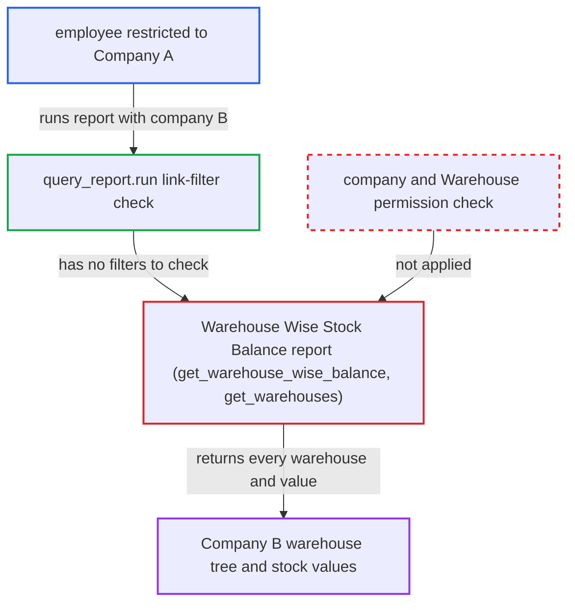

# Warehouse Wise Stock Balance report ignores Company and Warehouse user permissions

| Field | Value |
|---|---|
| ID | `find_01PkG7qjYBzaS7tEhyU8caCa` |
| Severity | **Medium** |
| Status | open |
| CWE | CWE-862 — Missing authorization |
| Created | 2026-10-27T21:14:38.918741Z |
| Claude Security | https://claude.ai/security/findings/find_01PkG7qjYBzaS7tEhyU8caCa |

## Description

A logged-in employee with the Stock User or Accounts Manager role can read the warehouse tree and the stock value of each warehouse for a Company their User Permissions exclude. A user limited to certain Warehouses also sees every warehouse of their own company. The data is aggregate only and read-only. The cause is that the Warehouse Wise Stock Balance report trusts the caller's `company` filter, and its queries in `get_warehouse_wise_balance` and `get_warehouses` apply no User Permissions.

1. **attacker** calls the report endpoint with another company. The attacker is restricted to Company A. They call `/api/method/frappe.desk.query_report.run` with `report_name=Warehouse Wise Stock Balance` and `filters={"company":"B","show_disabled_warehouses":1}`.
2. **Frappe `query_report.run`** checks only report roles and the role-level report permission. The Report JSON has an empty `filters` table, so the link-filter permission check has nothing to validate. The `company` filter is declared only in the JS file. ([`erpnext/stock/report/warehouse_wise_stock_balance/warehouse_wise_stock_balance.json`](https://github.com/cx-benchmark/erpnext/blob/90e7aefca73da3c440d2e8da7472fcb67838e678/erpnext/stock/report/warehouse_wise_stock_balance/warehouse_wise_stock_balance.json))
3. **report `execute`** passes the filters straight to `get_data`. Nothing checks that the user may select the requested company, unlike `validate_company_permission` in `trial_balance.py`. ([`erpnext/stock/report/warehouse_wise_stock_balance/warehouse_wise_stock_balance.py:20-25`](https://github.com/cx-benchmark/erpnext/blob/90e7aefca73da3c440d2e8da7472fcb67838e678/erpnext/stock/report/warehouse_wise_stock_balance/warehouse_wise_stock_balance.py#L20-L25))
4. **the query `get_warehouse_wise_balance`** sums stock value per warehouse for the requested company. The raw `frappe.qb` query over Stock Ledger Entry is limited only by docstatus and `sle.company` equal to the caller's value, so no User Permission is applied. ([`erpnext/stock/report/warehouse_wise_stock_balance/warehouse_wise_stock_balance.py:28-42`](https://github.com/cx-benchmark/erpnext/blob/90e7aefca73da3c440d2e8da7472fcb67838e678/erpnext/stock/report/warehouse_wise_stock_balance/warehouse_wise_stock_balance.py#L28-L42))
5. **the function `get_warehouses`** lists every warehouse of that company. It uses `frappe.get_all`, which ignores permissions, so warehouses hidden from the user's list view are returned too. ([`erpnext/stock/report/warehouse_wise_stock_balance/warehouse_wise_stock_balance.py:45-51`](https://github.com/cx-benchmark/erpnext/blob/90e7aefca73da3c440d2e8da7472fcb67838e678/erpnext/stock/report/warehouse_wise_stock_balance/warehouse_wise_stock_balance.py#L45-L51))
6. **the report** returns the full warehouse tree with rolled-up stock values to the attacker. Each row has the warehouse name, parent, group flag, disabled flag and total stock value. ([`erpnext/stock/report/warehouse_wise_stock_balance/warehouse_wise_stock_balance.py:20-25`](https://github.com/cx-benchmark/erpnext/blob/90e7aefca73da3c440d2e8da7472fcb67838e678/erpnext/stock/report/warehouse_wise_stock_balance/warehouse_wise_stock_balance.py#L20-L25))

## Assessment

The attacker is a logged-in employee with the Stock User or Accounts Manager role. A User Permission restricts them to Company A, or to particular Warehouses. They set `company` to another company's name in the report filters. No victim action is needed. A user restricted to particular Warehouses also sees every warehouse of their own company. Leaving out `company` does not widen the leak, because `get_warehouses` then matches only warehouses with no company.

Impact: The attacker learns the warehouse hierarchy and the aggregate inventory value per warehouse for companies or warehouses their User Permissions exclude. This breaks cross-company isolation. The data is aggregate only, with no item-level detail. The report is read-only, so nothing can be changed.

## Recommendation

The report trusts the caller's `company` filter. It reads Stock Ledger Entry and Warehouse through permission-blind `frappe.qb` and `frappe.get_all` calls, so rows outside the user's User Permissions are returned.

Fix criteria: A run for a Company the user may not select fails with a PermissionError or returns no rows. Returned warehouses and balances are limited to Warehouses the user is permitted to see. Check: a Stock User restricted to Company A who requests `company=B` gets an error or no rows. A user restricted to Warehouse W1 sees only W1, plus its permitted ancestors, with its balance.

## Evidence

**https://github.com/cx-benchmark/erpnext**

- [`erpnext/stock/report/warehouse_wise_stock_balance/warehouse_wise_stock_balance.py:28-42`](https://github.com/cx-benchmark/erpnext/blob/90e7aefca73da3c440d2e8da7472fcb67838e678/erpnext/stock/report/warehouse_wise_stock_balance/warehouse_wise_stock_balance.py#L28-L42)
- [`erpnext/stock/report/warehouse_wise_stock_balance/warehouse_wise_stock_balance.py:45-51`](https://github.com/cx-benchmark/erpnext/blob/90e7aefca73da3c440d2e8da7472fcb67838e678/erpnext/stock/report/warehouse_wise_stock_balance/warehouse_wise_stock_balance.py#L45-L51)
- [`erpnext/stock/report/warehouse_wise_stock_balance/warehouse_wise_stock_balance.py:20-25`](https://github.com/cx-benchmark/erpnext/blob/90e7aefca73da3c440d2e8da7472fcb67838e678/erpnext/stock/report/warehouse_wise_stock_balance/warehouse_wise_stock_balance.py#L20-L25)
- [`erpnext/stock/report/warehouse_wise_stock_balance/warehouse_wise_stock_balance.json`](https://github.com/cx-benchmark/erpnext/blob/90e7aefca73da3c440d2e8da7472fcb67838e678/erpnext/stock/report/warehouse_wise_stock_balance/warehouse_wise_stock_balance.json)
- [`erpnext/accounts/report/trial_balance/trial_balance.py:48-50`](https://github.com/cx-benchmark/erpnext/blob/90e7aefca73da3c440d2e8da7472fcb67838e678/erpnext/accounts/report/trial_balance/trial_balance.py#L48-L50)
- [`erpnext/stock/report/total_stock_summary/total_stock_summary.py:50-51`](https://github.com/cx-benchmark/erpnext/blob/90e7aefca73da3c440d2e8da7472fcb67838e678/erpnext/stock/report/total_stock_summary/total_stock_summary.py#L50-L51)

