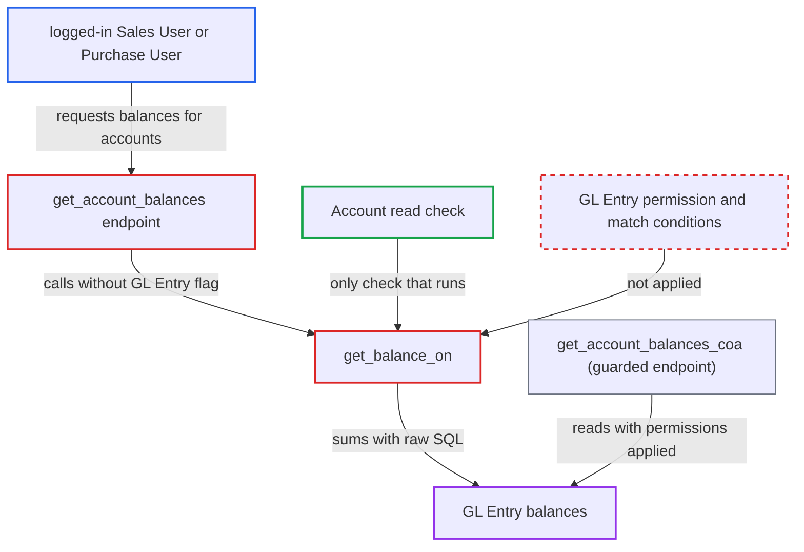

# Whitelisted get_account_balances returns GL balances without GL Entry permissions

| Field | Value |
|---|---|
| ID | `find_01XZYudfenGDxE3EnTpKwAVF` |
| Severity | **Medium** |
| Status | open |
| CWE | CWE-862 — Missing Authorization |
| Created | 2026-10-27T21:49:18.864338Z |
| Claude Security | https://claude.ai/security/findings/find_01XZYudfenGDxE3EnTpKwAVF |

## Description

A logged-in desk user whose role can read Account but not GL Entry (Sales User or Purchase User) can read ledger account balances they should not see. A user whose GL Entry view is narrowed by Cost Center or Project User Permissions can also get around that limit. The whitelisted `get_account_balances` calls `get_balance_on` without `apply_gl_entry_permissions=True`, so only the Account read check runs. Company User Permissions still apply.

1. **Logged-in user** posts a request to `/api/method/erpnext.accounts.utils.get_account_balances`. The request carries `company` and an `accounts` list of account names taken from the Account list the user can read, and may add `cost_center=` or `date=`. ([`erpnext/accounts/utils.py:1412-1449`](https://github.com/cx-benchmark/erpnext/blob/90e7aefca73da3c440d2e8da7472fcb67838e678/erpnext/accounts/utils.py#L1412-L1449))
2. **the endpoint `get_account_balances`** calls `get_balance_on` for each supplied account. It does not pass `apply_gl_entry_permissions=True` and makes no GL Entry permission check. ([`erpnext/accounts/utils.py:1412-1449`](https://github.com/cx-benchmark/erpnext/blob/90e7aefca73da3c440d2e8da7472fcb67838e678/erpnext/accounts/utils.py#L1412-L1449))
3. **the function `get_balance_on`** fills missing `date`, `party_type`, `party` and `cost_center` from `frappe.form_dict`. The wrapper passes none of these, so values the caller adds to the HTTP request are used; the Cost Center is loaded without a permission check. ([`erpnext/accounts/utils.py:215-258`](https://github.com/cx-benchmark/erpnext/blob/90e7aefca73da3c440d2e8da7472fcb67838e678/erpnext/accounts/utils.py#L215-L258))
4. **the function `get_balance_on`** checks only that the user can read the Account. `acc.check_permission("read")` passes for Sales User and Purchase User, because Account read is granted to them. ([`erpnext/accounts/utils.py:262-343`](https://github.com/cx-benchmark/erpnext/blob/90e7aefca73da3c440d2e8da7472fcb67838e678/erpnext/accounts/utils.py#L262-L343))
5. **the function `get_balance_on`** sums `tabGL Entry` with raw SQL and returns the result. The user's GL Entry match conditions are added only when `apply_gl_entry_permissions` is set, so they are skipped here. ([`erpnext/accounts/utils.py:262-343`](https://github.com/cx-benchmark/erpnext/blob/90e7aefca73da3c440d2e8da7472fcb67838e678/erpnext/accounts/utils.py#L262-L343))

## Assessment

The attacker is a logged-in desk user with a role that reads Account but not GL Entry, such as Sales User or Purchase User. Another possible attacker is a GL Entry reader whose view is narrowed by Cost Center or Project User Permissions. The attacker needs only network access to the whitelisted method, which any logged-in user can reach. They can also add `cost_center=` or `date=` to the same request to get per-cost-center P\&L balances or as-of-date balances. Those values are read from `frappe.form_dict`.

Impact: The attacker learns the current, as-of-date or per-cost-center balance of every ledger account in the companies they may read, such as cash, bank, receivables, revenue and expense accounts. This is trial-balance level data that the GL Entry role permission and the Chart of Accounts UI withhold from them. Access is read-only. Other companies stay closed because Company User Permissions still apply through the Account check.

## Recommendation

(1) `get_account_balances` exposes GL Entry sums but enforces only the Account document's read permission. This bypasses the GL Entry role permission and the GL Entry User Permissions (cost center, project).

Fix criteria: A caller without `read` on GL Entry is refused by `get_account_balances`, or the endpoint is removed, since the tree uses `get_account_balances_coa`. A caller with GL Entry read gets only sums over GL Entry rows their match conditions allow, for example by passing `apply_gl_entry_permissions=True`. Calling the method as a Sales User gives a PermissionError. Calling it as a Cost-Center-restricted Accounts User gives balances limited to that cost center.

(2) `get_balance_on` silently reads `date`, `party_type`, `party` and `cost_center` from `frappe.form_dict` when a caller omits them. HTTP callers of any whitelisted wrapper can therefore add filters the wrapper never intended. The `cost_center` is loaded without a permission check.

Fix criteria: Whitelisted wrappers set every filter explicitly, with no request-wide fallback. A caller-supplied cost center must pass the user's Cost Center permission before it narrows the query. Adding `cost_center=` to a `get_account_balances` request no longer changes the result.

## Evidence

**https://github.com/cx-benchmark/erpnext**

- [`erpnext/accounts/utils.py:1412-1449`](https://github.com/cx-benchmark/erpnext/blob/90e7aefca73da3c440d2e8da7472fcb67838e678/erpnext/accounts/utils.py#L1412-L1449)
- [`erpnext/accounts/utils.py:262-343`](https://github.com/cx-benchmark/erpnext/blob/90e7aefca73da3c440d2e8da7472fcb67838e678/erpnext/accounts/utils.py#L262-L343)
- [`erpnext/accounts/utils.py:215-258`](https://github.com/cx-benchmark/erpnext/blob/90e7aefca73da3c440d2e8da7472fcb67838e678/erpnext/accounts/utils.py#L215-L258)
- [`erpnext/accounts/doctype/account/account.json:218-254`](https://github.com/cx-benchmark/erpnext/blob/90e7aefca73da3c440d2e8da7472fcb67838e678/erpnext/accounts/doctype/account/account.json#L218-L254)
- [`erpnext/accounts/doctype/gl_entry/gl_entry.json:390-413`](https://github.com/cx-benchmark/erpnext/blob/90e7aefca73da3c440d2e8da7472fcb67838e678/erpnext/accounts/doctype/gl_entry/gl_entry.json#L390-L413)
- [`erpnext/accounts/utils.py:1452-1470`](https://github.com/cx-benchmark/erpnext/blob/90e7aefca73da3c440d2e8da7472fcb67838e678/erpnext/accounts/utils.py#L1452-L1470)
- [`erpnext/accounts/doctype/account/account_tree.js:119-130`](https://github.com/cx-benchmark/erpnext/blob/90e7aefca73da3c440d2e8da7472fcb67838e678/erpnext/accounts/doctype/account/account_tree.js#L119-L130)
- [`erpnext/accounts/report/account_balance/test_account_balance.py:100-122`](https://github.com/cx-benchmark/erpnext/blob/90e7aefca73da3c440d2e8da7472fcb67838e678/erpnext/accounts/report/account_balance/test_account_balance.py#L100-L122)

