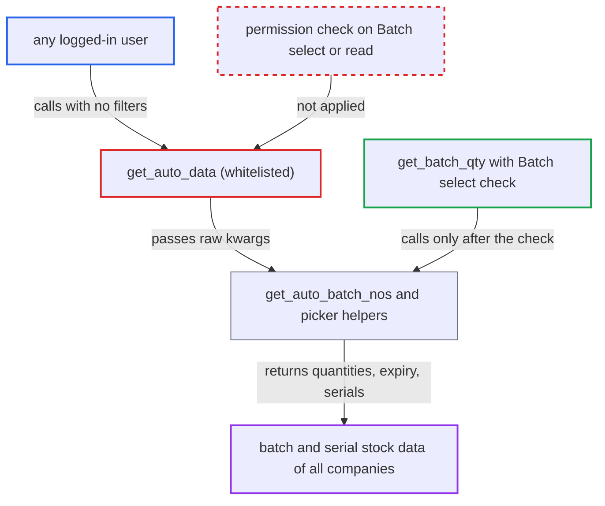

# Whitelisted get_auto_data exposes batch stock levels and serial numbers to any session

| Field | Value |
|---|---|
| ID | `find_01GWMevHiG2MYFSrHyyfjUnq` |
| Severity | **Medium** |
| Status | open |
| CWE | CWE-862 — Missing Authorization |
| Created | 2026-10-27T21:18:10.703190Z |
| Claude Security | https://claude.ai/security/findings/find_01GWMevHiG2MYFSrHyyfjUnq |

## Description

Any logged-in user, including a portal customer or supplier or an employee with no stock role, can read batch stock levels and serial-number locations they are not allowed to see. Without filters, the request returns batch quantities and expiry dates for every warehouse in every company. The whitelisted method `get_auto_data` runs no permission check and passes the raw request `kwargs` to the picker helpers. The impact is read-only.

1. **a logged-in user** calls `get_auto_data` over `/api/method` with `has_batch_no=1` and `for_stock_levels=1` and no item, warehouse or company. Any authenticated session can call a whitelisted method, and the request needs no special setting or victim action. ([`erpnext/stock/doctype/serial_and_batch_bundle/serial_and_batch_bundle.py:2665-2671`](https://github.com/cx-benchmark/erpnext/blob/90e7aefca73da3c440d2e8da7472fcb67838e678/erpnext/stock/doctype/serial_and_batch_bundle/serial_and_batch_bundle.py#L2665-L2671))
2. **the handler `get_auto_data`** hands the raw request `kwargs` to the picker helpers without checking permission. The handler calls no `frappe.has_permission`, `require_permission` or role check before it does so. ([`erpnext/stock/doctype/serial_and_batch_bundle/serial_and_batch_bundle.py:2665-2671`](https://github.com/cx-benchmark/erpnext/blob/90e7aefca73da3c440d2e8da7472fcb67838e678/erpnext/stock/doctype/serial_and_batch_bundle/serial_and_batch_bundle.py#L2665-L2671))
3. **the helper `get_auto_batch_nos`** merges the results of `get_available_batches` and `get_stock_ledgers_batches` and returns the full list. The full list is returned because `qty` was not given. The caller can also skip the reservation helpers with `for_stock_levels` or `ignore_reserved_stock`. ([`erpnext/stock/doctype/serial_and_batch_bundle/serial_and_batch_bundle.py:3256-3318`](https://github.com/cx-benchmark/erpnext/blob/90e7aefca73da3c440d2e8da7472fcb67838e678/erpnext/stock/doctype/serial_and_batch_bundle/serial_and_batch_bundle.py#L3256-L3318))
4. **the query `get_available_batches`** sums batch quantities per warehouse across all companies. The `company`, `warehouse` and `item_code` filters are added only `if kwargs.get(...)`, so leaving them out removes every restriction. ([`erpnext/stock/doctype/serial_and_batch_bundle/serial_and_batch_bundle.py:3505-3573`](https://github.com/cx-benchmark/erpnext/blob/90e7aefca73da3c440d2e8da7472fcb67838e678/erpnext/stock/doctype/serial_and_batch_bundle/serial_and_batch_bundle.py#L3505-L3573))
5. **the query `get_stock_ledgers_batches`** adds legacy ledger rows, including `item_code`, to the response. It has the same optional filters, and `update_available_batches` merges its rows into the result. ([`erpnext/stock/doctype/serial_and_batch_bundle/serial_and_batch_bundle.py:3844-3910`](https://github.com/cx-benchmark/erpnext/blob/90e7aefca73da3c440d2e8da7472fcb67838e678/erpnext/stock/doctype/serial_and_batch_bundle/serial_and_batch_bundle.py#L3844-L3910))

## Assessment

The attacker is any authenticated user, such as a portal customer or supplier, or a desk user with no stock role. No victim action or special configuration is needed. For batch data, the attacker calls `get_auto_data` with `has_batch_no=1` and `for_stock_levels=1` and leaves out `item_code`, `warehouse` and `company`. Alternatively, with `has_serial_no=1` and a chosen `item_code`, `get_available_serial_nos` returns that item's serial-number records with their current warehouse. Another route is `scio_detail`, which returns the serial and batch rows reserved against a Subcontracting Inward Order row.

Impact: The attacker can read per-batch, per-warehouse quantities, batch expiry dates, warehouse names (which carry the company abbreviation) and `item_code` from legacy rows. They can also read a chosen item's serial numbers and current warehouses. This crosses company and portal boundaries but covers stock-level information only. Nothing is modified, and Batch and Serial No names are opaque ids in this fork.

## Recommendation

`get_auto_data` exposes internal picker functions over `/api/method` with no permission check. It also lets the caller leave out the scoping filters, so unrestricted queries are possible.

Fix criteria: `get_auto_data` refuses callers who lack at least `select` or `read` on the relevant doctype (Serial No, Batch or Serial and Batch Bundle). It enforces document-level permission, including User Permissions and Company Restriction, on the supplied `item_code` and `warehouse`. It requires `item_code` to be present. Portal and website users receive a PermissionError. To verify, call the method as a user without stock roles and as a portal user, and confirm that no rows are returned.

## Evidence

**https://github.com/cx-benchmark/erpnext**

- [`erpnext/stock/doctype/serial_and_batch_bundle/serial_and_batch_bundle.py:2665-2671`](https://github.com/cx-benchmark/erpnext/blob/90e7aefca73da3c440d2e8da7472fcb67838e678/erpnext/stock/doctype/serial_and_batch_bundle/serial_and_batch_bundle.py#L2665-L2671)
- [`erpnext/stock/doctype/serial_and_batch_bundle/serial_and_batch_bundle.py:3256-3318`](https://github.com/cx-benchmark/erpnext/blob/90e7aefca73da3c440d2e8da7472fcb67838e678/erpnext/stock/doctype/serial_and_batch_bundle/serial_and_batch_bundle.py#L3256-L3318)
- [`erpnext/stock/doctype/serial_and_batch_bundle/serial_and_batch_bundle.py:3505-3573`](https://github.com/cx-benchmark/erpnext/blob/90e7aefca73da3c440d2e8da7472fcb67838e678/erpnext/stock/doctype/serial_and_batch_bundle/serial_and_batch_bundle.py#L3505-L3573)
- [`erpnext/stock/doctype/serial_and_batch_bundle/serial_and_batch_bundle.py:3844-3910`](https://github.com/cx-benchmark/erpnext/blob/90e7aefca73da3c440d2e8da7472fcb67838e678/erpnext/stock/doctype/serial_and_batch_bundle/serial_and_batch_bundle.py#L3844-L3910)
- [`erpnext/stock/doctype/serial_and_batch_bundle/serial_and_batch_bundle.py:2682-2760`](https://github.com/cx-benchmark/erpnext/blob/90e7aefca73da3c440d2e8da7472fcb67838e678/erpnext/stock/doctype/serial_and_batch_bundle/serial_and_batch_bundle.py#L2682-L2760)
- [`erpnext/stock/doctype/batch/batch.py:271-323`](https://github.com/cx-benchmark/erpnext/blob/90e7aefca73da3c440d2e8da7472fcb67838e678/erpnext/stock/doctype/batch/batch.py#L271-L323)
- [`erpnext/stock/doctype/serial_and_batch_bundle/serial_and_batch_bundle.py:2261-2271`](https://github.com/cx-benchmark/erpnext/blob/90e7aefca73da3c440d2e8da7472fcb67838e678/erpnext/stock/doctype/serial_and_batch_bundle/serial_and_batch_bundle.py#L2261-L2271)

