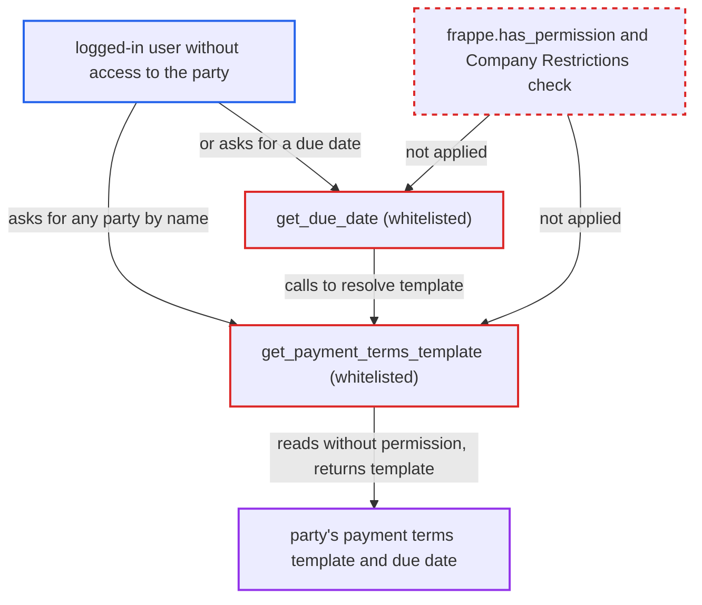

# Whitelisted payment-terms helpers disclose any Customer/Supplier's credit terms without permission

| Field | Value |
|---|---|
| ID | `find_01U771mAUThaJbNxCyAdEkme` |
| Severity | **Medium** |
| Status | open |
| CWE | CWE-862 — Missing authorization |
| Created | 2026-10-27T21:17:14.205296Z |
| Claude Security | https://claude.ai/security/findings/find_01U771mAUThaJbNxCyAdEkme |

## Description

Any logged-in user can learn the agreed payment-terms template, or the due date derived from it, for any Customer or Supplier whose name they know. This works even when their role, User Permissions or Company Restrictions should keep them out. Only that one attribute and whether the party exists leak. The whitelisted helpers `get_payment_terms_template` and `get_due_date` read the party without calling `frappe.has_permission`.

1. **authenticated user** calls the whitelisted endpoint `get_payment_terms_template` with a chosen party name. The request is `/api/method/erpnext.accounts.party.get_payment_terms_template?party_name=<customer>&party_type=Customer`, and the user may have no permission on that party. ([`erpnext/accounts/party.py:885-909`](https://github.com/cx-benchmark/erpnext/blob/90e7aefca73da3c440d2e8da7472fcb67838e678/erpnext/accounts/party.py#L885-L909))
2. **the helper `get_payment_terms_template`** reads the party's `payment_terms`, then its group's `payment_terms`, with `frappe.get_cached_value`. `frappe.get_cached_value` checks no permission, and the helper never calls `frappe.has_permission` or applies Company Restrictions. ([`erpnext/accounts/party.py:885-909`](https://github.com/cx-benchmark/erpnext/blob/90e7aefca73da3c440d2e8da7472fcb67838e678/erpnext/accounts/party.py#L885-L909))
3. **the helper `get_payment_terms_template`** returns the resolved Payment Terms Template name to the caller. The name comes from the party's own terms, else its group's, else the company's. The group name itself is not returned. ([`erpnext/accounts/party.py:885-909`](https://github.com/cx-benchmark/erpnext/blob/90e7aefca73da3c440d2e8da7472fcb67838e678/erpnext/accounts/party.py#L885-L909))
4. **authenticated user** can instead call `get_due_date` with a `posting_date` for the same party. `get_due_date` calls `get_payment_terms_template` and returns the due date computed from it, which shows the party's credit days. ([`erpnext/accounts/party.py:729-758`](https://github.com/cx-benchmark/erpnext/blob/90e7aefca73da3c440d2e8da7472fcb67838e678/erpnext/accounts/party.py#L729-L758))
5. **authenticated user** supplies a party name that does not exist and sees an error. `get_cached_value` returns None and the following `customer.payment_terms` / `supplier.payment_terms` access raises, so an error means the party is missing and a normal answer means it exists. ([`erpnext/accounts/party.py:885-909`](https://github.com/cx-benchmark/erpnext/blob/90e7aefca73da3c440d2e8da7472fcb67838e678/erpnext/accounts/party.py#L885-L909))

## Assessment

The attacker is any authenticated user, and the report names no other precondition or setting. They need the name of a Customer or Supplier. That party can be one their role has no permission on, for example Purchase User on Customer or Sales User on Supplier. It can also be one that User Permissions or Company Restrictions put out of their reach. They call `get_payment_terms_template`, or `get_due_date` with a `posting_date`, over `/api/method/`.

Impact: The attacker learns the party's payment-terms template name, or the due date derived from it, and whether a party with that name exists. Balances, addresses and bank details are not exposed, the group name is not returned, and nothing is modified.

## Recommendation

`get_payment_terms_template` and `get_due_date` return party-derived data after a `frappe.get_cached_value` lookup that checks no permission. The related `_get_party_details` authorises the party first, but these two entry points do not.

Fix criteria: Both whitelisted entry points verify that the caller may read (or at least select) the named party before any party field is read. This uses `frappe.has_permission(party_type, ptype, doc=party)` and honours User Permissions and Company Restrictions. Both also refuse unknown `party_type` values. A user without permission on a Customer gets a permission error from both endpoints instead of the template name or due date. Invoice forms for permitted parties keep working.

## Evidence

**https://github.com/cx-benchmark/erpnext**

- [`erpnext/accounts/party.py:885-909`](https://github.com/cx-benchmark/erpnext/blob/90e7aefca73da3c440d2e8da7472fcb67838e678/erpnext/accounts/party.py#L885-L909)
- [`erpnext/accounts/party.py:729-758`](https://github.com/cx-benchmark/erpnext/blob/90e7aefca73da3c440d2e8da7472fcb67838e678/erpnext/accounts/party.py#L729-L758)
- [`erpnext/accounts/party.py:140-145`](https://github.com/cx-benchmark/erpnext/blob/90e7aefca73da3c440d2e8da7472fcb67838e678/erpnext/accounts/party.py#L140-L145)

