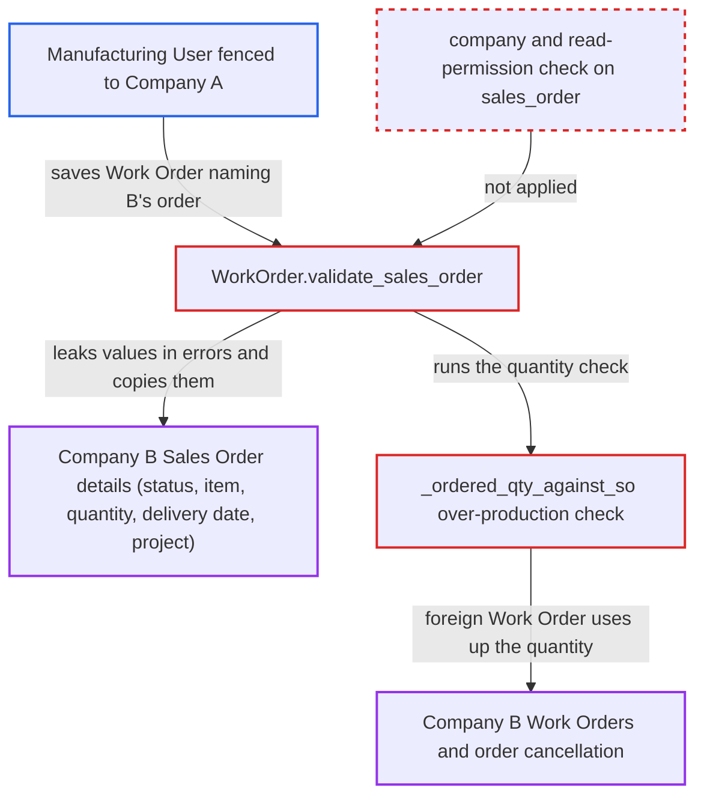

# Work Order accepts another company's Sales Order, leaking its lines and blocking its production

| Field | Value |
|---|---|
| ID | `find_01F9Q8BFWsNCdBLBdUGNYqih` |
| Severity | **Medium** |
| Status | open |
| CWE | CWE-639 — Missing Authorization |
| Created | 2026-10-27T22:32:32.425741Z |
| Claude Security | https://claude.ai/security/findings/find_01F9Q8BFWsNCdBLBdUGNYqih |

## Description

A user limited to one company can read parts of another company's Sales Orders and block that company's production. The attacker is a Manufacturing User fenced to Company A by a Company User Permission, and the role has no Sales Order access at all. `WorkOrder.validate_sales_order` never checks that the `sales_order` belongs to the Work Order's `company` or that the user may read it. `_ordered_qty_against_so` also counts Work Orders across companies.

1. **Manufacturing User fenced to Company A** saves a Work Order through `/api/resource/Work Order` with a guessed Company-B order in `sales_order`. Only the form's picker `query_sales_order` is scoped by permissions, and a direct REST call skips it. Order names are sequential, like `SAL-ORD-.YYYY.-`, so they can be guessed. ([`erpnext/manufacturing/doctype/work_order/work_order.py:1399-1414`](https://github.com/cx-benchmark/erpnext/blob/90e7aefca73da3c440d2e8da7472fcb67838e678/erpnext/manufacturing/doctype/work_order/work_order.py#L1399-L1414))
2. **the method `validate_sales_order`** accepts the caller-chosen `sales_order` without any company or permission check. It runs on every save and submit. It never compares the order's company with the Work Order's `company` and never checks read access. ([`erpnext/manufacturing/doctype/work_order/work_order.py:519-606`](https://github.com/cx-benchmark/erpnext/blob/90e7aefca73da3c440d2e8da7472fcb67838e678/erpnext/manufacturing/doctype/work_order/work_order.py#L519-L606))
3. **the function `check_on_hold_or_closed_status`** returns the order's Closed or On Hold status in an error message. It reads the status with `frappe.db.get_value` and puts it in the message without any permission check. ([`erpnext/buying/utils.py:126-137`](https://github.com/cx-benchmark/erpnext/blob/90e7aefca73da3c440d2e8da7472fcb67838e678/erpnext/buying/utils.py#L126-L137))
4. **the method `validate_sales_order`** reveals whether the item is on the order and how much of it is ordered. It throws `Sales Order {0} is not valid` when the item is missing. The over-production check throws `Cannot produce more Item {0} than Sales Order quantity {1}`, which shows the quantity. ([`erpnext/manufacturing/doctype/work_order/services/status.py:34-65`](https://github.com/cx-benchmark/erpnext/blob/90e7aefca73da3c440d2e8da7472fcb67838e678/erpnext/manufacturing/doctype/work_order/services/status.py#L34-L65))
5. **the method `validate_sales_order`** copies the order line's delivery date and the order's project into the attacker's own Work Order when the save succeeds. The attacker can read their own Work Order, so the copied values become visible to them. ([`erpnext/manufacturing/doctype/work_order/work_order.py:519-606`](https://github.com/cx-benchmark/erpnext/blob/90e7aefca73da3c440d2e8da7472fcb67838e678/erpnext/manufacturing/doctype/work_order/work_order.py#L519-L606))
6. **Manufacturing User fenced to Company A** submits the foreign Work Order for the order's full quantity. `_ordered_qty_against_so` adds up every submitted Work Order with the same `sales_order` and `production_item`. It applies no company filter and no `sales_order_item` filter. ([`erpnext/manufacturing/doctype/work_order/services/status.py:34-65`](https://github.com/cx-benchmark/erpnext/blob/90e7aefca73da3c440d2e8da7472fcb67838e678/erpnext/manufacturing/doctype/work_order/services/status.py#L34-L65))
7. **Company B's users** fail to create Work Orders for that item on that order and cannot cancel the order. Their Work Orders hit `OverProductionError`. `Sales Order.on_cancel` does not ignore Work Order links, so the back-link check refuses the cancel, and B's fenced users cannot see or cancel the foreign Work Order. ([`erpnext/selling/doctype/sales_order/sales_order.py:586-595`](https://github.com/cx-benchmark/erpnext/blob/90e7aefca73da3c440d2e8da7472fcb67838e678/erpnext/selling/doctype/sales_order/sales_order.py#L586-L595))

## Assessment

The attacker is a desk user with the Manufacturing User role, fenced to Company A by a Company User Permission. The role can create and submit Work Orders and BOMs, and the report names no other precondition. The attacker needs an item and BOM they can use, and a submitted Company-B Sales Order name, which they guess. They send the request to `/api/resource/Work Order`. No victim action is needed, and default settings apply. The report relies on an assumption about the pinned Frappe version (`>=17.0.0-dev,<18`, not in the checkout). The assumption is that link validation only checks that the record exists, and User Permissions restrict only Links whose target doctype has User Permission records. So the Company permission limits `Work Order.company` but not `sales_order`. The ERPNext Company Restriction hook covers only Item, Customer and Supplier.

Impact: The attacker learns another company's order status, whether a given item is on it, its quantity of that item, the line's delivery date and the project. These fields are limited, and they do not include customers or prices. Company B cannot create or submit Work Orders for that item on that order, and cannot cancel the order, until someone with cross-company rights cancels the foreign Work Order. No change to Company B's records is established, because the submit-time write to `Sales Order Item` is keyed on a random `sales_order_item` name the attacker cannot learn.

## Recommendation

(1) `WorkOrder.validate_sales_order` trusts the caller-supplied `sales_order` Link. It never checks that the Sales Order belongs to the Work Order's `company` or that the saving user may read it. It also sends the order's status, item membership and quantity back in validation messages.

Fix criteria: Saving or submitting a Work Order whose `sales_order` belongs to another company, or that the user cannot read, fails with a generic error. The error comes before any status, item or quantity check and before any field is copied. To verify, a Company-A-fenced Manufacturing User posts such a Work Order through REST and learns nothing about the order. Nothing is copied into the saved document.

(2) The over-production check `_ordered_qty_against_so` adds up Work Orders against a Sales Order without regard to their company. A Work Order that should never have been linked therefore uses up the owning company's order quantity.

Fix criteria: Only Work Orders legitimately linked to the Sales Order, in the same company, count toward its ordered quantity. To verify, after the attacker's attempt Company B can still create, submit and cancel its own Work Orders and its Sales Order.

## Evidence

**https://github.com/cx-benchmark/erpnext**

- [`erpnext/manufacturing/doctype/work_order/work_order.py:519-606`](https://github.com/cx-benchmark/erpnext/blob/90e7aefca73da3c440d2e8da7472fcb67838e678/erpnext/manufacturing/doctype/work_order/work_order.py#L519-L606)
- [`erpnext/manufacturing/doctype/work_order/services/status.py:34-65`](https://github.com/cx-benchmark/erpnext/blob/90e7aefca73da3c440d2e8da7472fcb67838e678/erpnext/manufacturing/doctype/work_order/services/status.py#L34-L65)
- [`erpnext/buying/utils.py:126-137`](https://github.com/cx-benchmark/erpnext/blob/90e7aefca73da3c440d2e8da7472fcb67838e678/erpnext/buying/utils.py#L126-L137)
- [`erpnext/manufacturing/doctype/work_order/work_order.py:1399-1414`](https://github.com/cx-benchmark/erpnext/blob/90e7aefca73da3c440d2e8da7472fcb67838e678/erpnext/manufacturing/doctype/work_order/work_order.py#L1399-L1414)
- [`erpnext/selling/doctype/sales_order/sales_order.json`](https://github.com/cx-benchmark/erpnext/blob/90e7aefca73da3c440d2e8da7472fcb67838e678/erpnext/selling/doctype/sales_order/sales_order.json)
- [`erpnext/selling/doctype/sales_order/sales_order.py:586-595`](https://github.com/cx-benchmark/erpnext/blob/90e7aefca73da3c440d2e8da7472fcb67838e678/erpnext/selling/doctype/sales_order/sales_order.py#L586-L595)

