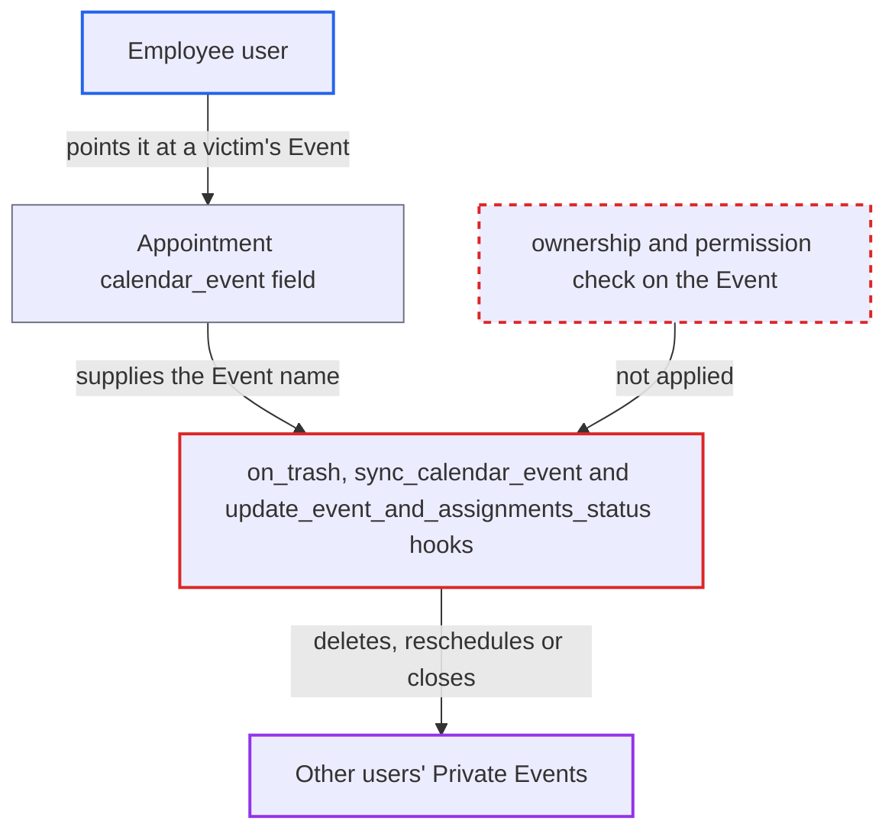

# Writable Appointment calendar_event lets Employees delete or alter other users' Events

| Field | Value |
|---|---|
| ID | `find_011VJwHxkuW8a7zs5WZVVZkx` |
| Severity | **Medium** |
| Status | open |
| CWE | CWE-639 — Insecure direct object reference |
| Created | 2026-10-27T21:19:05.016900Z |
| Claude Security | https://claude.ai/security/findings/find_011VJwHxkuW8a7zs5WZVVZkx |

## Description

A logged-in user with the `Employee` role can delete, close, reopen or reschedule other users' Private calendar Events that Frappe would not let them touch. The attack needs an Appointment the user owns and can edit. The `calendar_event` field on `Appointment` is a writable Link, and the hooks `on_trash`, `sync_calendar_event` and `update_event_and_assignments_status` act on whatever Event it names without any permission check.

1. **Employee attacker** creates an Appointment with a valid future `scheduled_time`. The `Employee` role has if_owner create, write and delete on `Appointment`, so this is allowed through `/api/resource/Appointment`. ([`erpnext/crm/doctype/appointment/appointment.json:185-199`](https://github.com/cx-benchmark/erpnext/blob/90e7aefca73da3c440d2e8da7472fcb67838e678/erpnext/crm/doctype/appointment/appointment.json#L185-L199))
2. **Employee attacker** saves the Appointment with `calendar_event` set to a victim's Private Event name. `calendar_event` is a plain `Link` with no `read_only`, `set_only_once` or permlevel, so the client can write it. Event names are sequential and guessable, and the `Could not find` link error shows whether an Event exists. ([`erpnext/crm/doctype/appointment/appointment.json:73-78`](https://github.com/cx-benchmark/erpnext/blob/90e7aefca73da3c440d2e8da7472fcb67838e678/erpnext/crm/doctype/appointment/appointment.json#L73-L78))
3. **the function `create_calendar_event`** keeps the supplied Event instead of creating a new one. It returns early when `calendar_event` is already set, so the caller's value becomes the appointment's Event. ([`erpnext/crm/doctype/appointment/appointment.py:382-384`](https://github.com/cx-benchmark/erpnext/blob/90e7aefca73da3c440d2e8da7472fcb67838e678/erpnext/crm/doctype/appointment/appointment.py#L382-L384))
4. **the hook `on_trash`** deletes the named Event when the attacker deletes the Appointment. It calls `frappe.delete_doc("Event", event, ignore_permissions=True)` without checking who created the Event or who may delete it. ([`erpnext/crm/doctype/appointment/appointment.py:198-206`](https://github.com/cx-benchmark/erpnext/blob/90e7aefca73da3c440d2e8da7472fcb67838e678/erpnext/crm/doctype/appointment/appointment.py#L198-L206))
5. **the function `sync_calendar_event`** reschedules the named Event when the attacker changes `scheduled_time`. It overwrites `starts_on` and saves with `ignore_permissions=True`. ([`erpnext/crm/doctype/appointment/appointment.py:261-267`](https://github.com/cx-benchmark/erpnext/blob/90e7aefca73da3c440d2e8da7472fcb67838e678/erpnext/crm/doctype/appointment/appointment.py#L261-L267))
6. **the function `update_event_and_assignments_status`** closes or reopens the named Event when the attacker changes the Appointment status. It writes `status` with a raw `frappe.db.set_value`, which skips all permission checks. ([`erpnext/crm/doctype/appointment/appointment.py:269-278`](https://github.com/cx-benchmark/erpnext/blob/90e7aefca73da3c440d2e8da7472fcb67838e678/erpnext/crm/doctype/appointment/appointment.py#L269-L278))

## Assessment

The attacker is a logged-in user with the `Employee` role, which can create, write and delete its own Appointments. `Sales User` has create and write on Appointment as well. The report names either role as able to point an appointment at any Event name. The attacker needs no victim action. The attack relies on Event names being sequential and guessable, and on link validation checking only that the Event exists, not that the user may read it. The report states this as an assumption for Frappe 17.0.0-dev as pinned in `pyproject.toml`. The attacker can delete the appointment to delete the Event. Changing the appointment's status or time instead closes, reopens or reschedules it.

Impact: The attacker can delete, close, reopen or reschedule other users' Private Events, and can repeat this across the site. Nothing is disclosed. The damage is limited to Event records, and deletion fails where another document hard-links the Event.

## Recommendation

The hooks on `Appointment` delete and change the Event named by the user-writable `calendar_event` Link, using `ignore_permissions=True` or raw DB writes. They never check that this appointment created the Event or that the user may change it.

Fix criteria: Only the server can set `calendar_event`, and only to the Event the appointment itself created. A client-supplied value is rejected or discarded on insert and update. Alternatively, every hook checks that the Event belongs to this appointment before it writes or deletes. An `Employee` who saves an owned appointment pointing at another user's Private Event, then closes, reschedules or deletes it, leaves that Event unchanged.

## Evidence

**https://github.com/cx-benchmark/erpnext**

- [`erpnext/crm/doctype/appointment/appointment.py:198-206`](https://github.com/cx-benchmark/erpnext/blob/90e7aefca73da3c440d2e8da7472fcb67838e678/erpnext/crm/doctype/appointment/appointment.py#L198-L206)
- [`erpnext/crm/doctype/appointment/appointment.py:261-267`](https://github.com/cx-benchmark/erpnext/blob/90e7aefca73da3c440d2e8da7472fcb67838e678/erpnext/crm/doctype/appointment/appointment.py#L261-L267)
- [`erpnext/crm/doctype/appointment/appointment.py:269-278`](https://github.com/cx-benchmark/erpnext/blob/90e7aefca73da3c440d2e8da7472fcb67838e678/erpnext/crm/doctype/appointment/appointment.py#L269-L278)
- [`erpnext/crm/doctype/appointment/appointment.py:382-384`](https://github.com/cx-benchmark/erpnext/blob/90e7aefca73da3c440d2e8da7472fcb67838e678/erpnext/crm/doctype/appointment/appointment.py#L382-L384)
- [`erpnext/crm/doctype/appointment/appointment.json:73-78`](https://github.com/cx-benchmark/erpnext/blob/90e7aefca73da3c440d2e8da7472fcb67838e678/erpnext/crm/doctype/appointment/appointment.json#L73-L78)
- [`erpnext/crm/doctype/appointment/appointment.json:185-199`](https://github.com/cx-benchmark/erpnext/blob/90e7aefca73da3c440d2e8da7472fcb67838e678/erpnext/crm/doctype/appointment/appointment.json#L185-L199)

