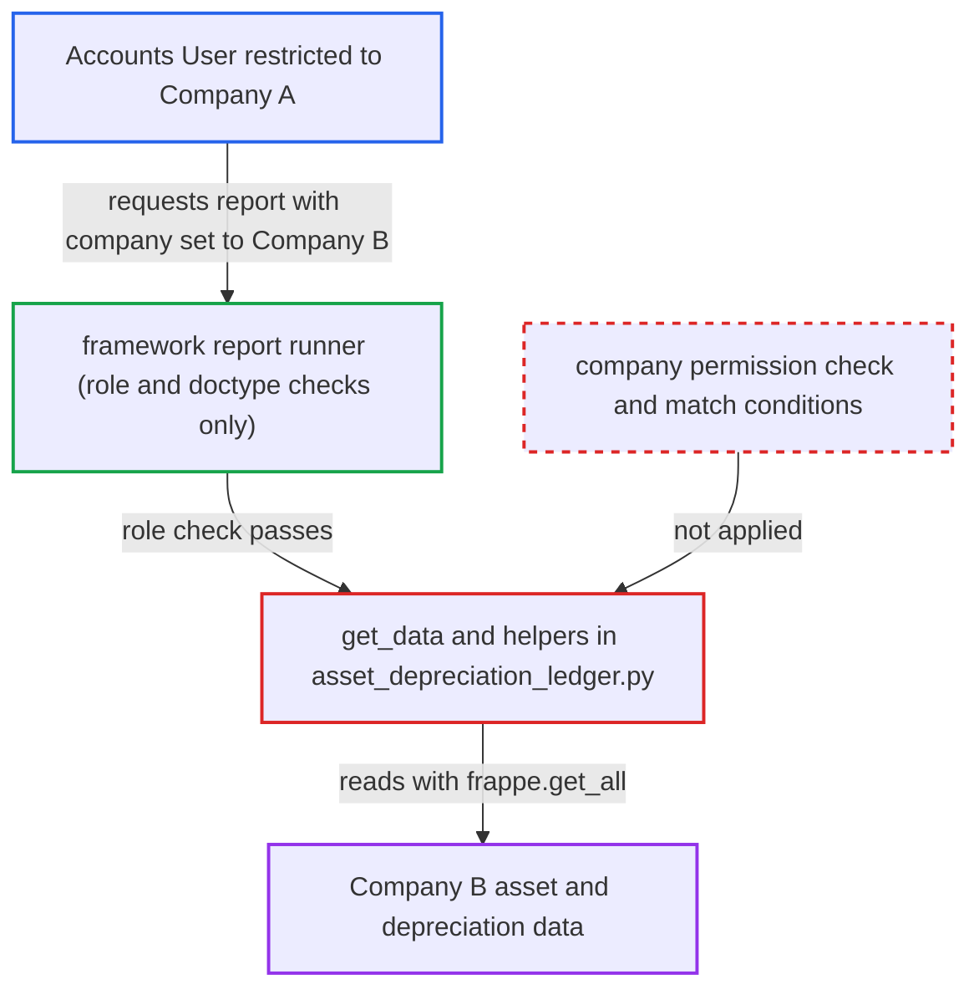

# Asset Depreciation Ledger ignores Company user permissions on the caller-chosen company

| Field | Value |
|---|---|
| ID | `find_01UcaEh6JHZDeHGj8G8Tn2k9` |
| Severity | **Low** |
| Status | open |
| CWE | CWE-862 — Missing Authorization |
| Created | 2026-10-27T21:13:33.911235Z |
| Claude Security | https://claude.ai/security/findings/find_01UcaEh6JHZDeHGj8G8Tn2k9 |

## Description

A logged-in Accounts User who is limited to one company by a Company User Permission can read another company's fixed-asset and depreciation data. This works on a multi-company site that uses Company User Permissions. The report `Asset Depreciation Ledger` (`get_data()` in `asset_depreciation_ledger.py`) trusts the `company` filter from the request and reads with `frappe.get_all`, which ignores permissions.

1. **restricted Accounts User** requests the report with another company's name. The user is limited to Company A and posts to `/api/method/frappe.desk.query_report.run` with `report_name=Asset Depreciation Ledger`, `company` set to Company B and a date range. ([`erpnext/accounts/report/asset_depreciation_ledger/asset_depreciation_ledger.json:8-24`](https://github.com/cx-benchmark/erpnext/blob/90e7aefca73da3c440d2e8da7472fcb67838e678/erpnext/accounts/report/asset_depreciation_ledger/asset_depreciation_ledger.json#L8-L24))
2. **framework report runner** lets the request through after role-level checks only. The report is granted to Accounts User with `ref_doctype` Asset and an empty Report `filters` table, so only the role and the doctype-level `report` permission are checked and the `company` value is never validated. ([`erpnext/accounts/report/asset_depreciation_ledger/asset_depreciation_ledger.json:8-24`](https://github.com/cx-benchmark/erpnext/blob/90e7aefca73da3c440d2e8da7472fcb67838e678/erpnext/accounts/report/asset_depreciation_ledger/asset_depreciation_ledger.json#L8-L24))
3. **the function `get_data()`** queries `GL Entry` for depreciation postings of the chosen company. The request's `company` is the only company scope, and the query uses `frappe.get_all`, which applies no permission conditions. ([`erpnext/accounts/report/asset_depreciation_ledger/asset_depreciation_ledger.py:15-50`](https://github.com/cx-benchmark/erpnext/blob/90e7aefca73da3c440d2e8da7472fcb67838e678/erpnext/accounts/report/asset_depreciation_ledger/asset_depreciation_ledger.py#L15-L50))
4. **the function `get_assets_details()`** loads master data for every matched asset. It reads purchase amount, opening accumulated depreciation, category, cost center and status with `frappe.get_all("Asset")`, and these values go into the returned rows. ([`erpnext/accounts/report/asset_depreciation_ledger/asset_depreciation_ledger.py:198-217`](https://github.com/cx-benchmark/erpnext/blob/90e7aefca73da3c440d2e8da7472fcb67838e678/erpnext/accounts/report/asset_depreciation_ledger/asset_depreciation_ledger.py#L198-L217))
5. **the report helpers** read more `GL Entry` and `Asset Repair` data for the chosen company. They compute accumulated depreciation and value after depreciation, again without permission conditions, so Company B's figures are returned to the Company A user. ([`erpnext/accounts/report/asset_depreciation_ledger/asset_depreciation_ledger.py:114-192`](https://github.com/cx-benchmark/erpnext/blob/90e7aefca73da3c440d2e8da7472fcb67838e678/erpnext/accounts/report/asset_depreciation_ledger/asset_depreciation_ledger.py#L114-L192))

## Assessment

The attacker is an authenticated desk user with the Accounts User role who is restricted to Company A by a Company User Permission. The site must use Company User Permissions. No victim action is needed. The attacker sets the `company` filter to Company B when running the report. The finding also notes an assumption about Frappe >=17, which is not in the checkout: restrictions on Asset, Cost Center, Asset Category or Journal Entry show up as Link columns in the result and the framework likely post-filters them. The result has no Company column, so the confirmed gap is the Company restriction.

Impact: The attacker can read, for any company, asset IDs and names, purchase amounts, opening and accumulated depreciation, each period's depreciation, value after depreciation, category, cost center, status, purchase dates and depreciation Journal Entry numbers. This is read-only and limited to the fixed-asset and depreciation part of the books. Nothing is modified.

## Recommendation

`get_data()` and its helpers in `asset_depreciation_ledger.py` trust the `company` sent by the caller. They read `GL Entry`, `Asset` and `Asset Repair` with `frappe.get_all`, which ignores permissions, so Company User Permissions are never enforced for this report.

Fix criteria: The report returns only `GL Entry` and `Asset` data the session user may read. A `company` the user is not permitted to select raises a PermissionError or returns no rows. The user's match conditions for `GL Entry` and `Asset` constrain the queries. To verify, run the report as a user restricted to Company A with `company` set to Company B, where Company B has posted depreciation: no Company B row may be returned.

## Evidence

**https://github.com/cx-benchmark/erpnext**

- [`erpnext/accounts/report/asset_depreciation_ledger/asset_depreciation_ledger.py:15-50`](https://github.com/cx-benchmark/erpnext/blob/90e7aefca73da3c440d2e8da7472fcb67838e678/erpnext/accounts/report/asset_depreciation_ledger/asset_depreciation_ledger.py#L15-L50)
- [`erpnext/accounts/report/asset_depreciation_ledger/asset_depreciation_ledger.py:198-217`](https://github.com/cx-benchmark/erpnext/blob/90e7aefca73da3c440d2e8da7472fcb67838e678/erpnext/accounts/report/asset_depreciation_ledger/asset_depreciation_ledger.py#L198-L217)
- [`erpnext/accounts/report/asset_depreciation_ledger/asset_depreciation_ledger.py:114-192`](https://github.com/cx-benchmark/erpnext/blob/90e7aefca73da3c440d2e8da7472fcb67838e678/erpnext/accounts/report/asset_depreciation_ledger/asset_depreciation_ledger.py#L114-L192)
- [`erpnext/accounts/report/asset_depreciation_ledger/asset_depreciation_ledger.json:8-24`](https://github.com/cx-benchmark/erpnext/blob/90e7aefca73da3c440d2e8da7472fcb67838e678/erpnext/accounts/report/asset_depreciation_ledger/asset_depreciation_ledger.json#L8-L24)
- [`erpnext/assets/doctype/asset/asset.json:174-181`](https://github.com/cx-benchmark/erpnext/blob/90e7aefca73da3c440d2e8da7472fcb67838e678/erpnext/assets/doctype/asset/asset.json#L174-L181)
- [`erpnext/accounts/report/trial_balance/trial_balance.py:40-50`](https://github.com/cx-benchmark/erpnext/blob/90e7aefca73da3c440d2e8da7472fcb67838e678/erpnext/accounts/report/trial_balance/trial_balance.py#L40-L50)
- [`erpnext/accounts/report/asset_depreciations_and_balances/asset_depreciations_and_balances.py:513`](https://github.com/cx-benchmark/erpnext/blob/90e7aefca73da3c440d2e8da7472fcb67838e678/erpnext/accounts/report/asset_depreciations_and_balances/asset_depreciations_and_balances.py#L513)

