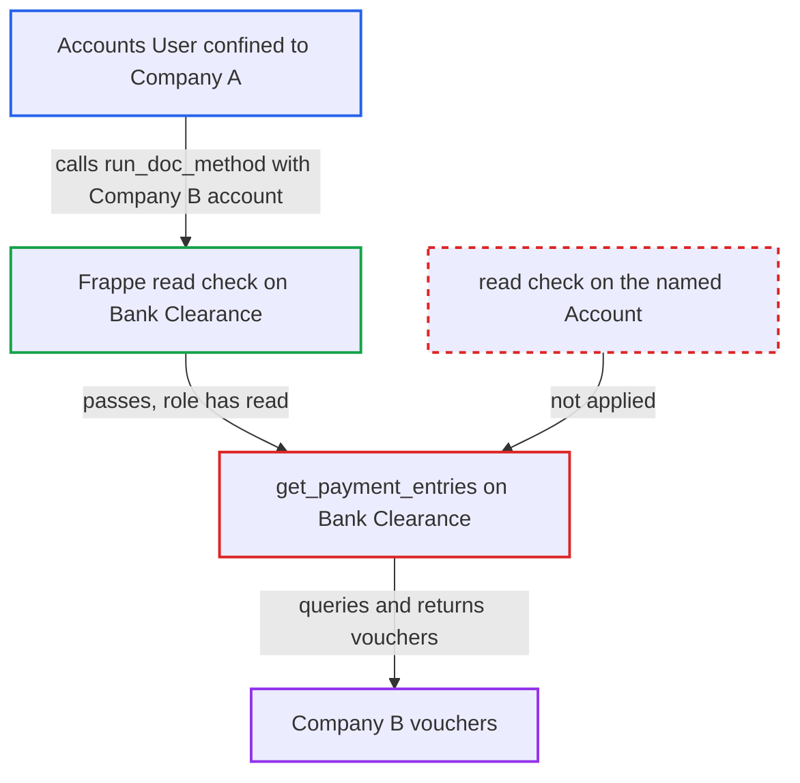

# Bank Clearance get_payment_entries lists another company's vouchers without Account permission check

| Field | Value |
|---|---|
| ID | `find_01Ne8PGwjU6fxoKwKxp3WebH` |
| Severity | **Low** |
| Status | open |
| CWE | CWE-862 — Missing Authorization |
| Created | 2026-10-27T21:18:44.030544Z |
| Claude Security | https://claude.ai/security/findings/find_01Ne8PGwjU6fxoKwKxp3WebH |

## Description

A user with the `Accounts User` role who is confined to Company A by User Permissions can list Company B's payment vouchers for any date range. The leak is read-only and covers voucher metadata such as names, cheque numbers, amounts and dates. The whitelisted method `BankClearance.get_payment_entries` uses the client-supplied `account` and runs permission-free `frappe.qb` queries without checking that the caller may read that `Account`.

1. **the attacker (an `Accounts User` confined to Company A)** posts a `Bank Clearance` doc to `/api/method/run_doc_method` with `method=get_payment_entries`. The doc's `account` is a Company B GL account such as `Creditors - B`, with a wide date range. The client-side `Bank`/`Cash` account type filter is not enforced on a direct API call. ([`erpnext/accounts/doctype/bank_clearance/bank_clearance.js:8-66`](https://github.com/cx-benchmark/erpnext/blob/90e7aefca73da3c440d2e8da7472fcb67838e678/erpnext/accounts/doctype/bank_clearance/bank_clearance.js#L8-L66))
2. **Frappe** checks only `read` permission on `Bank Clearance`. `Accounts User` holds `read` on this doctype, so the call is allowed. The fork's catch-all permission hook also returns True for single doctypes, so it adds no restriction. ([`erpnext/accounts/doctype/bank_clearance/bank_clearance.json:99-107`](https://github.com/cx-benchmark/erpnext/blob/90e7aefca73da3c440d2e8da7472fcb67838e678/erpnext/accounts/doctype/bank_clearance/bank_clearance.json#L99-L107))
3. **the method `get_payment_entries`** takes `self.account` and the dates from the posted doc without any permission check. It never checks that the caller may read the named `Account`. ([`erpnext/accounts/doctype/bank_clearance/bank_clearance.py:42-71`](https://github.com/cx-benchmark/erpnext/blob/90e7aefca73da3c440d2e8da7472fcb67838e678/erpnext/accounts/doctype/bank_clearance/bank_clearance.py#L42-L71))
4. **the method `get_entries_for_account`** passes the account, dates and include flags to the `get_payment_entries_for_bank_clearance` hook. No permission filter is applied on the way. ([`erpnext/accounts/doctype/bank_clearance/bank_clearance.py:72-95`](https://github.com/cx-benchmark/erpnext/blob/90e7aefca73da3c440d2e8da7472fcb67838e678/erpnext/accounts/doctype/bank_clearance/bank_clearance.py#L72-L95))
5. **the hook `get_payment_entries_for_bank_clearance`** queries Journal Entries, Payment Entries, paid Purchase Invoices and POS Sales Invoice payments with `frappe.qb`. The queries filter only by account, docstatus and dates. Query-builder queries apply no role or User Permission conditions, so Company B's vouchers match. ([`erpnext/accounts/doctype/bank_clearance/bank_clearance.py:256-476`](https://github.com/cx-benchmark/erpnext/blob/90e7aefca73da3c440d2e8da7472fcb67838e678/erpnext/accounts/doctype/bank_clearance/bank_clearance.py#L256-L476))
6. **the method `get_payment_entries`** stores the rows in `self.payment_entries` and returns them to the caller. The attacker receives Company B's voucher names, reference or cheque numbers, dates, amounts, posting dates, counter-party or against account, and clearance dates. ([`erpnext/accounts/doctype/bank_clearance/bank_clearance.py:42-71`](https://github.com/cx-benchmark/erpnext/blob/90e7aefca73da3c440d2e8da7472fcb67838e678/erpnext/accounts/doctype/bank_clearance/bank_clearance.py#L42-L71))

## Assessment

The attacker is a logged-in desk user with the `Accounts User` role on a multi-company site, where Company User Permissions confine them to Company A. They need no victim action. They send a direct POST to `/api/method/run_doc_method` with `method=get_payment_entries` and a `Bank Clearance` doc whose `account` names a Company B GL account. Account names follow the predictable `<Account Name> - <Company Abbr>` pattern, so they are easy to guess. Any GL account works, for example another company's `Debtors - XYZ` or `Creditors - XYZ`.

Impact: The attacker can read Company B's voucher metadata for any GL account and date range. This covers Journal Entry and Payment Entry names, reference or cheque numbers, dates, amounts, posting dates, party or against account, and clearance dates, plus paid Purchase Invoices and POS payments. The method is read-only and saves nothing. It exposes no full documents or item lines, and no invoices beyond paid and POS ones. This breaks isolation between companies.

## Recommendation

`BankClearance.get_payment_entries` takes the GL account, and optionally the Bank Account, from the client doc. It then runs permission-free `frappe.qb` queries without checking that the caller may read that `Account`. This breaks Company User Permission isolation.

Fix criteria: Before any query, the method requires the caller's `read` permission on the supplied `Account`, and on `Bank Account` when one is set, as `update_clearance_date` does. A user confined to Company A who names a Company B account gets a permission error and no rows. Verify by calling `run_doc_method` as such a user with another company's account and confirming the call is denied.

## Evidence

**https://github.com/cx-benchmark/erpnext**

- [`erpnext/accounts/doctype/bank_clearance/bank_clearance.py:42-71`](https://github.com/cx-benchmark/erpnext/blob/90e7aefca73da3c440d2e8da7472fcb67838e678/erpnext/accounts/doctype/bank_clearance/bank_clearance.py#L42-L71)
- [`erpnext/accounts/doctype/bank_clearance/bank_clearance.py:72-95`](https://github.com/cx-benchmark/erpnext/blob/90e7aefca73da3c440d2e8da7472fcb67838e678/erpnext/accounts/doctype/bank_clearance/bank_clearance.py#L72-L95)
- [`erpnext/accounts/doctype/bank_clearance/bank_clearance.py:256-476`](https://github.com/cx-benchmark/erpnext/blob/90e7aefca73da3c440d2e8da7472fcb67838e678/erpnext/accounts/doctype/bank_clearance/bank_clearance.py#L256-L476)
- [`erpnext/accounts/doctype/bank_clearance/bank_clearance.py:97-100`](https://github.com/cx-benchmark/erpnext/blob/90e7aefca73da3c440d2e8da7472fcb67838e678/erpnext/accounts/doctype/bank_clearance/bank_clearance.py#L97-L100)
- [`erpnext/stock/doctype/company_restriction/company_restriction.py:191-210`](https://github.com/cx-benchmark/erpnext/blob/90e7aefca73da3c440d2e8da7472fcb67838e678/erpnext/stock/doctype/company_restriction/company_restriction.py#L191-L210)
- [`erpnext/accounts/doctype/bank_clearance/bank_clearance.json:99-107`](https://github.com/cx-benchmark/erpnext/blob/90e7aefca73da3c440d2e8da7472fcb67838e678/erpnext/accounts/doctype/bank_clearance/bank_clearance.json#L99-L107)
- [`erpnext/accounts/doctype/bank_clearance/bank_clearance.js:8-66`](https://github.com/cx-benchmark/erpnext/blob/90e7aefca73da3c440d2e8da7472fcb67838e678/erpnext/accounts/doctype/bank_clearance/bank_clearance.js#L8-L66)

