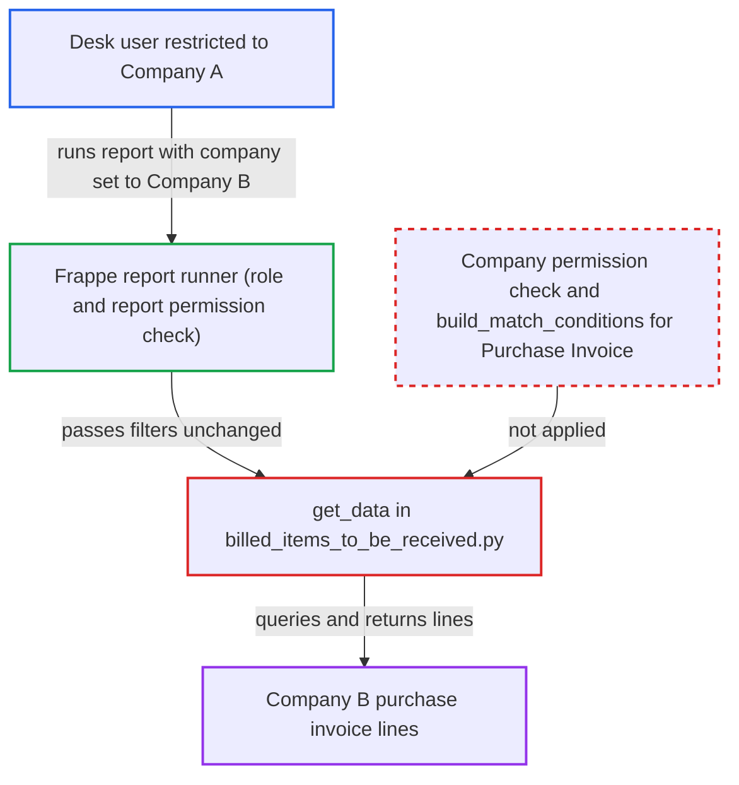

# Billed Items To Be Received ignores Company user permissions on caller-chosen company

| Field | Value |
|---|---|
| ID | `find_01PQkWFMdfoqoaV5n8XN1ojk` |
| Severity | **Low** |
| Status | open |
| CWE | CWE-862 — Missing Authorization |
| Created | 2026-10-27T21:16:27.058273Z |
| Claude Security | https://claude.ai/security/findings/find_01PQkWFMdfoqoaV5n8XN1ojk |

## Description

A logged-in Accounts User or Purchase User restricted to one company can read another company's purchase invoice lines through the Billed Items To Be Received report. This works on a multi-company site, and the attacker only has to name the other company in the report filter. The report query in `get_data()` trusts the caller's `company` value and applies no permission or match conditions.

1. **Attacker (desk user limited to Company A)** calls the report endpoint with another company's name. The request goes to `/api/method/frappe.desk.query_report.run` with `report_name` set to Billed Items To Be Received and `filters` holding `company` set to Company B and a `posting_date`. ([`erpnext/accounts/report/billed_items_to_be_received/billed_items_to_be_received.json`](https://github.com/cx-benchmark/erpnext/blob/90e7aefca73da3c440d2e8da7472fcb67838e678/erpnext/accounts/report/billed_items_to_be_received/billed_items_to_be_received.json))
2. **Frappe report runner** lets the request through after role checks only. The report has `ref_doctype` Purchase Invoice and an empty `filters` table, so the runner checks only the report roles and doctype-level `report` permission and never checks the `company` value. ([`erpnext/accounts/report/billed_items_to_be_received/billed_items_to_be_received.json`](https://github.com/cx-benchmark/erpnext/blob/90e7aefca73da3c440d2e8da7472fcb67838e678/erpnext/accounts/report/billed_items_to_be_received/billed_items_to_be_received.json))
3. **the function `execute()`** hands the caller's filters to `get_data()` unchanged. The company value is not validated on the way. ([`erpnext/accounts/report/billed_items_to_be_received/billed_items_to_be_received.py:12-16`](https://github.com/cx-benchmark/erpnext/blob/90e7aefca73da3c440d2e8da7472fcb67838e678/erpnext/accounts/report/billed_items_to_be_received/billed_items_to_be_received.py#L12-L16))
4. **the function `get_data()`** runs a raw `frappe.qb` query over Purchase Invoice and Purchase Invoice Item. The only scope is `invoice.company == report_filters.get("company")` on line 68, plus the caller's `posting_date` and the optional `purchase_invoice`, and `query.run(as_dict=True)` applies no permission logic. ([`erpnext/accounts/report/billed_items_to_be_received/billed_items_to_be_received.py:19-84`](https://github.com/cx-benchmark/erpnext/blob/90e7aefca73da3c440d2e8da7472fcb67838e678/erpnext/accounts/report/billed_items_to_be_received/billed_items_to_be_received.py#L19-L84))
5. **Frappe row post-filter** cannot remove the rows from the other company. The report columns include Link columns for Purchase Invoice, Supplier, Item and UOM but no Company column, so Company User Permissions are never applied to the rows. ([`erpnext/accounts/report/billed_items_to_be_received/billed_items_to_be_received.py:205-236`](https://github.com/cx-benchmark/erpnext/blob/90e7aefca73da3c440d2e8da7472fcb67838e678/erpnext/accounts/report/billed_items_to_be_received/billed_items_to_be_received.py#L205-L236))

## Assessment

The attacker is an authenticated desk user with the Purchase User or Accounts User role. A Company User Permission confines this user to Company A on a site with several companies. No victim action is needed. The attacker sends the report request with another company's name in `company`. They can also set `posting_date` to an earlier date to see historical invoice-first lines that were not yet received at that date.

Impact: The attacker can read, across companies, Purchase Invoice line data: invoice numbers, dates, suppliers, item codes and names, quantities, purchase rates and amounts. This covers only submitted, non-stock-updating, non-return invoices of stock or fixed-asset items not fully received as on the chosen date. It is read-only, with no write or availability effect.

## Recommendation

`get_data()` in `billed_items_to_be_received.py` trusts the caller-supplied `company` and runs an unrestricted `frappe.qb` query over Purchase Invoice. Company, Project and Cost Center User Permissions and the fork's company restrictions are never applied.

Fix criteria: The report returns only Purchase Invoices the session user may read. A `company` the user is not permitted for is refused or yields no rows, and the user's match conditions for Purchase Invoice constrain the rows. Verify by running the report as a user restricted to Company A with `company` set to Company B: expect a PermissionError or no rows.

## Evidence

**https://github.com/cx-benchmark/erpnext**

- [`erpnext/accounts/report/billed_items_to_be_received/billed_items_to_be_received.py:19-84`](https://github.com/cx-benchmark/erpnext/blob/90e7aefca73da3c440d2e8da7472fcb67838e678/erpnext/accounts/report/billed_items_to_be_received/billed_items_to_be_received.py#L19-L84)
- [`erpnext/accounts/report/billed_items_to_be_received/billed_items_to_be_received.py:12-16`](https://github.com/cx-benchmark/erpnext/blob/90e7aefca73da3c440d2e8da7472fcb67838e678/erpnext/accounts/report/billed_items_to_be_received/billed_items_to_be_received.py#L12-L16)
- [`erpnext/accounts/report/billed_items_to_be_received/billed_items_to_be_received.json`](https://github.com/cx-benchmark/erpnext/blob/90e7aefca73da3c440d2e8da7472fcb67838e678/erpnext/accounts/report/billed_items_to_be_received/billed_items_to_be_received.json)
- [`erpnext/accounts/report/billed_items_to_be_received/billed_items_to_be_received.py:205-236`](https://github.com/cx-benchmark/erpnext/blob/90e7aefca73da3c440d2e8da7472fcb67838e678/erpnext/accounts/report/billed_items_to_be_received/billed_items_to_be_received.py#L205-L236)
- [`erpnext/accounts/report/purchase_register/purchase_register.py:512-515`](https://github.com/cx-benchmark/erpnext/blob/90e7aefca73da3c440d2e8da7472fcb67838e678/erpnext/accounts/report/purchase_register/purchase_register.py#L512-L515)
- [`erpnext/selling/report/sales_partner_commission_summary/test_sales_partner_commission_summary.py:265-300`](https://github.com/cx-benchmark/erpnext/blob/90e7aefca73da3c440d2e8da7472fcb67838e678/erpnext/selling/report/sales_partner_commission_summary/test_sales_partner_commission_summary.py#L265-L300)

