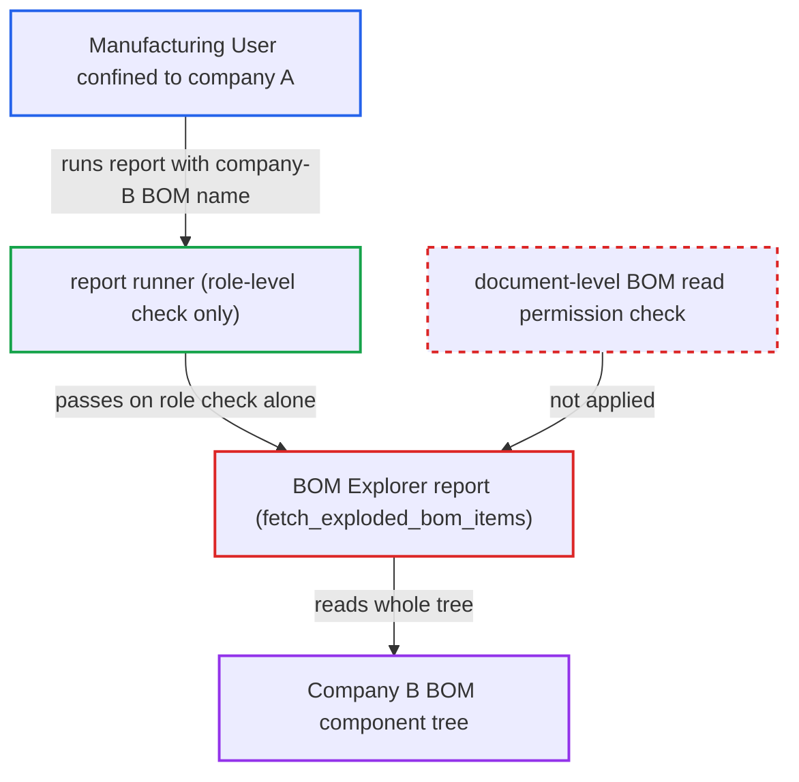

# BOM Explorer report exposes any BOM's component tree without checking document permission

| Field | Value |
|---|---|
| ID | `find_019WqAXWwxBhhjtjVj4xKCiM` |
| Severity | **Low** |
| Status | open |
| CWE | CWE-639 — Authorization bypass |
| Created | 2026-10-27T21:17:56.230224Z |
| Claude Security | https://claude.ai/security/findings/find_019WqAXWwxBhhjtjVj4xKCiM |

## Description

A Manufacturing User limited to company A can read the full multi-level component tree of any company-B BOM, including item codes, names, descriptions, quantities, UOMs and sub-BOMs. The user only needs to know or guess the BOM name, and the deployment must confine users by company. The BOM Explorer report passes the caller-supplied `filters.bom` to a raw query in `fetch_exploded_bom_items` without checking document permission.

1. **attacker (Manufacturing User confined to company A)** calls the report runner for BOM Explorer with a company-B BOM name. The request goes to `/api/method/frappe.desk.query_report.run` with `report_name="BOM Explorer"` and `filters={"bom": "BOM-<item>-001"}`; BOM names follow `BOM-<item>-<###>`, so they are easy to guess from item codes.
2. **Frappe report runner** checks only the role-level report permission on BOM. The report's JSON has `ref_doctype: BOM`, the roles Manufacturing Manager and Manufacturing User, and no `filters` table, so nothing validates the named BOM. ([`erpnext/manufacturing/report/bom_explorer/bom_explorer.json`](https://github.com/cx-benchmark/erpnext/blob/90e7aefca73da3c440d2e8da7472fcb67838e678/erpnext/manufacturing/report/bom_explorer/bom_explorer.json))
3. **the report's `get_data`** passes `filters.bom` straight into the explosion. No `frappe.has_permission("BOM", doc=...)` check and no company scoping happen first. ([`erpnext/manufacturing/report/bom_explorer/bom_explorer.py:18-20`](https://github.com/cx-benchmark/erpnext/blob/90e7aefca73da3c440d2e8da7472fcb67838e678/erpnext/manufacturing/report/bom_explorer/bom_explorer.py#L18-L20))
4. **the function `fetch_exploded_bom_items`** runs a recursive query over `tabBOM Item` from the named BOM. The query is seeded at `parent == root_bom` and walks every descendant sub-BOM, with no permission or company condition. ([`erpnext/manufacturing/report/bom_explorer/bom_explorer.py:23-61`](https://github.com/cx-benchmark/erpnext/blob/90e7aefca73da3c440d2e8da7472fcb67838e678/erpnext/manufacturing/report/bom_explorer/bom_explorer.py#L23-L61))
5. **Frappe report row filter** fails to remove any rows. The output has only the Link columns `item_code` (Item) and `bom` (BOM) and no company column, so a Company User Permission drops nothing. ([`erpnext/manufacturing/report/bom_explorer/bom_explorer.py:89-110`](https://github.com/cx-benchmark/erpnext/blob/90e7aefca73da3c440d2e8da7472fcb67838e678/erpnext/manufacturing/report/bom_explorer/bom_explorer.py#L89-L110))

## Assessment

The attacker is an authenticated desk user with the Manufacturing User role whose access is confined to company A by a Company User Permission. The attack needs a deployment that confines users by company. The attacker calls the report runner with a company-B BOM name, which is easy to guess. Only the role-level report permission is checked. Permission-query hooks such as the Company Restriction hooks in `hooks.py` are not applied to report rows.

Impact: The attacker reads another company's bill of materials: component item codes, names, descriptions, scaled quantities, UOMs and sub-assembly BOMs at every level. This is read-only. No rates or costs are returned, nothing is modified, and the query load is bounded by the size of the named tree.

## Recommendation

The report trusts the caller-supplied BOM name and reads its whole exploded tree with permission-ignoring queries. Document-level BOM permission, meaning user permissions on `company` and the inherited item Company Restriction, is never enforced.

Fix criteria: Before returning rows, the report confirms the caller has document-level read permission on the root BOM. It should also confirm this for each descendant BOM it expands, honouring user permissions and permission hooks. Alternatively, the query is scoped by the caller's allowed companies. A Manufacturing User restricted to company A who runs BOM Explorer on a company-B BOM gets a permission error or no rows. A company-A BOM still explodes normally.

## Evidence

**https://github.com/cx-benchmark/erpnext**

- [`erpnext/manufacturing/report/bom_explorer/bom_explorer.py:18-20`](https://github.com/cx-benchmark/erpnext/blob/90e7aefca73da3c440d2e8da7472fcb67838e678/erpnext/manufacturing/report/bom_explorer/bom_explorer.py#L18-L20)
- [`erpnext/manufacturing/report/bom_explorer/bom_explorer.py:23-61`](https://github.com/cx-benchmark/erpnext/blob/90e7aefca73da3c440d2e8da7472fcb67838e678/erpnext/manufacturing/report/bom_explorer/bom_explorer.py#L23-L61)
- [`erpnext/manufacturing/report/bom_explorer/bom_explorer.py:89-110`](https://github.com/cx-benchmark/erpnext/blob/90e7aefca73da3c440d2e8da7472fcb67838e678/erpnext/manufacturing/report/bom_explorer/bom_explorer.py#L89-L110)
- [`erpnext/manufacturing/report/bom_explorer/bom_explorer.json`](https://github.com/cx-benchmark/erpnext/blob/90e7aefca73da3c440d2e8da7472fcb67838e678/erpnext/manufacturing/report/bom_explorer/bom_explorer.json)
- [`erpnext/manufacturing/report/bom_operations_time/bom_operations_time.py:78-79`](https://github.com/cx-benchmark/erpnext/blob/90e7aefca73da3c440d2e8da7472fcb67838e678/erpnext/manufacturing/report/bom_operations_time/bom_operations_time.py#L78-L79)
- [`erpnext/manufacturing/doctype/bom/bom.py:1767-1770`](https://github.com/cx-benchmark/erpnext/blob/90e7aefca73da3c440d2e8da7472fcb67838e678/erpnext/manufacturing/doctype/bom/bom.py#L1767-L1770)
- [`erpnext/manufacturing/doctype/bom/mapper.py:37-51`](https://github.com/cx-benchmark/erpnext/blob/90e7aefca73da3c440d2e8da7472fcb67838e678/erpnext/manufacturing/doctype/bom/mapper.py#L37-L51)

