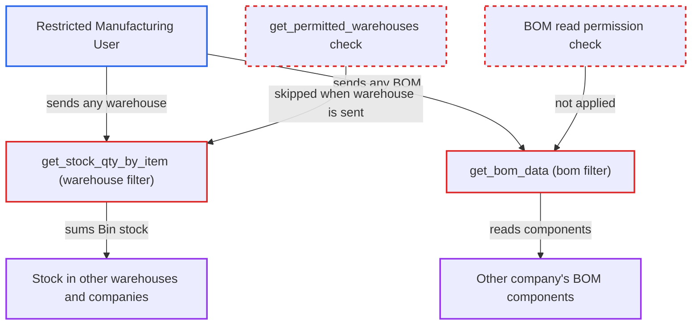

# BOM Stock Analysis bypasses Warehouse and Company user permissions via caller-chosen warehouse and BOM

| Field | Value |
|---|---|
| ID | `find_01C8ahbqhaJo9eb4cU4i2hnf` |
| Severity | **Low** |
| Status | open |
| CWE | CWE-639 — Missing authorization |
| Created | 2026-10-27T21:19:43.646378Z |
| Claude Security | https://claude.ai/security/findings/find_01C8ahbqhaJo9eb4cU4i2hnf |

## Description

A logged-in Manufacturing User or Manager who is limited by Warehouse or Company User Permissions can read stock levels in warehouses they are not allowed to see, including other companies' warehouses. They can also read another company's BOM component list. The report `BOM Stock Analysis` skips permission checks when the caller supplies `filters.warehouse` or `filters.bom`, in `get_stock_qty_by_item` and `get_bom_data`.

1. **restricted Manufacturing User** calls the report endpoint with chosen filters. The call is to `/api/method/frappe.desk.query_report.run` with `report_name` set to `BOM Stock Analysis`. The filters are `bom` (any BOM, such as their own), `warehouse` (a restricted or other-company warehouse) and `qty_to_make` of 1. ([`erpnext/manufacturing/report/bom_stock_analysis/bom_stock_analysis.json`](https://github.com/cx-benchmark/erpnext/blob/90e7aefca73da3c440d2e8da7472fcb67838e678/erpnext/manufacturing/report/bom_stock_analysis/bom_stock_analysis.json))
2. **Frappe report framework** checks only the report roles and the role-level report permission on BOM. The report's `filters` list is empty, so there is no server-side link-filter check on the `bom` or `warehouse` values. The output has only `Item` and `BOM` Link columns, so the row filter applies no Company or Warehouse User Permissions. ([`erpnext/manufacturing/report/bom_stock_analysis/bom_stock_analysis.py:103-131`](https://github.com/cx-benchmark/erpnext/blob/90e7aefca73da3c440d2e8da7472fcb67838e678/erpnext/manufacturing/report/bom_stock_analysis/bom_stock_analysis.py#L103-L131))
3. **`get_stock_qty_by_item`** sums stock over the caller-named warehouse and all its children. It reads `lft` and `rgt` of that warehouse with `frappe.db.get_value` and sums `tabBin.actual_qty`, with no permission check. ([`erpnext/manufacturing/report/bom_stock_analysis/bom_stock_analysis.py:209-227`](https://github.com/cx-benchmark/erpnext/blob/90e7aefca73da3c440d2e8da7472fcb67838e678/erpnext/manufacturing/report/bom_stock_analysis/bom_stock_analysis.py#L209-L227))
4. **`get_bom_data`** reads the components of the caller-named BOM. It uses raw `frappe.qb` and `frappe.get_all` on `BOM Item` and `BOM Explosion Item`, with no `has_permission` check and no company check. ([`erpnext/manufacturing/report/bom_stock_analysis/bom_stock_analysis.py:243-287`](https://github.com/cx-benchmark/erpnext/blob/90e7aefca73da3c440d2e8da7472fcb67838e678/erpnext/manufacturing/report/bom_stock_analysis/bom_stock_analysis.py#L243-L287))
5. **the report** returns item-wise stock and producible quantity to the attacker. The no-warehouse branch is limited by `get_permitted_warehouses`, but this path never reaches it. ([`erpnext/manufacturing/report/bom_stock_analysis/bom_stock_analysis.py:228-240`](https://github.com/cx-benchmark/erpnext/blob/90e7aefca73da3c440d2e8da7472fcb67838e678/erpnext/manufacturing/report/bom_stock_analysis/bom_stock_analysis.py#L228-L240))

## Assessment

The attacker is a logged-in employee with the Manufacturing User or Manufacturing Manager role. User Permissions limit them to one Warehouse (such as W1) or one Company (such as A). They gain something only where such restrictions exist. To read stock, they send `filters.warehouse` naming any warehouse, including a group warehouse of another company, plus a BOM in their own company that lists the items they want. To read a recipe, they name another company's BOM in `filters.bom`. BOM names follow the pattern `BOM-<item>-NNN`.

Impact: The attacker reads item-wise stock on hand and the maximum producible quantity for any warehouse or warehouse group, across companies. They can also read another company's BOM component list, descriptions and per-unit quantities. The data is limited to the items in the chosen BOM, and the access is read-only.

## Recommendation

(1) `get_stock_qty_by_item` trusts a caller-supplied `warehouse` and sums `Bin` over it with permission-blind queries. The Warehouse and Company User Permissions that the no-warehouse branch enforces are skipped.

Fix criteria: Stock is summed only over warehouses the user may read, intersected with the requested warehouse subtree, or a disallowed warehouse is refused. In the project's test setup, the W1-restricted user who passes the restricted or other-company warehouse sees no stock from it.

(2) `get_bom_data` reads the caller-named BOM and its phantom sub-BOMs without a document-level read check, so Company User Permissions on BOM are bypassed.

Fix criteria: The root BOM and any phantom sub-BOM it expands pass a document-level read check, including User Permissions, for the running user. A Company-A-restricted Manufacturing User who names a Company-B BOM gets a permission error or no rows.

## Evidence

**https://github.com/cx-benchmark/erpnext**

- [`erpnext/manufacturing/report/bom_stock_analysis/bom_stock_analysis.py:209-227`](https://github.com/cx-benchmark/erpnext/blob/90e7aefca73da3c440d2e8da7472fcb67838e678/erpnext/manufacturing/report/bom_stock_analysis/bom_stock_analysis.py#L209-L227)
- [`erpnext/manufacturing/report/bom_stock_analysis/bom_stock_analysis.py:228-240`](https://github.com/cx-benchmark/erpnext/blob/90e7aefca73da3c440d2e8da7472fcb67838e678/erpnext/manufacturing/report/bom_stock_analysis/bom_stock_analysis.py#L228-L240)
- [`erpnext/manufacturing/report/bom_stock_analysis/bom_stock_analysis.py:243-287`](https://github.com/cx-benchmark/erpnext/blob/90e7aefca73da3c440d2e8da7472fcb67838e678/erpnext/manufacturing/report/bom_stock_analysis/bom_stock_analysis.py#L243-L287)
- [`erpnext/manufacturing/report/bom_stock_analysis/bom_stock_analysis.py:103-131`](https://github.com/cx-benchmark/erpnext/blob/90e7aefca73da3c440d2e8da7472fcb67838e678/erpnext/manufacturing/report/bom_stock_analysis/bom_stock_analysis.py#L103-L131)
- [`erpnext/manufacturing/report/bom_stock_analysis/bom_stock_analysis.json`](https://github.com/cx-benchmark/erpnext/blob/90e7aefca73da3c440d2e8da7472fcb67838e678/erpnext/manufacturing/report/bom_stock_analysis/bom_stock_analysis.json)
- [`erpnext/manufacturing/report/bom_stock_analysis/test_bom_stock_analysis.py:299-312`](https://github.com/cx-benchmark/erpnext/blob/90e7aefca73da3c440d2e8da7472fcb67838e678/erpnext/manufacturing/report/bom_stock_analysis/test_bom_stock_analysis.py#L299-L312)

