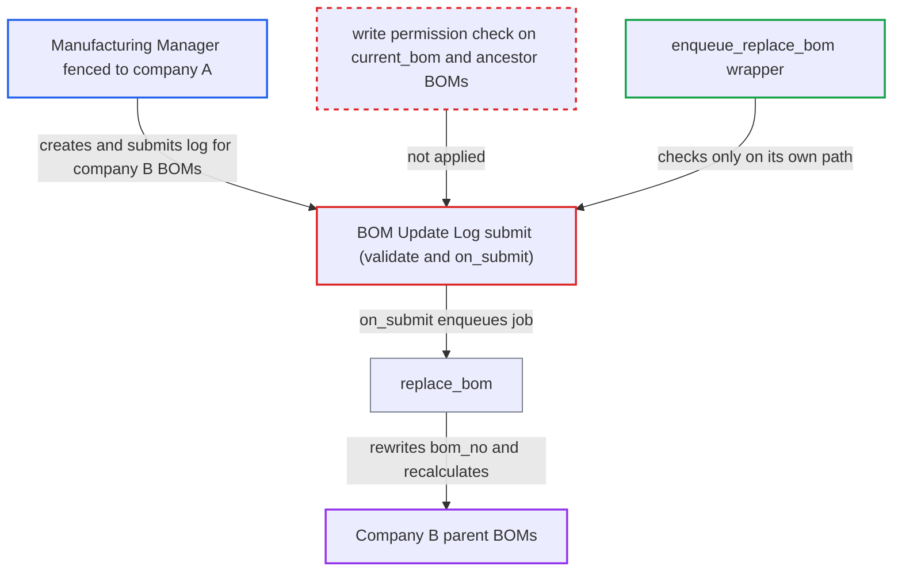

# BOM Update Log submit rewrites BOMs the submitter cannot write, bypassing BOM Update Tool checks

| Field | Value |
|---|---|
| ID | `find_01HngEm7ExCY6fdrvyuZfoz5` |
| Severity | **Low** |
| Status | open |
| CWE | CWE-862 — Missing Authorization |
| Created | 2026-10-27T21:27:24.349055Z |
| Claude Security | https://claude.ai/security/findings/find_01HngEm7ExCY6fdrvyuZfoz5 |

## Description

A Manufacturing Manager who is fenced by User Permissions (for example to company A) can rewrite BOMs in another company. They swap one sub-assembly BOM for another in every parent BOM, submitted ones included. The swap is limited to existing, submitted, active BOMs of the same item, company and currency. The cause is that `BOM Update Log` checks only business consistency, and the permission checks exist only in the wrapper `enqueue_replace_bom`.

1. **Restricted Manufacturing Manager** creates and submits a `BOM Update Log` directly through `/api/resource` or `frappe.client.insert` and `frappe.client.submit`. This role has create, write and submit on the doctype, and the report says `in_create` only hides the desk 'New' button. ([`erpnext/manufacturing/doctype/bom_update_log/bom_update_log.json:122-133`](https://github.com/cx-benchmark/erpnext/blob/90e7aefca73da3c440d2e8da7472fcb67838e678/erpnext/manufacturing/doctype/bom_update_log/bom_update_log.json#L122-L133))
2. **the `validate` method of `BOMUpdateLog`** accepts the chosen BOM pair after consistency checks only. It checks that both BOMs are set and different, and that they share item, company and currency. It also checks that `new_bom` is submitted and active. It never checks the user's rights on the BOMs. ([`erpnext/manufacturing/doctype/bom_update_log/bom_update_log.py:58-68`](https://github.com/cx-benchmark/erpnext/blob/90e7aefca73da3c440d2e8da7472fcb67838e678/erpnext/manufacturing/doctype/bom_update_log/bom_update_log.py#L58-L68))
3. **the hook `has_inherited_permission`** lets the document through. It looks only at links to Item, Customer and Supplier, and `BOM Update Log` has none, so it returns True. The log has no company field, so a Company User Permission never applies. ([`erpnext/stock/doctype/company_restriction/company_restriction.py:191-224`](https://github.com/cx-benchmark/erpnext/blob/90e7aefca73da3c440d2e8da7472fcb67838e678/erpnext/stock/doctype/company_restriction/company_restriction.py#L191-L224))
4. **the handler `on_submit`** enqueues `run_replace_bom_job` with the caller's BOM pair. The job then calls `replace_bom`. ([`erpnext/manufacturing/doctype/bom_update_log/bom_update_log.py:146-157`](https://github.com/cx-benchmark/erpnext/blob/90e7aefca73da3c440d2e8da7472fcb67838e678/erpnext/manufacturing/doctype/bom_update_log/bom_update_log.py#L146-L157))
5. **the function `replace_bom`** rewrites `bom_no` in every BOM Item and BOM Operation row that pointed at `current_bom`. A raw `frappe.qb.update` touches all rows with docstatus below 2, so submitted parent BOMs of any company change too. ([`erpnext/manufacturing/doctype/bom_update_log/bom_updation_utils.py:103-110`](https://github.com/cx-benchmark/erpnext/blob/90e7aefca73da3c440d2e8da7472fcb67838e678/erpnext/manufacturing/doctype/bom_update_log/bom_updation_utils.py#L103-L110))
6. **the function `replace_bom`** recalculates exploded items and cost of each ancestor BOM and saves it with `db_update()`. No permission check runs at this point. ([`erpnext/manufacturing/doctype/bom_update_log/bom_updation_utils.py:17-42`](https://github.com/cx-benchmark/erpnext/blob/90e7aefca73da3c440d2e8da7472fcb67838e678/erpnext/manufacturing/doctype/bom_update_log/bom_updation_utils.py#L17-L42))

## Assessment

The attacker is a desk user with the Manufacturing Manager role, not System Manager. Their BOM access is fenced by User Permissions, for example to company A. This requires a deployment that fences users that way. They send a POST to `/api/resource/BOM Update Log` with `update_type=Replace BOM`, two submitted, active company-B BOMs of one item and `docstatus=1`. Alternatively, they insert the log and then call `frappe.client.submit`. The same bypass works under BOM-level User Permissions. A user allowed only the two BOMs being swapped can rewrite parent BOMs they cannot access.

Impact: The attacker changes manufacturing master data outside their permitted scope. Sub-assembly references in submitted and draft parent BOMs are switched, and exploded items and costs are recalculated. This affects later Work Orders and costing. The attacker cannot inject arbitrary content, because the swap is limited to existing, submitted, active BOMs of the same item, company and currency. The report finds no disclosure and no availability impact.

## Recommendation

The authorisation checks for BOM replacement exist only in the `enqueue_replace_bom` wrapper. The `BOM Update Log` document actually triggers the rewrite and accepts any BOM pair from any user allowed to create and submit it. Document-level write permission on the affected BOMs is never enforced.

Fix criteria: Submitting a 'Replace BOM' log by any path fails unless the submitting user has write permission, including User Permissions, on `current_bom` and on every BOM that `replace_bom` will rewrite. This matches the checks in `enqueue_replace_bom`. To verify, a Manufacturing Manager restricted to company A inserts and submits a `BOM Update Log` for company-B BOMs via `/api/resource`. The call returns a PermissionError and no BOM row changes.

## Evidence

**https://github.com/cx-benchmark/erpnext**

- [`erpnext/manufacturing/doctype/bom_update_log/bom_update_log.py:58-68`](https://github.com/cx-benchmark/erpnext/blob/90e7aefca73da3c440d2e8da7472fcb67838e678/erpnext/manufacturing/doctype/bom_update_log/bom_update_log.py#L58-L68)
- [`erpnext/manufacturing/doctype/bom_update_log/bom_update_log.py:146-157`](https://github.com/cx-benchmark/erpnext/blob/90e7aefca73da3c440d2e8da7472fcb67838e678/erpnext/manufacturing/doctype/bom_update_log/bom_update_log.py#L146-L157)
- [`erpnext/manufacturing/doctype/bom_update_log/bom_updation_utils.py:17-42`](https://github.com/cx-benchmark/erpnext/blob/90e7aefca73da3c440d2e8da7472fcb67838e678/erpnext/manufacturing/doctype/bom_update_log/bom_updation_utils.py#L17-L42)
- [`erpnext/manufacturing/doctype/bom_update_log/bom_updation_utils.py:103-110`](https://github.com/cx-benchmark/erpnext/blob/90e7aefca73da3c440d2e8da7472fcb67838e678/erpnext/manufacturing/doctype/bom_update_log/bom_updation_utils.py#L103-L110)
- [`erpnext/manufacturing/doctype/bom_update_tool/bom_update_tool.py:35-62`](https://github.com/cx-benchmark/erpnext/blob/90e7aefca73da3c440d2e8da7472fcb67838e678/erpnext/manufacturing/doctype/bom_update_tool/bom_update_tool.py#L35-L62)
- [`erpnext/manufacturing/doctype/bom_update_log/bom_update_log.json:122-133`](https://github.com/cx-benchmark/erpnext/blob/90e7aefca73da3c440d2e8da7472fcb67838e678/erpnext/manufacturing/doctype/bom_update_log/bom_update_log.json#L122-L133)
- [`erpnext/stock/doctype/company_restriction/company_restriction.py:191-224`](https://github.com/cx-benchmark/erpnext/blob/90e7aefca73da3c440d2e8da7472fcb67838e678/erpnext/stock/doctype/company_restriction/company_restriction.py#L191-L224)

