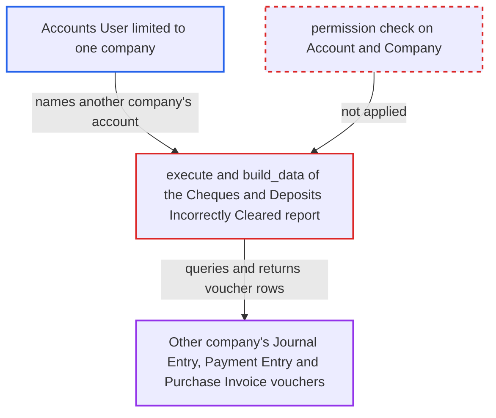

# Cheques and Deposits Incorrectly Cleared report lists another company's bank vouchers without permission checks

| Field | Value |
|---|---|
| ID | `find_01JLudoTtFC9rx61tzpeXmuc` |
| Severity | **Low** |
| Status | open |
| CWE | CWE-862 — Missing Authorization |
| Created | 2026-10-27T21:17:34.938588Z |
| Claude Security | https://claude.ai/security/findings/find_01JLudoTtFC9rx61tzpeXmuc |

## Description

An Accounts User limited to one company by User Permissions can read another company's bank or cash account vouchers. They see voucher ids, posting and clearance dates and debit/credit amounts. Only vouchers whose clearance date is on or before `report_date` and whose posting date is after it are exposed. The cause is that `execute()`/`build_data()` pass the caller's `account` filter into queries without checking that the user may read that Account or its Company.

1. **attacker (Accounts User limited to one company)** runs the report with another company's account. The attacker sets `account` to another company's bank or cash account name and picks any `report_date`, either in the UI or through `frappe.desk.query_report.run`. ([`erpnext/accounts/report/cheques_and_deposits_incorrectly_cleared/cheques_and_deposits_incorrectly_cleared.py:15-23`](https://github.com/cx-benchmark/erpnext/blob/90e7aefca73da3c440d2e8da7472fcb67838e678/erpnext/accounts/report/cheques_and_deposits_incorrectly_cleared/cheques_and_deposits_incorrectly_cleared.py#L15-L23))
2. **the report code `execute()`/`build_data()`** passes the raw filters on to the query functions. Nothing validates the Account or Company against the user's permissions first. ([`erpnext/accounts/report/cheques_and_deposits_incorrectly_cleared/cheques_and_deposits_incorrectly_cleared.py:15-23`](https://github.com/cx-benchmark/erpnext/blob/90e7aefca73da3c440d2e8da7472fcb67838e678/erpnext/accounts/report/cheques_and_deposits_incorrectly_cleared/cheques_and_deposits_incorrectly_cleared.py#L15-L23))
3. **the query function `get_amounts_not_reflected_in_system_for_bank_reconciliation_statement()`** queries Journal Entry and Payment Entry rows for the chosen account. The queries filter only on `filters.account`, the posting date and the clearance date, with no company constraint, permission check or match condition. ([`erpnext/accounts/report/cheques_and_deposits_incorrectly_cleared/cheques_and_deposits_incorrectly_cleared.py:39-88`](https://github.com/cx-benchmark/erpnext/blob/90e7aefca73da3c440d2e8da7472fcb67838e678/erpnext/accounts/report/cheques_and_deposits_incorrectly_cleared/cheques_and_deposits_incorrectly_cleared.py#L39-L88))
4. **the function `get_paid_purchase_invoices()`** returns paid Purchase Invoices on the same chosen account. It also applies no permission check on `cash_bank_account`. ([`erpnext/accounts/report/cheques_and_deposits_incorrectly_cleared/cheques_and_deposits_incorrectly_cleared.py:91-111`](https://github.com/cx-benchmark/erpnext/blob/90e7aefca73da3c440d2e8da7472fcb67838e678/erpnext/accounts/report/cheques_and_deposits_incorrectly_cleared/cheques_and_deposits_incorrectly_cleared.py#L91-L111))
5. **Frappe report framework** returns all rows to the attacker without dropping any. The only Link column is `payment_document` pointing to DocType, and no Company or Account column is returned, so row filtering by user permission cannot remove another company's rows. ([`erpnext/accounts/report/cheques_and_deposits_incorrectly_cleared/cheques_and_deposits_incorrectly_cleared.py:115-147`](https://github.com/cx-benchmark/erpnext/blob/90e7aefca73da3c440d2e8da7472fcb67838e678/erpnext/accounts/report/cheques_and_deposits_incorrectly_cleared/cheques_and_deposits_incorrectly_cleared.py#L115-L147))

## Assessment

The attacker is a logged-in desk user with the `Accounts User` role whom User Permissions confine to one company. They open the report in the UI or call `frappe.desk.query_report.run` with `account` set to another company's bank or cash account name (for example `Cash - <abbr>`) and any `report_date`. The sibling Bank Reconciliation Statement does check access through `get_balance_on`, but this report does not. The leak needs vouchers on the account whose clearance date comes before their posting date, so it depends on the victim's data. By sweeping `report_date`, the attacker can collect every such voucher on the account.

Impact: The attacker reads voucher ids, posting and clearance dates and debit/credit amounts of another company's Journal Entries, Payment Entries and paid Purchase Invoices. They cannot read these through the doctypes themselves. Only vouchers whose clearance date comes before their posting date are exposed, and nothing can be written.

## Recommendation

The report builds every query from the caller-supplied `account` filter and never checks that the user may read that Account or its Company. This bypasses the User Permissions that keep each company's vouchers apart.

Fix criteria: Before any data is returned, the report refuses an `account` the user may not read, along with its company. The same check covers a `company` filter that does not own the account. Results are limited to vouchers the user may read. Test: a user restricted to Company B who names a Company A bank account gets a permission error or no rows, while their own company's accounts still work.

## Evidence

**https://github.com/cx-benchmark/erpnext**

- [`erpnext/accounts/report/cheques_and_deposits_incorrectly_cleared/cheques_and_deposits_incorrectly_cleared.py:39-88`](https://github.com/cx-benchmark/erpnext/blob/90e7aefca73da3c440d2e8da7472fcb67838e678/erpnext/accounts/report/cheques_and_deposits_incorrectly_cleared/cheques_and_deposits_incorrectly_cleared.py#L39-L88)
- [`erpnext/accounts/report/cheques_and_deposits_incorrectly_cleared/cheques_and_deposits_incorrectly_cleared.py:91-111`](https://github.com/cx-benchmark/erpnext/blob/90e7aefca73da3c440d2e8da7472fcb67838e678/erpnext/accounts/report/cheques_and_deposits_incorrectly_cleared/cheques_and_deposits_incorrectly_cleared.py#L91-L111)
- [`erpnext/accounts/report/cheques_and_deposits_incorrectly_cleared/cheques_and_deposits_incorrectly_cleared.py:15-23`](https://github.com/cx-benchmark/erpnext/blob/90e7aefca73da3c440d2e8da7472fcb67838e678/erpnext/accounts/report/cheques_and_deposits_incorrectly_cleared/cheques_and_deposits_incorrectly_cleared.py#L15-L23)
- [`erpnext/accounts/report/cheques_and_deposits_incorrectly_cleared/cheques_and_deposits_incorrectly_cleared.py:115-147`](https://github.com/cx-benchmark/erpnext/blob/90e7aefca73da3c440d2e8da7472fcb67838e678/erpnext/accounts/report/cheques_and_deposits_incorrectly_cleared/cheques_and_deposits_incorrectly_cleared.py#L115-L147)
- [`erpnext/accounts/report/cheques_and_deposits_incorrectly_cleared/cheques_and_deposits_incorrectly_cleared.json:8-28`](https://github.com/cx-benchmark/erpnext/blob/90e7aefca73da3c440d2e8da7472fcb67838e678/erpnext/accounts/report/cheques_and_deposits_incorrectly_cleared/cheques_and_deposits_incorrectly_cleared.json#L8-L28)
- [`erpnext/accounts/utils.py:268-270`](https://github.com/cx-benchmark/erpnext/blob/90e7aefca73da3c440d2e8da7472fcb67838e678/erpnext/accounts/utils.py#L268-L270)
- [`erpnext/accounts/doctype/payment_entry/payment_entry.json:150-157`](https://github.com/cx-benchmark/erpnext/blob/90e7aefca73da3c440d2e8da7472fcb67838e678/erpnext/accounts/doctype/payment_entry/payment_entry.json#L150-L157)

