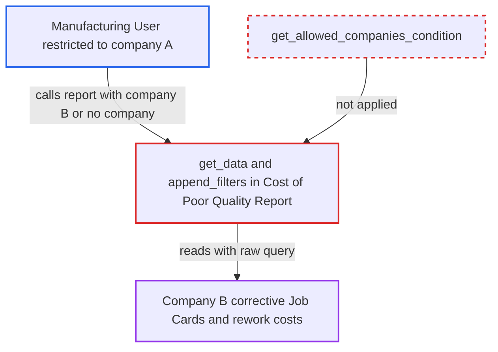

# Cost of Poor Quality report ignores Company user permissions on Job Cards

| Field | Value |
|---|---|
| ID | `find_01A56JGeaMPuudcQvUEesA4L` |
| Severity | **Low** |
| Status | open |
| CWE | CWE-862 — Missing Authorization |
| Created | 2026-10-27T21:09:29.499633Z |
| Claude Security | https://claude.ai/security/findings/find_01A56JGeaMPuudcQvUEesA4L |

## Description

A logged-in Manufacturing User who is restricted to one company can read another company's corrective Job Cards and rework costs. This only matters on a multi-company site that uses Company User Permissions. The cause is `get_data`, which reads Job Cards with raw `frappe.qb` and filters only by an optional `company` value that the caller supplies.

1. **Attacker (Manufacturing User limited to company A)** calls `/api/method/frappe.desk.query_report.run` for "Cost of Poor Quality Report". The call sets `filters` to a company B value or leaves out the `company` filter. The `reqd: 1` on the filter exists only in the browser, so a direct API call can skip it. ([`erpnext/manufacturing/report/cost_of_poor_quality_report/cost_of_poor_quality_report.js:9-15`](https://github.com/cx-benchmark/erpnext/blob/90e7aefca73da3c440d2e8da7472fcb67838e678/erpnext/manufacturing/report/cost_of_poor_quality_report/cost_of_poor_quality_report.js#L9-L15))
2. **Frappe report runner** accepts the request without checking the filter. The role check passes because Manufacturing User may run this report. The report declares no filters, so there is no filter permission to validate. ([`erpnext/manufacturing/report/cost_of_poor_quality_report/cost_of_poor_quality_report.json:9-35`](https://github.com/cx-benchmark/erpnext/blob/90e7aefca73da3c440d2e8da7472fcb67838e678/erpnext/manufacturing/report/cost_of_poor_quality_report/cost_of_poor_quality_report.json#L9-L35))
3. **`append_filters`** adds the caller's `company` value to the query as an equality condition. No allowed-companies condition is added. If no company is given, no company restriction applies at all. ([`erpnext/manufacturing/report/cost_of_poor_quality_report/cost_of_poor_quality_report.py:61-85`](https://github.com/cx-benchmark/erpnext/blob/90e7aefca73da3c440d2e8da7472fcb67838e678/erpnext/manufacturing/report/cost_of_poor_quality_report/cost_of_poor_quality_report.py#L61-L85))
4. **`get_data`** queries `Job Card` with raw `frappe.qb` and returns every matching row. Raw `frappe.qb` applies no user permissions. The rows include the Job Card name, work order, item, serial/batch numbers, workstation, `hour_rate`, time spent and `operating_cost`. ([`erpnext/manufacturing/report/cost_of_poor_quality_report/cost_of_poor_quality_report.py:20-58`](https://github.com/cx-benchmark/erpnext/blob/90e7aefca73da3c440d2e8da7472fcb67838e678/erpnext/manufacturing/report/cost_of_poor_quality_report/cost_of_poor_quality_report.py#L20-L58))

## Assessment

The attacker is a logged-in desk user with the Manufacturing User role. A Company User Permission limits that user to company A. The site must have several companies and Company User Permissions set. The attacker calls `/api/method/frappe.desk.query_report.run` with `report_name="Cost of Poor Quality Report"`. Either they set `filters={"company": "<company B>"}`, or they send no company filter and get every company's rows.

Impact: The attacker can read company B's corrective Job Card IDs, work orders, items, serial/batch numbers, workstations, hour rates, time spent and rework operating cost. This is read-only and limited to what this report outputs. The report does not say that anything can be written or that availability is affected.

## Recommendation

The report reads Job Cards with raw `frappe.qb`. It scopes them only by an optional `company` filter that the caller controls. This bypasses the caller's Company User Permissions. The project's own helper `get_allowed_companies_condition` is not used here.

Fix criteria: Every row returned belongs to a company the caller may read Job Cards for. This holds when the company filter is omitted, set to an allowed company, or set to a disallowed one. Verify that a user restricted to company A receives no company B rows through `frappe.desk.query_report.run` in all three cases.

## Evidence

**https://github.com/cx-benchmark/erpnext**

- [`erpnext/manufacturing/report/cost_of_poor_quality_report/cost_of_poor_quality_report.py:61-85`](https://github.com/cx-benchmark/erpnext/blob/90e7aefca73da3c440d2e8da7472fcb67838e678/erpnext/manufacturing/report/cost_of_poor_quality_report/cost_of_poor_quality_report.py#L61-L85)
- [`erpnext/manufacturing/report/cost_of_poor_quality_report/cost_of_poor_quality_report.py:20-58`](https://github.com/cx-benchmark/erpnext/blob/90e7aefca73da3c440d2e8da7472fcb67838e678/erpnext/manufacturing/report/cost_of_poor_quality_report/cost_of_poor_quality_report.py#L20-L58)
- [`erpnext/manufacturing/report/cost_of_poor_quality_report/cost_of_poor_quality_report.json:9-35`](https://github.com/cx-benchmark/erpnext/blob/90e7aefca73da3c440d2e8da7472fcb67838e678/erpnext/manufacturing/report/cost_of_poor_quality_report/cost_of_poor_quality_report.json#L9-L35)
- [`erpnext/manufacturing/report/cost_of_poor_quality_report/cost_of_poor_quality_report.js:9-15`](https://github.com/cx-benchmark/erpnext/blob/90e7aefca73da3c440d2e8da7472fcb67838e678/erpnext/manufacturing/report/cost_of_poor_quality_report/cost_of_poor_quality_report.js#L9-L15)
- [`erpnext/stock/doctype/company_restriction/company_restriction.py:62-74`](https://github.com/cx-benchmark/erpnext/blob/90e7aefca73da3c440d2e8da7472fcb67838e678/erpnext/stock/doctype/company_restriction/company_restriction.py#L62-L74)
- [`erpnext/manufacturing/doctype/job_card/job_card.json:154-158`](https://github.com/cx-benchmark/erpnext/blob/90e7aefca73da3c440d2e8da7472fcb67838e678/erpnext/manufacturing/doctype/job_card/job_card.json#L154-L158)

