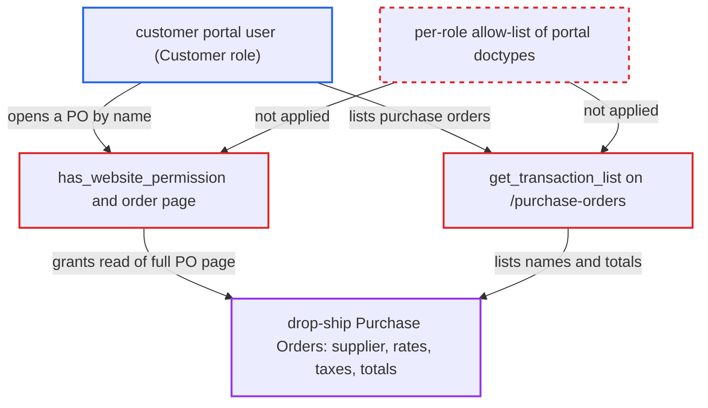

# Customer portal users can view drop-ship Purchase Orders with supplier and purchase rates

| Field | Value |
|---|---|
| ID | `find_01S1GTpnczz9nUpcV9L23zgQ` |
| Severity | **Low** |
| Status | open |
| CWE | CWE-863 — Incorrect Authorization |
| Created | 2026-10-27T21:29:34.213471Z |
| Claude Security | https://claude.ai/security/findings/find_01S1GTpnczz9nUpcV9L23zgQ |

## Description

A customer's portal user can read Purchase Orders that belong to the buying side, including the supplier name, purchase rates, taxes and totals. This applies only to drop-ship Purchase Orders that carry that customer, and it is read-only. The cause is `get_customers_suppliers()`, which treats any doctype with a `customer` field as customer-visible, so `has_website_permission()` and `get_transaction_list()` let Customer-role users in.

1. **Sales Order mapper `make_purchase_order`** keeps the customer on a Purchase Order that has drop-ship items. The `customer` field is kept when any item is `delivered_by_supplier` and cleared otherwise, so only drop-ship Purchase Orders carry the customer. ([`erpnext/selling/doctype/sales_order/mapper.py:807-822`](https://github.com/cx-benchmark/erpnext/blob/90e7aefca73da3c440d2e8da7472fcb67838e678/erpnext/selling/doctype/sales_order/mapper.py#L807-L822))
2. **the helper `get_customers_suppliers()`** treats Purchase Order as a customer document. It decides this only because the doctype has a `customer` field, and there is no list of which doctypes each portal role may see. ([`erpnext/controllers/website_list_for_contact.py:263-282`](https://github.com/cx-benchmark/erpnext/blob/90e7aefca73da3c440d2e8da7472fcb67838e678/erpnext/controllers/website_list_for_contact.py#L263-L282))
3. **customer portal user** opens `/purchase-orders` or `/purchase-orders/<name>`. Both routes are open to any logged-in portal user, and Purchase Order names are sequential, so they can be guessed. ([`erpnext/hooks.py:193-209`](https://github.com/cx-benchmark/erpnext/blob/90e7aefca73da3c440d2e8da7472fcb67838e678/erpnext/hooks.py#L193-L209))
4. **the list code `get_transaction_list()`** returns drop-ship Purchase Orders for the user's customers with permission checks off. For a Customer-role website user it filters on `customer in customers` and sets `ignore_permissions = True`, so the list shows names, statuses and grand totals. ([`erpnext/controllers/website_list_for_contact.py:112-128`](https://github.com/cx-benchmark/erpnext/blob/90e7aefca73da3c440d2e8da7472fcb67838e678/erpnext/controllers/website_list_for_contact.py#L112-L128))
5. **the hook `has_website_permission()`** returns True for the Purchase Order. For a user with the `Customer` role it returns True when the Purchase Order's `customer` is one of the user's portal customers. This includes draft and cancelled documents, because it has no docstatus check. ([`erpnext/controllers/website_list_for_contact.py:296-311`](https://github.com/cx-benchmark/erpnext/blob/90e7aefca73da3c440d2e8da7472fcb67838e678/erpnext/controllers/website_list_for_contact.py#L296-L311))
6. **the page `order.py`** admits the viewer and renders the order page. A portal customer has no desk read role on Purchase Order, so the website hook alone decides. The page `order.html` then shows the supplier name, each item's purchase `rate` and `amount`, and the taxes and net total. ([`erpnext/templates/pages/order.py:36-37`](https://github.com/cx-benchmark/erpnext/blob/90e7aefca73da3c440d2e8da7472fcb67838e678/erpnext/templates/pages/order.py#L36-L37))

## Assessment

The attacker is a customer's portal user: a Website User with the `Customer` role and a `Portal User` row on that Customer. They log in and open `/purchase-orders` to list drop-ship Purchase Orders, or open `/purchase-orders/<name>` directly. It also needs a drop-ship Purchase Order that carries their customer. The vendor raises that at runtime, and the attacker cannot cause it. The `/printview` path is an additional route, but it assumes Frappe's print-permission check accepts `has_website_permission`. The finding also relies on Frappe dispatching `frappe.has_website_permission` to the `hooks.py` entry for the doctype. Frappe's source is not in the checkout.

Impact: The attacker can read the supplier identity, purchase rates and amounts, taxes, net total and grand total of every Purchase Order that carries their customer. Draft and cancelled ones are included. From this they can work out the vendor's margin against their own Sales Order. Access is read-only and limited to those documents.

## Recommendation

Portal visibility is inferred from whether a doctype has a `customer` field (`meta.has_field("customer")`) in `get_customers_suppliers`, not from which documents each portal role may see. A Purchase Order therefore becomes readable by Customer-role users through its drop-ship `customer` link, in both `has_website_permission` and `get_transaction_list`.

Fix criteria: A Customer-role portal user cannot list, open or print a Purchase Order, or any other buying document, whatever its `customer` field holds. Purchase Order portal access is granted only through the `supplier` linkage of a Supplier portal user. To verify, log in as a Customer portal user linked to the drop-ship customer. They get an empty list at `/purchase-orders`. They get `Not Permitted` at `/purchase-orders/<drop-ship PO>` and at `/printview?doctype=Purchase Order&name=<drop-ship PO>`. The PO's Supplier portal user still sees it.

## Evidence

**https://github.com/cx-benchmark/erpnext**

- [`erpnext/controllers/website_list_for_contact.py:263-282`](https://github.com/cx-benchmark/erpnext/blob/90e7aefca73da3c440d2e8da7472fcb67838e678/erpnext/controllers/website_list_for_contact.py#L263-L282)
- [`erpnext/controllers/website_list_for_contact.py:296-311`](https://github.com/cx-benchmark/erpnext/blob/90e7aefca73da3c440d2e8da7472fcb67838e678/erpnext/controllers/website_list_for_contact.py#L296-L311)
- [`erpnext/templates/pages/order.py:36-37`](https://github.com/cx-benchmark/erpnext/blob/90e7aefca73da3c440d2e8da7472fcb67838e678/erpnext/templates/pages/order.py#L36-L37)
- [`erpnext/hooks.py:381`](https://github.com/cx-benchmark/erpnext/blob/90e7aefca73da3c440d2e8da7472fcb67838e678/erpnext/hooks.py#L381)
- [`erpnext/hooks.py:193-209`](https://github.com/cx-benchmark/erpnext/blob/90e7aefca73da3c440d2e8da7472fcb67838e678/erpnext/hooks.py#L193-L209)
- [`erpnext/hooks.py:293-298`](https://github.com/cx-benchmark/erpnext/blob/90e7aefca73da3c440d2e8da7472fcb67838e678/erpnext/hooks.py#L293-L298)
- [`erpnext/controllers/website_list_for_contact.py:112-128`](https://github.com/cx-benchmark/erpnext/blob/90e7aefca73da3c440d2e8da7472fcb67838e678/erpnext/controllers/website_list_for_contact.py#L112-L128)
- [`erpnext/buying/doctype/purchase_order/purchase_order.json:289-294`](https://github.com/cx-benchmark/erpnext/blob/90e7aefca73da3c440d2e8da7472fcb67838e678/erpnext/buying/doctype/purchase_order/purchase_order.json#L289-L294)
- [`erpnext/selling/doctype/sales_order/mapper.py:807-822`](https://github.com/cx-benchmark/erpnext/blob/90e7aefca73da3c440d2e8da7472fcb67838e678/erpnext/selling/doctype/sales_order/mapper.py#L807-L822)
- [`erpnext/templates/pages/order.html:75-122`](https://github.com/cx-benchmark/erpnext/blob/90e7aefca73da3c440d2e8da7472fcb67838e678/erpnext/templates/pages/order.html#L75-L122)

