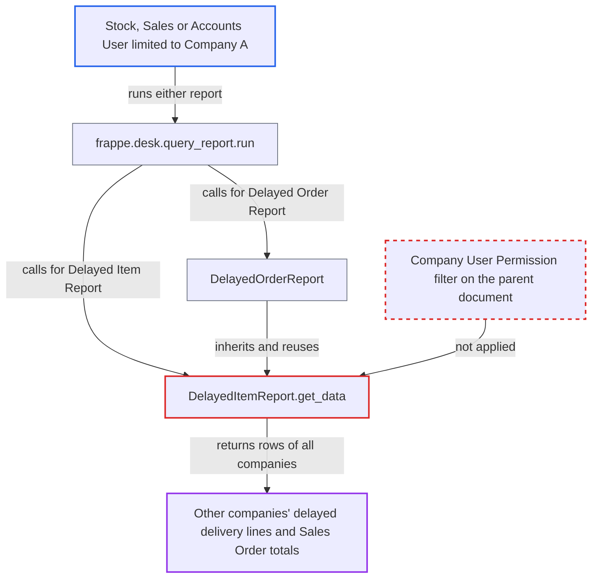

# Delayed Item and Delayed Order reports ignore Company user permissions

| Field | Value |
|---|---|
| ID | `find_015AaxHJEhpPnAy58RYWJevp` |
| Severity | **Low** |
| Status | open |
| CWE | CWE-862 — Missing authorization |
| Created | 2026-10-27T21:52:00.922859Z |
| Claude Security | https://claude.ai/security/findings/find_015AaxHJEhpPnAy58RYWJevp |

## Description

A logged-in Stock User, Sales User or Accounts User limited to one company can read delayed delivery data of other companies. The leak is read-only. It needs a multi-company site that uses Company User Permissions. `DelayedItemReport.get_data`, which `DelayedOrderReport` inherits, applies no permission conditions and only uses the caller's optional `company` filter.

1. **attacker** calls `frappe.desk.query_report.run` for `Delayed Item Report` or `Delayed Order Report`. The attacker sets `based_on` to `Delivery Note`, a wide date range, and either no `company` or `company` set to Company B. ([`erpnext/stock/report/delayed_item_report/delayed_item_report.json:17-36`](https://github.com/cx-benchmark/erpnext/blob/90e7aefca73da3c440d2e8da7472fcb67838e678/erpnext/stock/report/delayed_item_report/delayed_item_report.json#L17-L36))
2. **the method `get_data`** builds a raw `frappe.qb` join of the delivery documents and their item rows. The only company limit is the caller's optional `company` filter, which is never compared with the companies the user may access, and no permission conditions are added. ([`erpnext/stock/report/delayed_item_report/delayed_item_report.py:24-84`](https://github.com/cx-benchmark/erpnext/blob/90e7aefca73da3c440d2e8da7472fcb67838e678/erpnext/stock/report/delayed_item_report/delayed_item_report.py#L24-L84))
3. **the report runner** keeps every returned row. It filters rows only by User Permissions on Link columns, and the output has no Company column to match, so other companies' rows are not dropped. ([`erpnext/stock/report/delayed_item_report/delayed_item_report.py:117-174`](https://github.com/cx-benchmark/erpnext/blob/90e7aefca73da3c440d2e8da7472fcb67838e678/erpnext/stock/report/delayed_item_report/delayed_item_report.py#L117-L174))
4. **`DelayedOrderReport`** calls the same `get_data` and adds each Sales Order's `grand_total`. It reads the totals with `frappe.get_all('Sales Order')`, which ignores permissions, so the order report has the same gap. ([`erpnext/stock/report/delayed_order_report/delayed_order_report.py:20-47`](https://github.com/cx-benchmark/erpnext/blob/90e7aefca73da3c440d2e8da7472fcb67838e678/erpnext/stock/report/delayed_order_report/delayed_order_report.py#L20-L47))

## Assessment

The attacker is an authenticated Stock User, Sales User or Accounts User whose Company User Permission limits them to Company A. They need the `report` permission on `Delivery Note`, which these roles have. The site must be multi-company and use Company User Permissions. The attacker calls `frappe.desk.query_report.run` for `Delayed Item Report` or `Delayed Order Report` with `based_on` set to `Delivery Note`, a wide date range, and no `company` or `company` set to Company B. The report script is the same either way, since `DelayedOrderReport` inherits `get_data`.

Impact: The attacker reads other companies' delivered line items: customer, item, quantity, unit rate, amount, customer PO number and dates. The order variant also gives Sales Order `grand_total`. This covers only deliveries made after the Sales Order's expected date in the chosen range. Customer and Item User Permissions still apply. Nothing is modified and availability is unaffected.

## Recommendation

`DelayedItemReport.get_data`, which `DelayedOrderReport` inherits, trusts the caller's optional `company` filter and applies none of the user's permission conditions on the parent document. Its output has no Company column the report runner could use to drop other companies' rows.

Fix criteria: Both reports return only rows of `Delivery Note` or `Sales Invoice` documents the running user may read, including their Company User Permissions. This holds whether the `company` filter is omitted or names a company the user is not permitted. To verify, run each report through `frappe.desk.query_report.run` as a user with a Company User Permission for Company A, once with no company filter and once with `company` = Company B. Only Company A documents appear.

## Evidence

**https://github.com/cx-benchmark/erpnext**

- [`erpnext/stock/report/delayed_item_report/delayed_item_report.py:24-84`](https://github.com/cx-benchmark/erpnext/blob/90e7aefca73da3c440d2e8da7472fcb67838e678/erpnext/stock/report/delayed_item_report/delayed_item_report.py#L24-L84)
- [`erpnext/stock/report/delayed_item_report/delayed_item_report.py:117-174`](https://github.com/cx-benchmark/erpnext/blob/90e7aefca73da3c440d2e8da7472fcb67838e678/erpnext/stock/report/delayed_item_report/delayed_item_report.py#L117-L174)
- [`erpnext/stock/report/delayed_order_report/delayed_order_report.py:20-47`](https://github.com/cx-benchmark/erpnext/blob/90e7aefca73da3c440d2e8da7472fcb67838e678/erpnext/stock/report/delayed_order_report/delayed_order_report.py#L20-L47)
- [`erpnext/stock/report/delayed_item_report/delayed_item_report.json:17-36`](https://github.com/cx-benchmark/erpnext/blob/90e7aefca73da3c440d2e8da7472fcb67838e678/erpnext/stock/report/delayed_item_report/delayed_item_report.json#L17-L36)
- [`erpnext/stock/doctype/delivery_note/delivery_note.json:238-246`](https://github.com/cx-benchmark/erpnext/blob/90e7aefca73da3c440d2e8da7472fcb67838e678/erpnext/stock/doctype/delivery_note/delivery_note.json#L238-L246)
- [`erpnext/selling/report/sales_partner_commission_summary/sales_partner_commission_summary.py:125-127`](https://github.com/cx-benchmark/erpnext/blob/90e7aefca73da3c440d2e8da7472fcb67838e678/erpnext/selling/report/sales_partner_commission_summary/sales_partner_commission_summary.py#L125-L127)

