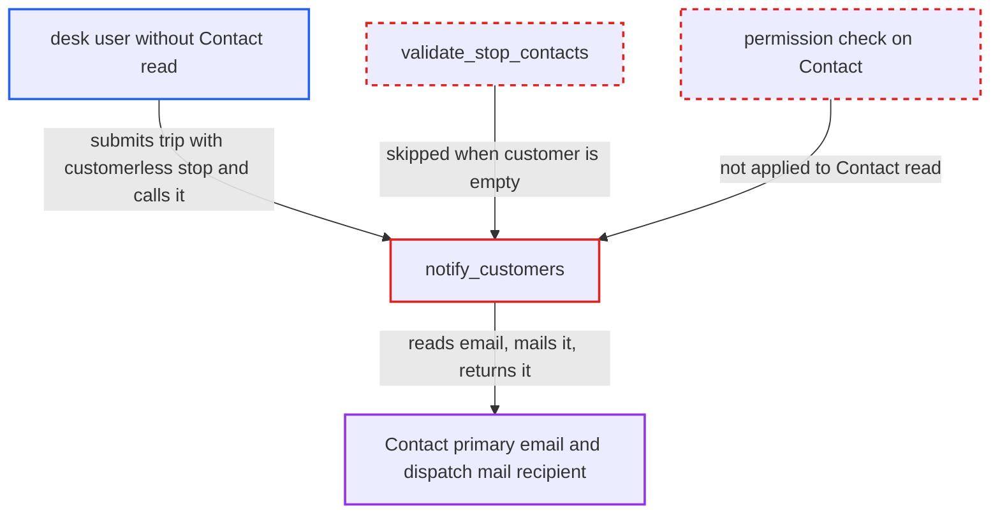

# Delivery Trip notify_customers mails and discloses any Contact named on a customerless stop

| Field | Value |
|---|---|
| ID | `find_01Pesgr8SV5cMDJun9YCYWuG` |
| Severity | **Low** |
| Status | open |
| CWE | CWE-862 — Missing authorization |
| Created | 2026-10-27T22:06:51.648816Z |
| Claude Security | https://claude.ai/security/findings/find_01Pesgr8SV5cMDJun9YCYWuG |

## Description

A low-privilege desk user (Stock, Fulfillment or Delivery User, or Delivery Manager) without Contact read can learn the primary email of any Contact they can name. The site also mails that contact a dispatch email. The attacker needs the Contact's name and an outgoing Email Account on the site. The cause is `notify_customers`, which reads the stop's Contact with no permission check. `validate_stop_contacts` skips stops with an empty `customer`.

1. **attacker (desk user)** creates a Delivery Trip through `/api/resource/Delivery Trip` with a stop naming a victim Contact and a blank customer. `customer` is an optional link, and the REST API skips the desk form's Contact picker filter, so any existing Contact name is accepted. ([`erpnext/stock/doctype/delivery_stop/delivery_stop.json:34-41`](https://github.com/cx-benchmark/erpnext/blob/90e7aefca73da3c440d2e8da7472fcb67838e678/erpnext/stock/doctype/delivery_stop/delivery_stop.json#L34-L41))
2. **`validate_stop_contacts`** skips the stop when the trip is saved. It only checks stops where both `contact` and `customer` are set, so a Contact on a customerless stop is never tied to anything. ([`erpnext/stock/doctype/delivery_trip/delivery_trip.py:95-117`](https://github.com/cx-benchmark/erpnext/blob/90e7aefca73da3c440d2e8da7472fcb67838e678/erpnext/stock/doctype/delivery_trip/delivery_trip.py#L95-L117))
3. **attacker** submits the trip and POSTs `notify_customers`. The method only needs read on the Delivery Trip and `docstatus == 1`, and the attacker's own trip meets both. ([`erpnext/stock/doctype/delivery_trip/delivery_trip.py:528-534`](https://github.com/cx-benchmark/erpnext/blob/90e7aefca73da3c440d2e8da7472fcb67838e678/erpnext/stock/doctype/delivery_trip/delivery_trip.py#L528-L534))
4. **`notify_customers`** reads the Contact's `first_name`, `last_name` and `email_id` and mails the dispatch template to that address. It uses `frappe.db.get_value`, which checks no permission, so the caller's lack of Contact read is ignored. ([`erpnext/stock/doctype/delivery_trip/delivery_trip.py:547-574`](https://github.com/cx-benchmark/erpnext/blob/90e7aefca73da3c440d2e8da7472fcb67838e678/erpnext/stock/doctype/delivery_trip/delivery_trip.py#L547-L574))
5. **`notify_customers`** stores the address in the stop's `email_sent_to` and returns all recipients in a `frappe.msgprint`. The attacker can read both the response and their own trip row, so the email is disclosed to them. ([`erpnext/stock/doctype/delivery_trip/delivery_trip.py:547-574`](https://github.com/cx-benchmark/erpnext/blob/90e7aefca73da3c440d2e8da7472fcb67838e678/erpnext/stock/doctype/delivery_trip/delivery_trip.py#L547-L574))

## Assessment

The attacker is a desk user with Stock, Fulfillment or Delivery User, or Delivery Manager, and holds no Contact read. They must know or guess the Contact's name, since nothing here lists Contacts, but Contact names derive from the person's name. The site needs an outgoing Email Account, because without one `frappe.sendmail` raises and nothing is disclosed. The dispatch template ships configured on a standard site. No victim action is needed. Contacts, such as suppliers, leads and users, are exposed even though no Customer the attacker may select would show them. The report assumes `frappe.db.get_value` checks no permission and that link validation only checks that the Contact exists. Frappe's source is not in the checkout.

Impact: The attacker learns the primary email of any Contact they can name, one per stop, and confirms it exists. They can also make the company's mail account send a branded dispatch email to contacts outside the stop's customer. The email carries the driver's name and cell number, the vehicle and attacker-chosen stop text such as `customer_address`. Other Contact fields stay hidden, only the attacker's own trip is modified, and there is no availability impact. Emails already visible on documents the user can read, such as `contact_email` on Purchase Receipts or Delivery Notes, are not a new disclosure.

## Recommendation

`validate_stop_contacts` checks the Contact–Customer link only when `customer` is set. `notify_customers` reads and mails any stop Contact without checking that the caller may see it. A stop can therefore carry, and disclose, a Contact the user may not read.

Fix criteria: A stop's Contact is accepted on save, and mailed by `notify_customers`, only if it is linked to the stop's Customer and the user may select that Customer, or the user holds Contact read. A Contact on a stop with no Customer is refused unless the user can read it. Verify as a Delivery User without Contact read: saving or submitting a trip whose stop names an unrelated Contact with a blank customer fails, or `notify_customers` neither mails it nor returns or stores its email. A trip naming the stop customer's own contact is still mailed.

## Evidence

**https://github.com/cx-benchmark/erpnext**

- [`erpnext/stock/doctype/delivery_trip/delivery_trip.py:547-574`](https://github.com/cx-benchmark/erpnext/blob/90e7aefca73da3c440d2e8da7472fcb67838e678/erpnext/stock/doctype/delivery_trip/delivery_trip.py#L547-L574)
- [`erpnext/stock/doctype/delivery_trip/delivery_trip.py:95-117`](https://github.com/cx-benchmark/erpnext/blob/90e7aefca73da3c440d2e8da7472fcb67838e678/erpnext/stock/doctype/delivery_trip/delivery_trip.py#L95-L117)
- [`erpnext/stock/doctype/delivery_trip/delivery_trip.py:528-534`](https://github.com/cx-benchmark/erpnext/blob/90e7aefca73da3c440d2e8da7472fcb67838e678/erpnext/stock/doctype/delivery_trip/delivery_trip.py#L528-L534)
- [`erpnext/stock/doctype/delivery_stop/delivery_stop.json:34-41`](https://github.com/cx-benchmark/erpnext/blob/90e7aefca73da3c440d2e8da7472fcb67838e678/erpnext/stock/doctype/delivery_stop/delivery_stop.json#L34-L41)
- [`erpnext/stock/doctype/delivery_trip/delivery_trip.json:200-261`](https://github.com/cx-benchmark/erpnext/blob/90e7aefca73da3c440d2e8da7472fcb67838e678/erpnext/stock/doctype/delivery_trip/delivery_trip.json#L200-L261)
- [`erpnext/stock/doctype/delivery_trip/delivery_trip.py:473-476`](https://github.com/cx-benchmark/erpnext/blob/90e7aefca73da3c440d2e8da7472fcb67838e678/erpnext/stock/doctype/delivery_trip/delivery_trip.py#L473-L476)
- [`erpnext/stock/doctype/delivery_trip/test_delivery_trip.py:430-442`](https://github.com/cx-benchmark/erpnext/blob/90e7aefca73da3c440d2e8da7472fcb67838e678/erpnext/stock/doctype/delivery_trip/test_delivery_trip.py#L430-L442)
- [`erpnext/setup/setup_wizard/operations/install_fixtures.py:343-354`](https://github.com/cx-benchmark/erpnext/blob/90e7aefca73da3c440d2e8da7472fcb67838e678/erpnext/setup/setup_wizard/operations/install_fixtures.py#L343-L354)

