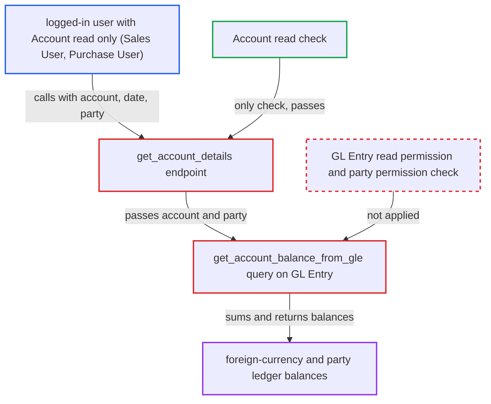

# Exchange Rate Revaluation get_account_details returns GL balances with only Account permission

| Field | Value |
|---|---|
| ID | `find_01U7DJg4S6CbNYGmYgL5eYWA` |
| Severity | **Low** |
| Status | open |
| CWE | CWE-862 — Missing Authorization |
| Created | 2026-10-27T22:03:40.218176Z |
| Claude Security | https://claude.ai/security/findings/find_01U7DJg4S6CbNYGmYgL5eYWA |

## Description

A logged-in user with read access to Account but not to GL Entry, such as a Sales User or Purchase User, can read ledger balances they are not meant to see. These include foreign-currency account balances and per-party sub-ledger balances at any date. The whitelisted `get_account_details` accepts Account read as enough permission. It then sums GL Entry data with no GL Entry permission check and no check on the named party.

1. **logged-in user** posts to the `get_account_details` API method. The user has Account read, for example as a Sales User or Purchase User, but no GL Entry read. They send `company`, any `posting_date` and a foreign-currency `account`, and for receivable or payable accounts also any `party_type` and `party`.
2. **the handler `get_account_details`** checks only Account permission. The one authorisation is `frappe.has_permission("Account", doc=account, throw=True)`. The Exchange Rate Revaluation doctype roles do not apply to this module-level function, and the `party_type` and `party` values go through unchecked. ([`erpnext/accounts/doctype/exchange_rate_revaluation/exchange_rate_revaluation.py:697-751`](https://github.com/cx-benchmark/erpnext/blob/90e7aefca73da3c440d2e8da7472fcb67838e678/erpnext/accounts/doctype/exchange_rate_revaluation/exchange_rate_revaluation.py#L697-L751))
3. **the helper `get_account_balance_from_gle`** sums GL Entry debit and credit with `frappe.qb`. The query is filtered only by account, `posting_date`, `is_cancelled` and the caller's party. A HAVING clause keeps only groups whose base and account-currency balances differ. No role check or user-permission condition is applied to GL Entry. ([`erpnext/accounts/doctype/exchange_rate_revaluation/exchange_rate_revaluation.py:187-277`](https://github.com/cx-benchmark/erpnext/blob/90e7aefca73da3c440d2e8da7472fcb67838e678/erpnext/accounts/doctype/exchange_rate_revaluation/exchange_rate_revaluation.py#L187-L277))
4. **the handler `get_account_details`** returns the balances to the caller. The response contains `balance_in_base_currency`, `balance_in_account_currency`, `current_exchange_rate`, the revalued balance and `gain_loss`. ([`erpnext/accounts/doctype/exchange_rate_revaluation/exchange_rate_revaluation.py:697-751`](https://github.com/cx-benchmark/erpnext/blob/90e7aefca73da3c440d2e8da7472fcb67838e678/erpnext/accounts/doctype/exchange_rate_revaluation/exchange_rate_revaluation.py#L697-L751))

## Assessment

The attacker is a logged-in desk user with Account read but no GL Entry read, such as a Sales User or Purchase User. No user interaction is needed. They call `/api/method/erpnext.accounts.doctype.exchange_rate_revaluation.exchange_rate_revaluation.get_account_details` with `company`, any `posting_date` and a foreign-currency `account`. For receivable or payable accounts they also send any `party_type` and `party`. The leak only yields data where the company keeps foreign-currency accounts, which is not the default setup. The report assumes that `frappe.has_permission` on an Account checks only that doctype's role permission and User Permissions.

Impact: The attacker reads aggregated ledger balances, in base and account currency and at any date, for foreign-currency accounts and for party sub-ledgers on them. Examples are a USD bank account's balance, or a supplier's sub-ledger on a USD Creditors account. Individual GL rows are not returned and nothing is modified. Company User Permissions still limit which accounts can be reached.

## Recommendation

`get_account_details` treats Account read as enough before returning GL Entry aggregates from `get_account_balance_from_gle`. That helper uses the query builder, which applies no permissions. The caller's `party_type` and `party` are passed through with no permission check.

Fix criteria: The endpoint requires GL Entry read and applies the caller's GL Entry user-permission conditions. It also checks read permission on the named party before aggregating. Alternatively, it is restricted to callers with Exchange Rate Revaluation read. Calling it as a Sales User with a foreign-currency account, and with a Supplier party, is refused. An Accounts User still receives the balances.

## Evidence

**https://github.com/cx-benchmark/erpnext**

- [`erpnext/accounts/doctype/exchange_rate_revaluation/exchange_rate_revaluation.py:697-751`](https://github.com/cx-benchmark/erpnext/blob/90e7aefca73da3c440d2e8da7472fcb67838e678/erpnext/accounts/doctype/exchange_rate_revaluation/exchange_rate_revaluation.py#L697-L751)
- [`erpnext/accounts/doctype/exchange_rate_revaluation/exchange_rate_revaluation.py:187-277`](https://github.com/cx-benchmark/erpnext/blob/90e7aefca73da3c440d2e8da7472fcb67838e678/erpnext/accounts/doctype/exchange_rate_revaluation/exchange_rate_revaluation.py#L187-L277)
- [`erpnext/accounts/doctype/account/account.json:218-254`](https://github.com/cx-benchmark/erpnext/blob/90e7aefca73da3c440d2e8da7472fcb67838e678/erpnext/accounts/doctype/account/account.json#L218-L254)
- [`erpnext/accounts/doctype/gl_entry/gl_entry.json:390-413`](https://github.com/cx-benchmark/erpnext/blob/90e7aefca73da3c440d2e8da7472fcb67838e678/erpnext/accounts/doctype/gl_entry/gl_entry.json#L390-L413)
- [`erpnext/accounts/doctype/exchange_rate_revaluation/exchange_rate_revaluation.json:121-167`](https://github.com/cx-benchmark/erpnext/blob/90e7aefca73da3c440d2e8da7472fcb67838e678/erpnext/accounts/doctype/exchange_rate_revaluation/exchange_rate_revaluation.json#L121-L167)

