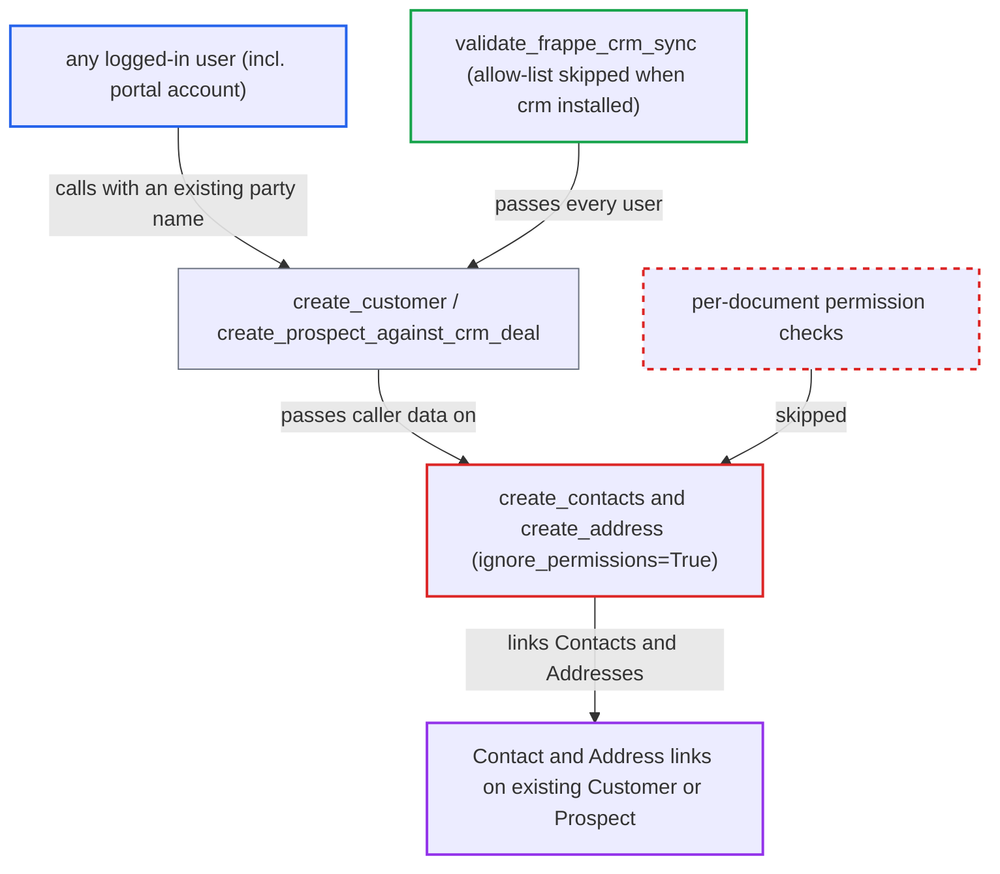

# Frappe CRM sync endpoints let any user link Contacts and Addresses to parties without permission

| Field | Value |
|---|---|
| ID | `find_01FLGn2gkkiL38g7QEeYvg34` |
| Severity | **Low** |
| Status | open |
| CWE | CWE-862 — Missing authorization |
| Created | 2026-10-27T21:12:07.394975Z |
| Claude Security | https://claude.ai/security/findings/find_01FLGn2gkkiL38g7QEeYvg34 |

## Description

Any logged-in user, including a portal (Website User) account, can attach Contacts and Addresses to any existing Customer or Prospect without the needed permissions. This works on a site with the `crm` app installed and `enable_frappe_crm_data_synchronization` on. The helpers `create_contacts()` and `create_address()` save with `ignore_permissions=True`, while the gate `validate_frappe_crm_sync()` lets every user through. Impact is limited to integrity.

1. **attacker** logs in as any authenticated user and calls `create_customer`. The call names an existing `customer_name`, a `contacts` list with an email, and an `address` with the `name` of an existing Address. ([`erpnext/crm/frappe_crm_api.py:142-179`](https://github.com/cx-benchmark/erpnext/blob/90e7aefca73da3c440d2e8da7472fcb67838e678/erpnext/crm/frappe_crm_api.py#L142-L179))
2. **`validate_frappe_crm_sync()`** lets the call through. When the `crm` app is installed it returns before the `allowed_users` check, so every session passes once `enable_frappe_crm_data_synchronization` is on. ([`erpnext/crm/frappe_crm_api.py:182-201`](https://github.com/cx-benchmark/erpnext/blob/90e7aefca73da3c440d2e8da7472fcb67838e678/erpnext/crm/frappe_crm_api.py#L182-L201))
3. **`create_customer()`** finds the existing Customer and skips the permission-checked insert. Because the Customer already exists, the code that checks the caller's permissions never runs, and the call goes on to `create_contacts` and `create_address`. ([`erpnext/crm/frappe_crm_api.py:142-179`](https://github.com/cx-benchmark/erpnext/blob/90e7aefca73da3c440d2e8da7472fcb67838e678/erpnext/crm/frappe_crm_api.py#L142-L179))
4. **`create_contacts()`** creates a Contact or loads an existing one by `email`/`mobile_no`, links it to the Customer and saves it. The save uses `contact.save(ignore_permissions=True)`, so the caller's rights on Contact and Customer are never checked. ([`erpnext/crm/frappe_crm_api.py:44-68`](https://github.com/cx-benchmark/erpnext/blob/90e7aefca73da3c440d2e8da7472fcb67838e678/erpnext/crm/frappe_crm_api.py#L44-L68))
5. **`create_address()`** loads the named existing Address, links it to the party and saves it. The save uses `ignore_permissions=True`, so the caller needs no permission on Address. ([`erpnext/crm/frappe_crm_api.py:71-101`](https://github.com/cx-benchmark/erpnext/blob/90e7aefca73da3c440d2e8da7472fcb67838e678/erpnext/crm/frappe_crm_api.py#L71-L101))

## Assessment

The attacker is any authenticated user, including a portal Customer or Supplier account. The site needs `enable_frappe_crm_data_synchronization` turned on and the `crm` app installed. The attacker sends `POST /api/method/erpnext.crm.frappe_crm_api.create_customer` with an existing `customer_name`, a `contacts` list and an `address` naming an existing Address. `create_prospect_against_crm_deal` is a second way in: it finds an existing Prospect by `organization`/`lead_name` and links the supplied contacts and address the same way. No victim action is needed. Separately, both endpoints omit `methods=["POST"]`, so they also accept GET, which Frappe does not protect with a CSRF token. On a site without the `crm` app, a victim who is in `allowed_users` can be tricked by a crafted link into creating Customers with `ignore_permissions=True`.

Impact: The attacker can create Contacts, or re-link existing Contacts found by email or phone, and attach existing Addresses to any Customer or Prospect, bypassing the role and user-permission rules. Attacker-supplied email or phone can become a Customer's contact data. `erpnext.portal.utils.set_default_role` grants the Customer or Supplier role to a User whose email matches such a Contact. Only the fields the helpers copy can be set and nothing is read back, so the integrity loss is limited.

## Recommendation

(1) `create_contacts()` and `create_address()` save Contact and Address documents with `ignore_permissions=True` for every caller. `validate_frappe_crm_sync()` admits any authenticated user when the CRM app is installed, so linking escapes the permission model the Customer insert relies on.

Fix criteria: A caller without write permission on the target Customer or Prospect, or without create/write on Contact and Address, cannot create, change or link Contact or Address records through these endpoints. Any permission bypass that stays applies only to sessions that passed the explicit `allowed_users` allow-list. To verify, call `create_customer` and `create_prospect_against_crm_deal` as a user with no CRM permissions, and as a Website User, on a CRM-installed site. Confirm a PermissionError and no new or changed Contact or Address rows.

(2) Both endpoints are whitelisted without `methods=["POST"]`, so state-changing calls are accepted over GET, which Frappe does not cover with CSRF validation.

Fix criteria: The endpoints accept only POST, or another CSRF-protected method. A GET request to either URL is rejected before any document is created.

## Evidence

**https://github.com/cx-benchmark/erpnext**

- [`erpnext/crm/frappe_crm_api.py:44-68`](https://github.com/cx-benchmark/erpnext/blob/90e7aefca73da3c440d2e8da7472fcb67838e678/erpnext/crm/frappe_crm_api.py#L44-L68)
- [`erpnext/crm/frappe_crm_api.py:182-201`](https://github.com/cx-benchmark/erpnext/blob/90e7aefca73da3c440d2e8da7472fcb67838e678/erpnext/crm/frappe_crm_api.py#L182-L201)
- [`erpnext/crm/frappe_crm_api.py:142-179`](https://github.com/cx-benchmark/erpnext/blob/90e7aefca73da3c440d2e8da7472fcb67838e678/erpnext/crm/frappe_crm_api.py#L142-L179)
- [`erpnext/crm/frappe_crm_api.py:71-101`](https://github.com/cx-benchmark/erpnext/blob/90e7aefca73da3c440d2e8da7472fcb67838e678/erpnext/crm/frappe_crm_api.py#L71-L101)
- [`erpnext/crm/frappe_crm_api.py:8-41`](https://github.com/cx-benchmark/erpnext/blob/90e7aefca73da3c440d2e8da7472fcb67838e678/erpnext/crm/frappe_crm_api.py#L8-L41)
- [`erpnext/crm/doctype/crm_settings/crm_settings.py:58-67`](https://github.com/cx-benchmark/erpnext/blob/90e7aefca73da3c440d2e8da7472fcb67838e678/erpnext/crm/doctype/crm_settings/crm_settings.py#L58-L67)

