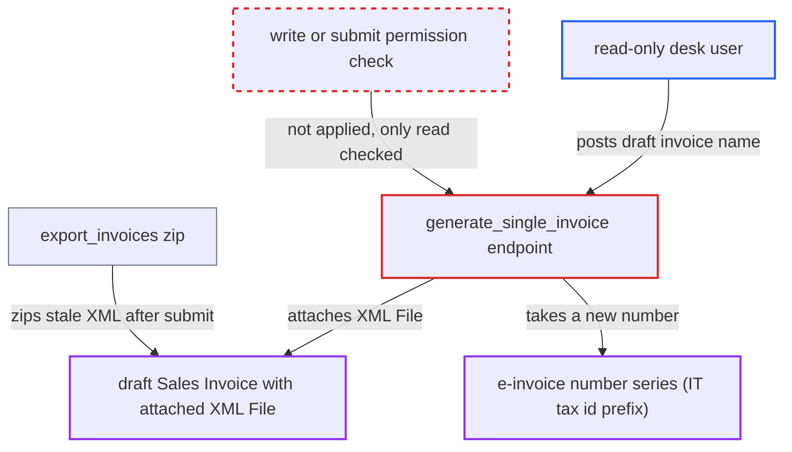

# generate_single_invoice lets read-only users attach e-invoice XML to draft invoices

| Field | Value |
|---|---|
| ID | `find_01RrRdibtw5R2xg3oUKxnH8P` |
| Severity | **Low** |
| Status | open |
| CWE | CWE-863 — Incorrect Authorization |
| Created | 2026-10-27T21:24:26.775818Z |
| Claude Security | https://claude.ai/security/findings/find_01RrRdibtw5R2xg3oUKxnH8P |

## Description

A user who can only read a draft Sales Invoice can still attach an e-invoice XML file to it and use up a number from the fiscal transmission series. When the draft is later submitted and exported, the export contains this stale XML next to the real one. The whitelisted `generate_single_invoice` checks only read permission, then runs a write operation, and it does not check the invoice state.

1. **read-only desk user** posts a draft Sales Invoice name to `generate_single_invoice`. The request goes to `/api/method/erpnext.regional.italy.utils.generate_single_invoice` with `docname`, and the user needs no write or submit permission. ([`erpnext/regional/italy/utils.py:378-384`](https://github.com/cx-benchmark/erpnext/blob/90e7aefca73da3c440d2e8da7472fcb67838e678/erpnext/regional/italy/utils.py#L378-L384))
2. **the endpoint `generate_single_invoice`** passes the read-only permission check and calls `prepare_and_attach_invoice(doc, True)`. `frappe.has_permission` is called without a write permission type, so it checks only read. The endpoint also does not check `docstatus`, opening invoices or the company's country. ([`erpnext/regional/italy/utils.py:378-384`](https://github.com/cx-benchmark/erpnext/blob/90e7aefca73da3c440d2e8da7472fcb67838e678/erpnext/regional/italy/utils.py#L378-L384))
3. **`get_progressive_name_and_number`** takes a new number from the `IT<tax_id>_.#####` series. A draft has no XML yet, so the replace path, which reuses the existing number, does not apply. A new number is drawn with `make_autoname` and the series moves forward. ([`erpnext/regional/italy/utils.py:463-474`](https://github.com/cx-benchmark/erpnext/blob/90e7aefca73da3c440d2e8da7472fcb67838e678/erpnext/regional/italy/utils.py#L463-L474))
4. **`prepare_and_attach_invoice`** renders the e-invoice and saves it as a private `File` attached to the draft. The `File` is owned by the caller. Frappe lets ordinary desk users create a `File` and does not check write permission on the parent invoice here. ([`erpnext/regional/italy/utils.py:348-375`](https://github.com/cx-benchmark/erpnext/blob/90e7aefca73da3c440d2e8da7472fcb67838e678/erpnext/regional/italy/utils.py#L348-L375))
5. **`sales_invoice_on_submit`** attaches a second XML with a new number when the draft is submitted. The hook calls `prepare_and_attach_invoice(doc)` with `replace=False`, so it does not replace the draft-time XML. ([`erpnext/regional/italy/utils.py:321-345`](https://github.com/cx-benchmark/erpnext/blob/90e7aefca73da3c440d2e8da7472fcb67838e678/erpnext/regional/italy/utils.py#L321-L345))
6. **`export_invoices`** zips every matching XML attached to the submitted invoice. `get_e_invoice_attachments` returns every `.xml` attachment whose name starts with `IT<tax_id>`, so the stale draft-time XML ships with the real one. ([`erpnext/regional/italy/utils.py:405-436`](https://github.com/cx-benchmark/erpnext/blob/90e7aefca73da3c440d2e8da7472fcb67838e678/erpnext/regional/italy/utils.py#L405-L436))

## Assessment

The attacker is a logged-in desk user who can read, but not write, a draft Sales Invoice of an Italian company. This can come from a read-only DocShare or a custom read role. The shipped roles grant read and write together. The attacker sends one POST request to `/api/method/erpnext.regional.italy.utils.generate_single_invoice` with `docname`. No victim action is needed for the write itself. The stale XML reaches the export only when the draft is later submitted. The desk button in `italy.js` is offered only for submitted invoices, so drafts can be reached only through the API.

Impact: A user with read access only can add a File, a timeline entry and a bump of the fiscal transmission series on an invoice they cannot edit. After submission, the e-invoice export contains a stale draft-time XML next to the real one. The XML content is rendered from the invoice and the caller cannot choose it. Nothing is disclosed beyond what the reader can already see. An invoice that already has an XML from another user is protected, because `remove_file` refuses a reader there and the request rolls back.

## Recommendation

(1) The whitelisted `generate_single_invoice` creates attachments on a Sales Invoice and consumes its fiscal transmission series, but it authorizes the caller only with the default `read` permission type.

Fix criteria: Generating or regenerating an e-invoice requires write or submit permission on that specific invoice. A user who holds only read, through a role or a DocShare, gets a PermissionError from `generate_single_invoice`. No File is created and the `IT<tax_id>_` series is unchanged.

(2) The endpoint skips the state checks that the submit hook and the desk UI apply: the invoice must be submitted, not an opening invoice, and belong to an Italian company. E-invoices can therefore be made for drafts and later exported next to the real one.

Fix criteria: Only submitted, non-opening invoices of Italian companies can be e-invoiced through this endpoint. Calling it on a draft, cancelled or opening invoice is refused. A submitted invoice never ends up with two e-invoice XMLs in `export_invoices`.

## Evidence

**https://github.com/cx-benchmark/erpnext**

- [`erpnext/regional/italy/utils.py:378-384`](https://github.com/cx-benchmark/erpnext/blob/90e7aefca73da3c440d2e8da7472fcb67838e678/erpnext/regional/italy/utils.py#L378-L384)
- [`erpnext/regional/italy/utils.py:463-474`](https://github.com/cx-benchmark/erpnext/blob/90e7aefca73da3c440d2e8da7472fcb67838e678/erpnext/regional/italy/utils.py#L463-L474)
- [`erpnext/regional/italy/utils.py:348-375`](https://github.com/cx-benchmark/erpnext/blob/90e7aefca73da3c440d2e8da7472fcb67838e678/erpnext/regional/italy/utils.py#L348-L375)
- [`erpnext/regional/italy/utils.py:321-345`](https://github.com/cx-benchmark/erpnext/blob/90e7aefca73da3c440d2e8da7472fcb67838e678/erpnext/regional/italy/utils.py#L321-L345)
- [`erpnext/regional/italy/utils.py:405-436`](https://github.com/cx-benchmark/erpnext/blob/90e7aefca73da3c440d2e8da7472fcb67838e678/erpnext/regional/italy/utils.py#L405-L436)
- [`erpnext/accounts/doctype/sales_invoice/regional/italy.js:1-23`](https://github.com/cx-benchmark/erpnext/blob/90e7aefca73da3c440d2e8da7472fcb67838e678/erpnext/accounts/doctype/sales_invoice/regional/italy.js#L1-L23)

