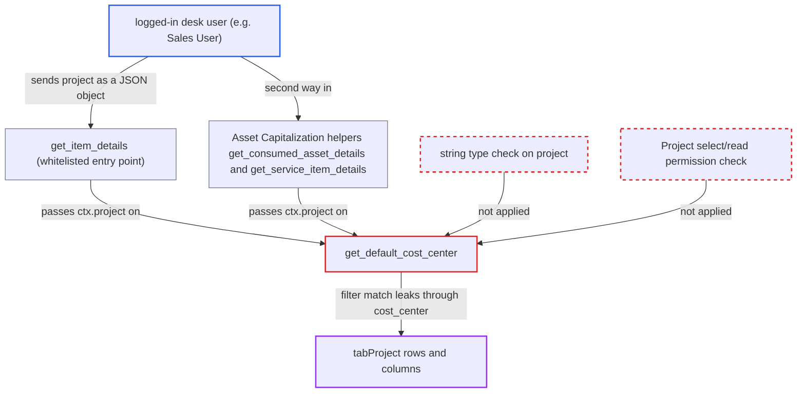

# get_item_details resolves dict `project` as filter, oracle over Project table via cost_center

| Field | Value |
|---|---|
| ID | `find_018QtT7mcMUYitwZAHHY8i3r` |
| Severity | **Low** |
| Status | open |
| CWE | CWE-639 — Improper Authorization |
| Created | 2026-10-27T22:13:40.402279Z |
| Claude Security | https://claude.ai/security/findings/find_018QtT7mcMUYitwZAHHY8i3r |

## Description

A logged-in desk user who can price transactions can learn hidden Project data across all companies, one yes/no answer per request. This includes customer, costing, sales and billing totals, margins and notes, and it bypasses Project permissions. It works only for Projects that have a cost center. `get_default_cost_center` passes the caller's `ctx.project` to `frappe.db.get_value` without checking that it is a string or that the caller may read the Project.

1. **attacker (logged-in desk user)** posts a `ctx` whose `project` is a JSON object to `get_item_details`. The `project` object holds filter conditions with operators such as `like`, `>`, `between` or `is`, for example conditions on `gross_margin` or `company`. ([`erpnext/stock/get_item_details.py:83-95`](https://github.com/cx-benchmark/erpnext/blob/90e7aefca73da3c440d2e8da7472fcb67838e678/erpnext/stock/get_item_details.py#L83-L95))
2. **the checks on `ctx`** let the object pass. `validate_pricing_context` never inspects `project`, and `normalize_ctx_input` keeps nested objects as Python dicts. ([`erpnext/accounts/doctype/pricing_rule/pricing_rule.py:766-794`](https://github.com/cx-benchmark/erpnext/blob/90e7aefca73da3c440d2e8da7472fcb67838e678/erpnext/accounts/doctype/pricing_rule/pricing_rule.py#L766-L794))
3. **`get_default_cost_center`** calls `frappe.db.get_value` with the dict as the Project name. The report assumes Frappe treats the dict as a filter set, so the first `tabProject` row matching the attacker's conditions is picked, with no string check and no Project permission check. ([`erpnext/stock/get_item_details.py:1160-1168`](https://github.com/cx-benchmark/erpnext/blob/90e7aefca73da3c440d2e8da7472fcb67838e678/erpnext/stock/get_item_details.py#L1160-L1168))
4. **`get_default_cost_center`** returns a different cost center for a match and for a miss. A match in another company gives `None`, a match in the caller's company gives that Project's cost center, and a miss falls back to the item default, the caller's own `ctx.cost_center` or the company default. ([`erpnext/stock/get_item_details.py:1197-1206`](https://github.com/cx-benchmark/erpnext/blob/90e7aefca73da3c440d2e8da7472fcb67838e678/erpnext/stock/get_item_details.py#L1197-L1206))
5. **`get_basic_details`** copies the value into `out.cost_center`. The response returns it, so the attacker sees whether the condition matched. ([`erpnext/stock/get_item_details.py:654`](https://github.com/cx-benchmark/erpnext/blob/90e7aefca73da3c440d2e8da7472fcb67838e678/erpnext/stock/get_item_details.py#L654))
6. **attacker** narrows the filter over repeated requests. Each request gives one bit, so values in columns the attacker cannot read can be extracted.

## Assessment

The attacker is a logged-in desk user, for example a Sales User. They need doctype read on one pricing doctype such as Quotation and read on one Item. Project access is only `select`. They POST to `/api/method/erpnext.stock.get_item_details.get_item_details` with a `ctx` whose `project` is an object like `{"cost_center":["is","set"],"company":"B","gross_margin":[">",50000]}`. A `cost_center` of null means a match, and the caller's own `cost_center` means no match. Another way in is the whitelisted Asset Capitalization helpers `get_consumed_asset_details` and `get_service_item_details`, which need only doctype-level Asset Capitalization read. No victim action is needed. The oracle works only for Projects with a cost center set. The attacker can add `"cost_center": ["is","set"]` to target them. The report assumes Frappe treats a dict given to `db.get_value` as filters, and Frappe is not in the checkout.

Impact: The attacker gets a blind yes/no read over every column of `tabProject` rows that have a cost center. This works across companies and bypasses Project role permissions, User Permissions and Company Restriction. The attacker also learns the matched Project's cost center directly. Only the Project table is reached, with no write effect and no availability effect.

## Recommendation

(1) `get_default_cost_center` uses the caller-supplied `ctx.project` as the Project name in `frappe.db.get_value` without requiring a string. A dict therefore acts as a filter set, and the result shows up in `cost_center`.

Fix criteria: Only a plain string `project` is looked up, and any other type is rejected or ignored before the query. Send a dict `project` through `get_item_details`, `get_consumed_asset_details` and `get_service_item_details`. Each response must be a uniform error, or the same `cost_center`, whether or not any Project matches.

(2) The Project named in a pricing or capitalization context is never authorised, so its cost center is read for Projects the caller may not select. The sanctioned `get_cost_center_name` does check this.

Fix criteria: Before a Project's data is used, the caller must pass a record-level `select` or `read` check on that Project, so User Permissions apply. A user restricted by User Permission to Project P1 must not be able to obtain P2's cost center through these endpoints.

## Evidence

**https://github.com/cx-benchmark/erpnext**

- [`erpnext/stock/get_item_details.py:1160-1168`](https://github.com/cx-benchmark/erpnext/blob/90e7aefca73da3c440d2e8da7472fcb67838e678/erpnext/stock/get_item_details.py#L1160-L1168)
- [`erpnext/stock/get_item_details.py:1197-1206`](https://github.com/cx-benchmark/erpnext/blob/90e7aefca73da3c440d2e8da7472fcb67838e678/erpnext/stock/get_item_details.py#L1197-L1206)
- [`erpnext/stock/get_item_details.py:654`](https://github.com/cx-benchmark/erpnext/blob/90e7aefca73da3c440d2e8da7472fcb67838e678/erpnext/stock/get_item_details.py#L654)
- [`erpnext/stock/get_item_details.py:83-95`](https://github.com/cx-benchmark/erpnext/blob/90e7aefca73da3c440d2e8da7472fcb67838e678/erpnext/stock/get_item_details.py#L83-L95)
- [`erpnext/accounts/doctype/pricing_rule/pricing_rule.py:766-794`](https://github.com/cx-benchmark/erpnext/blob/90e7aefca73da3c440d2e8da7472fcb67838e678/erpnext/accounts/doctype/pricing_rule/pricing_rule.py#L766-L794)
- [`erpnext/__init__.py:189-197`](https://github.com/cx-benchmark/erpnext/blob/90e7aefca73da3c440d2e8da7472fcb67838e678/erpnext/__init__.py#L189-L197)
- [`erpnext/projects/doctype/project/project.json:553-700`](https://github.com/cx-benchmark/erpnext/blob/90e7aefca73da3c440d2e8da7472fcb67838e678/erpnext/projects/doctype/project/project.json#L553-L700)
- [`erpnext/projects/doctype/project/project.py:693-696`](https://github.com/cx-benchmark/erpnext/blob/90e7aefca73da3c440d2e8da7472fcb67838e678/erpnext/projects/doctype/project/project.py#L693-L696)
- [`erpnext/assets/doctype/asset_capitalization/asset_capitalization.py:734-804`](https://github.com/cx-benchmark/erpnext/blob/90e7aefca73da3c440d2e8da7472fcb67838e678/erpnext/assets/doctype/asset_capitalization/asset_capitalization.py#L734-L804)

