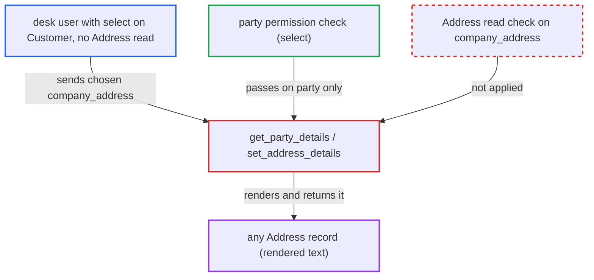

# get_party_details renders any Address without permission via company_address

| Field | Value |
|---|---|
| ID | `find_014Z7wvXe1YWWgcpoRgNcQEr` |
| Severity | **Low** |
| Status | open |
| CWE | CWE-862 — Missing authorization |
| Created | 2026-10-27T21:17:14.276589Z |
| Claude Security | https://claude.ai/security/findings/find_014Z7wvXe1YWWgcpoRgNcQEr |

## Description

A logged-in desk user who lacks Address read permission can read the full text of any Address record, one name per request. That includes street, city, state, pincode, country, phone and email. The user needs `select` or `read` on a Customer or Supplier, and a readable party with no linked address must exist. `set_address_details` renders the caller's `company_address` with `check_permissions=False`.

1. **attacker** calls the whitelisted `get_party_details` with a chosen `company_address`. The request uses `party_type=Customer`, a selectable `party` with no linked address, `doctype=Purchase Order`, any `currency`, and the target Address name as `company_address`. ([`erpnext/accounts/party.py:78-115`](https://github.com/cx-benchmark/erpnext/blob/90e7aefca73da3c440d2e8da7472fcb67838e678/erpnext/accounts/party.py#L78-L115))
2. **`get_party_details`** checks permission on the party only. `frappe.has_permission(party_type, ptype, party, throw=True)` accepts `select` on the party and never looks at the Address. ([`erpnext/accounts/party.py:137-142`](https://github.com/cx-benchmark/erpnext/blob/90e7aefca73da3c440d2e8da7472fcb67838e678/erpnext/accounts/party.py#L137-L142))
3. **`set_address_details`** stores the caller's `company_address` as given. It never checks that the Address is linked to `company`, and `company_address_display` is filled only in the else-branch by `get_company_address(company)`. ([`erpnext/accounts/party.py:267-271`](https://github.com/cx-benchmark/erpnext/blob/90e7aefca73da3c440d2e8da7472fcb67838e678/erpnext/accounts/party.py#L267-L271))
4. **`set_address_details`** renders the Address with `check_permissions=False` into `billing_address_display`. For a `doctype` in `PURCHASE_TRANSACTION_TYPES` the value is rendered with no Address read check, and it is also copied to `shipping_address_display` when no shipping address is set. ([`erpnext/accounts/party.py:286-295`](https://github.com/cx-benchmark/erpnext/blob/90e7aefca73da3c440d2e8da7472fcb67838e678/erpnext/accounts/party.py#L286-L295))
5. **attacker** reads the Address text from the response. `billing_address_display` holds the formatted Address the attacker was not allowed to read.

## Assessment

The attacker is any logged-in desk user with `select` or `read` on a Customer or Supplier. For example, a user with only the `Employee` role, which `employee.py:240-241` gives to every user linked to an Employee, has this. Other roles with `select` on Customer, such as HR, Projects, Support, Quality and Website roles, also qualify. The attacker must find a readable party that has no linked address, because the party's own addresses are still rendered with a permission check. That is a data-state condition. The `party_type` need not match `doctype`, so a Customer works with `doctype=Purchase Order`. Address names follow the predictable pattern `<title>-<type>`. The report assumes the pinned Frappe (`>=17.0.0-dev,<18`) `render_address` checks permission only when `check_permissions` is true.

Impact: The attacker can read the formatted contents of any Address record, including customer, supplier and lead addresses their roles do not allow. This covers lines, city, state, pincode, country, phone and email, one name per request. The leak is limited to address data, and nothing can be modified.

## Recommendation

`set_address_details` renders a caller-supplied `company_address` with `check_permissions=False` at `party.py:292`. It assumes the value is the company's own address, but nothing enforces that, so the Address read check is skipped for any name.

Fix criteria: A caller-supplied `company_address` is either verified as an Address linked to the requested `company` (Dynamic Link to Company and `is_your_company_address`) before an unchecked render, or rendered with `check_permissions=not ignore_permissions`. Calling `get_party_details` with `doctype=Purchase Order` and a `company_address` the caller cannot read raises a permission error or ignores the value, and does not return its display.

## Evidence

**https://github.com/cx-benchmark/erpnext**

- [`erpnext/accounts/party.py:286-295`](https://github.com/cx-benchmark/erpnext/blob/90e7aefca73da3c440d2e8da7472fcb67838e678/erpnext/accounts/party.py#L286-L295)
- [`erpnext/accounts/party.py:267-271`](https://github.com/cx-benchmark/erpnext/blob/90e7aefca73da3c440d2e8da7472fcb67838e678/erpnext/accounts/party.py#L267-L271)
- [`erpnext/accounts/party.py:78-115`](https://github.com/cx-benchmark/erpnext/blob/90e7aefca73da3c440d2e8da7472fcb67838e678/erpnext/accounts/party.py#L78-L115)
- [`erpnext/accounts/party.py:137-142`](https://github.com/cx-benchmark/erpnext/blob/90e7aefca73da3c440d2e8da7472fcb67838e678/erpnext/accounts/party.py#L137-L142)
- [`erpnext/accounts/party.py:229-262`](https://github.com/cx-benchmark/erpnext/blob/90e7aefca73da3c440d2e8da7472fcb67838e678/erpnext/accounts/party.py#L229-L262)
- [`erpnext/accounts/party.py:1194-1195`](https://github.com/cx-benchmark/erpnext/blob/90e7aefca73da3c440d2e8da7472fcb67838e678/erpnext/accounts/party.py#L1194-L1195)
- [`erpnext/selling/doctype/customer/customer.json:894-897`](https://github.com/cx-benchmark/erpnext/blob/90e7aefca73da3c440d2e8da7472fcb67838e678/erpnext/selling/doctype/customer/customer.json#L894-L897)
- [`erpnext/setup/doctype/employee/employee.py:235-241`](https://github.com/cx-benchmark/erpnext/blob/90e7aefca73da3c440d2e8da7472fcb67838e678/erpnext/setup/doctype/employee/employee.py#L235-L241)
- [`erpnext/setup/install.py:56-108`](https://github.com/cx-benchmark/erpnext/blob/90e7aefca73da3c440d2e8da7472fcb67838e678/erpnext/setup/install.py#L56-L108)

