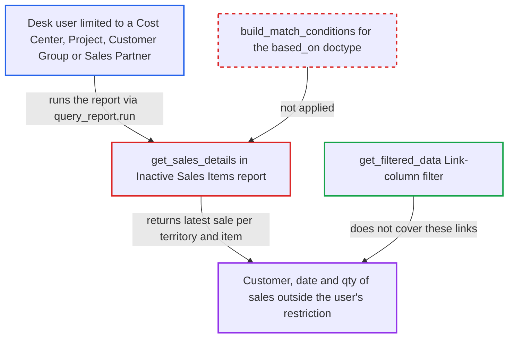

# Inactive Sales Items report skips Sales Invoice/Order match conditions (Cost Center, Project, Customer Group)

| Field | Value |
|---|---|
| ID | `find_014YtCtq4AKrcrRdPYFWRKgP` |
| Severity | **Low** |
| Status | open |
| CWE | CWE-862 — Missing Authorization |
| Created | 2026-10-27T21:15:12.502708Z |
| Claude Security | https://claude.ai/security/findings/find_014YtCtq4AKrcrRdPYFWRKgP |

## Description

A desk user whose access is limited to one Cost Center, Project, Customer Group or Sales Partner can still see customer names, dates and quantities from sales outside that limit. The user needs the Accounts User, Accounts Manager or Auditor role. `get_sales_details` applies only the company check and never applies the match conditions for Sales Invoice or Sales Order. The disclosure is small and read-only.

1. **Desk user** calls `/api/method/frappe.desk.query_report.run` for the report. The user holds Accounts User, Accounts Manager or Auditor, has User Permissions limiting them to a Cost Center, Project, Customer Group or Sales Partner, and sends `report_name=Inactive Sales Items` with `filters={based_on:'Sales Invoice', days:0}`. ([`erpnext/accounts/report/inactive_sales_items/inactive_sales_items.json:16-29`](https://github.com/cx-benchmark/erpnext/blob/90e7aefca73da3c440d2e8da7472fcb67838e678/erpnext/accounts/report/inactive_sales_items/inactive_sales_items.json#L16-L29))
2. **the function `get_sales_details`** reads all submitted Sales Invoice or Sales Order rows. The only row restriction is `get_allowed_companies_condition`, and `build_match_conditions(filters["based_on"])` is never applied, so permissions on cost_center, project, customer_group and sales_partner are ignored. ([`erpnext/accounts/report/inactive_sales_items/inactive_sales_items.py:106-151`](https://github.com/cx-benchmark/erpnext/blob/90e7aefca73da3c440d2e8da7472fcb67838e678/erpnext/accounts/report/inactive_sales_items/inactive_sales_items.py#L106-L151))
3. **the function `get_data`** builds one row per territory and item from the latest sale. Each row holds that sale's `customer`, `last_order_date` and `qty`, and each permitted territory is expanded to its subtree with `ignore_permissions=True`. ([`erpnext/accounts/report/inactive_sales_items/inactive_sales_items.py:66-98`](https://github.com/cx-benchmark/erpnext/blob/90e7aefca73da3c440d2e8da7472fcb67838e678/erpnext/accounts/report/inactive_sales_items/inactive_sales_items.py#L66-L98))
4. **Frappe's `get_filtered_data`** filters the rows only on Link columns. It checks User Permissions only for Territory, Item Group, Item and Customer, because the invoice's other links are not report columns, so rows from restricted invoices or orders stay in the result. ([`erpnext/accounts/report/inactive_sales_items/inactive_sales_items.py:66-98`](https://github.com/cx-benchmark/erpnext/blob/90e7aefca73da3c440d2e8da7472fcb67838e678/erpnext/accounts/report/inactive_sales_items/inactive_sales_items.py#L66-L98))
5. **Desk user** reads the returned rows. The rows show customers, dates and quantities of sales the user cannot open in desk.

## Assessment

The attacker is an authenticated desk user with Accounts User, Accounts Manager or Auditor role. Their User Permissions must limit them to a Cost Center, Project, Customer Group or Sales Partner. They call the report through `frappe.desk.query_report.run` with `based_on` set to Sales Invoice and `days` set to 0. A second route exists for a Territory permission with Hide Descendants. The code expands each permitted territory to its full subtree with `ignore_permissions=True`, so sales from child territories show under the permitted parent row. The bypass matters only where the operator relies on these restrictions.

Impact: The attacker can read the customer name, last order date and quantity of the most recent sale per territory and item, taken from invoices or orders outside their restriction. The disclosure is limited. Each territory and item pair shows only one sale, results stay within permitted companies, and Territory, Customer and Item restrictions still hold. There is no change or loss of data.

## Recommendation

`get_sales_details` queries Sales Invoice and Sales Order with only a company condition. It relies on Frappe's Link-column post-filter, which ignores User Permissions on document links that are not report columns. `get_data` also expands territories with `ignore_permissions=True`.

Fix criteria: Every sale the report summarises is one the session user may read. The query applies the based-on doctype's user-permission match conditions, and the territory subtree respects the user's Territory permissions. To verify, run the report as a user restricted to one Cost Center or Customer Group. No customer, date or quantity from other cost centers' or groups' invoices may appear.

## Evidence

**https://github.com/cx-benchmark/erpnext**

- [`erpnext/accounts/report/inactive_sales_items/inactive_sales_items.py:106-151`](https://github.com/cx-benchmark/erpnext/blob/90e7aefca73da3c440d2e8da7472fcb67838e678/erpnext/accounts/report/inactive_sales_items/inactive_sales_items.py#L106-L151)
- [`erpnext/accounts/report/inactive_sales_items/inactive_sales_items.py:66-98`](https://github.com/cx-benchmark/erpnext/blob/90e7aefca73da3c440d2e8da7472fcb67838e678/erpnext/accounts/report/inactive_sales_items/inactive_sales_items.py#L66-L98)
- [`erpnext/accounts/report/inactive_sales_items/inactive_sales_items.json:16-29`](https://github.com/cx-benchmark/erpnext/blob/90e7aefca73da3c440d2e8da7472fcb67838e678/erpnext/accounts/report/inactive_sales_items/inactive_sales_items.json#L16-L29)
- [`erpnext/accounts/doctype/sales_invoice/sales_invoice.json:376`](https://github.com/cx-benchmark/erpnext/blob/90e7aefca73da3c440d2e8da7472fcb67838e678/erpnext/accounts/doctype/sales_invoice/sales_invoice.json#L376)
- [`erpnext/accounts/report/item_wise_sales_register/item_wise_sales_register.py:497-500`](https://github.com/cx-benchmark/erpnext/blob/90e7aefca73da3c440d2e8da7472fcb67838e678/erpnext/accounts/report/item_wise_sales_register/item_wise_sales_register.py#L497-L500)

