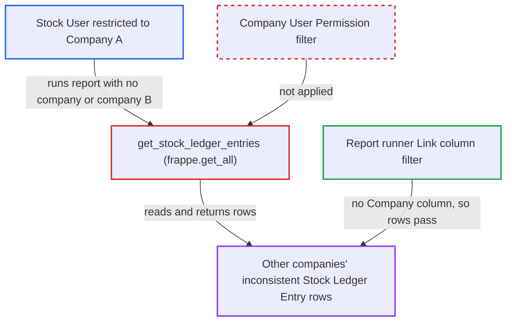

# Incorrect Balance Qty After Transaction report ignores Company user permissions

| Field | Value |
|---|---|
| ID | `find_01NfJwAkfovQAZYURaf6i2JA` |
| Severity | **Low** |
| Status | open |
| CWE | CWE-862 — Missing authorization |
| Created | 2026-10-27T21:25:03.186819Z |
| Claude Security | https://claude.ai/security/findings/find_01NfJwAkfovQAZYURaf6i2JA |

## Description

A Stock User limited to one company by a Company User Permission can read stock ledger rows that belong to other companies. The rows are only those with an inconsistent running balance, and the report is read-only. The cause is `get_stock_ledger_entries`, which reads with `frappe.get_all` (no permission checks) and never applies Company User Permissions.

1. **Stock User restricted to Company A** calls the report runner directly. The request goes to `/api/method/frappe.desk.query_report.run` with `report_name=Incorrect Balance Qty After Transaction` and `filters={}` or `{company:'B'}`, so the client-only `reqd` rule on `company` is bypassed. ([`erpnext/stock/report/incorrect_balance_qty_after_transaction/incorrect_balance_qty_after_transaction.js:6-13`](https://github.com/cx-benchmark/erpnext/blob/90e7aefca73da3c440d2e8da7472fcb67838e678/erpnext/stock/report/incorrect_balance_qty_after_transaction/incorrect_balance_qty_after_transaction.js#L6-L13))
2. **the function `get_stock_ledger_entries`** loads Stock Ledger Entries with `frappe.get_all`. `frappe.get_all` applies no permissions, and the only company scope is the caller's optional `company` filter, so rows from every company are read. ([`erpnext/stock/report/incorrect_balance_qty_after_transaction/incorrect_balance_qty_after_transaction.py:78-105`](https://github.com/cx-benchmark/erpnext/blob/90e7aefca73da3c440d2e8da7472fcb67838e678/erpnext/stock/report/incorrect_balance_qty_after_transaction/incorrect_balance_qty_after_transaction.py#L78-L105))
3. **the functions `get_data`, `validate_data` and `get_incorrect_data`** return the first inconsistent ledger row per item and warehouse. Each row is returned as the full Stock Ledger Entry dict, for every company that was read. ([`erpnext/stock/report/incorrect_balance_qty_after_transaction/incorrect_balance_qty_after_transaction.py:16-75`](https://github.com/cx-benchmark/erpnext/blob/90e7aefca73da3c440d2e8da7472fcb67838e678/erpnext/stock/report/incorrect_balance_qty_after_transaction/incorrect_balance_qty_after_transaction.py#L16-L75))
4. **Frappe's report runner** filters rows only by their Link columns. The report's Link columns are Stock Ledger Entry, DocType, Item and Warehouse, with no Company column, so a Company User Permission never removes a Company B row. ([`erpnext/stock/report/incorrect_balance_qty_after_transaction/incorrect_balance_qty_after_transaction.py:108-159`](https://github.com/cx-benchmark/erpnext/blob/90e7aefca73da3c440d2e8da7472fcb67838e678/erpnext/stock/report/incorrect_balance_qty_after_transaction/incorrect_balance_qty_after_transaction.py#L108-L159))
5. **Stock User restricted to Company A** receives other companies' ledger rows. The normal Stock Ledger Entry list would hide these rows from this user.

## Assessment

The attacker is an authenticated desk user with the Stock User role, restricted to Company A by a Company User Permission. Stock User is the role that can run the report, because the runner also requires `report` permission on Stock Ledger Entry. Stock Manager or Purchase User alone does not have it. The attacker calls the report runner directly with no `company` filter or with `company` set to another company. Rows come back only where another company's ledger has balance inconsistencies, a state the attacker does not control. The report does not say how the runner behaves for certain. That the runner ignores Company User Permissions here is an assumption, because Frappe `>=17.0.0-dev,<18` is not in the checkout and the claim rests on the fork's commits 6d55a759 and 24eb1a8c.

Impact: The attacker reads, but cannot change, other companies' inconsistent ledger rows. Each row holds the SLE id, posting date, voucher type and number, item, warehouse, and the expected, actual and difference quantities. The response also carries `company`, `batch_no`, `actual_qty` and `voucher_detail_no`. Only the first inconsistent row per item and warehouse is returned.

## Recommendation

`get_stock_ledger_entries` takes its company scope from the caller's filter on a permission-less `frappe.get_all`. The output has no Company link column, so a Company User Permission never narrows the rows.

Fix criteria: Every Stock Ledger Entry the report reads and returns belongs to a company the running user is allowed by their Company User Permissions applicable to Stock Ledger Entry, intersected with any caller filter. Test: a Stock User restricted to Company A runs the report with no company, and again with `company=B`, while Company B has an inconsistent ledger row. The user receives no Company B rows.

## Evidence

**https://github.com/cx-benchmark/erpnext**

- [`erpnext/stock/report/incorrect_balance_qty_after_transaction/incorrect_balance_qty_after_transaction.py:78-105`](https://github.com/cx-benchmark/erpnext/blob/90e7aefca73da3c440d2e8da7472fcb67838e678/erpnext/stock/report/incorrect_balance_qty_after_transaction/incorrect_balance_qty_after_transaction.py#L78-L105)
- [`erpnext/stock/report/incorrect_balance_qty_after_transaction/incorrect_balance_qty_after_transaction.py:108-159`](https://github.com/cx-benchmark/erpnext/blob/90e7aefca73da3c440d2e8da7472fcb67838e678/erpnext/stock/report/incorrect_balance_qty_after_transaction/incorrect_balance_qty_after_transaction.py#L108-L159)
- [`erpnext/stock/report/incorrect_balance_qty_after_transaction/incorrect_balance_qty_after_transaction.py:16-75`](https://github.com/cx-benchmark/erpnext/blob/90e7aefca73da3c440d2e8da7472fcb67838e678/erpnext/stock/report/incorrect_balance_qty_after_transaction/incorrect_balance_qty_after_transaction.py#L16-L75)
- [`erpnext/stock/report/incorrect_balance_qty_after_transaction/incorrect_balance_qty_after_transaction.json:18-31`](https://github.com/cx-benchmark/erpnext/blob/90e7aefca73da3c440d2e8da7472fcb67838e678/erpnext/stock/report/incorrect_balance_qty_after_transaction/incorrect_balance_qty_after_transaction.json#L18-L31)
- [`erpnext/stock/report/incorrect_balance_qty_after_transaction/incorrect_balance_qty_after_transaction.js:6-13`](https://github.com/cx-benchmark/erpnext/blob/90e7aefca73da3c440d2e8da7472fcb67838e678/erpnext/stock/report/incorrect_balance_qty_after_transaction/incorrect_balance_qty_after_transaction.js#L6-L13)

