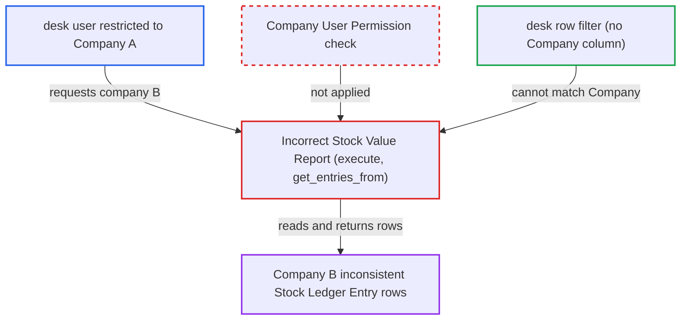

# Incorrect Stock Value Report reads any company's stock ledger without Company permission check

| Field | Value |
|---|---|
| ID | `find_01VPwPWDQ9wihC46MQrZxhYa` |
| Severity | **Low** |
| Status | open |
| CWE | CWE-862 — Missing authorization |
| Created | 2026-10-27T21:26:00.720308Z |
| Claude Security | https://claude.ai/security/findings/find_01VPwPWDQ9wihC46MQrZxhYa |

## Description

A logged-in desk user restricted to one company can read another company's Stock Ledger Entry rows through the Incorrect Stock Value Report. Only rows where the other company's ledger has stock-value inconsistencies are returned. The attacker needs the Stock User or Accounts Manager role. The report takes `company` from the caller and never checks it against Company User Permissions.

1. **attacker with Stock User or Accounts Manager role** calls `/api/method/frappe.desk.query_report.run` for the report with another company. The filters are `company` set to 'B', `account` set to 'Stock In Hand - B' and `from_date` set to '2000-01-01', while the attacker's User Permission limits them to Company A. ([`erpnext/stock/report/incorrect_stock_value_report/incorrect_stock_value_report.json:18-28`](https://github.com/cx-benchmark/erpnext/blob/90e7aefca73da3c440d2e8da7472fcb67838e678/erpnext/stock/report/incorrect_stock_value_report/incorrect_stock_value_report.json#L18-L28))
2. **the function `execute`** accepts the request after two checks that have nothing to do with permissions. It checks only that the company has perpetual inventory (on by default) and that `account` is non-empty, and never checks that the caller may access `filters.company`. ([`erpnext/stock/report/incorrect_stock_value_report/incorrect_stock_value_report.py:16-28`](https://github.com/cx-benchmark/erpnext/blob/90e7aefca73da3c440d2e8da7472fcb67838e678/erpnext/stock/report/incorrect_stock_value_report/incorrect_stock_value_report.py#L16-L28))
3. **the function `get_account_warehouses`** returns `None` when the company has at most one non-group Stock account. No warehouse narrowing is applied then, so the `account` value the attacker supplies barely matters. ([`erpnext/stock/report/incorrect_stock_value_report/incorrect_stock_value_report.py:77-95`](https://github.com/cx-benchmark/erpnext/blob/90e7aefca73da3c440d2e8da7472fcb67838e678/erpnext/stock/report/incorrect_stock_value_report/incorrect_stock_value_report.py#L77-L95))
4. **the function `get_entries_from`** reads every non-cancelled Stock Ledger Entry of the named company. The `frappe.qb` query is scoped only by `sle.company == company` from the caller's filter, and `get_stock_values_before` does the same for the opening values. ([`erpnext/stock/report/incorrect_stock_value_report/incorrect_stock_value_report.py:98-119`](https://github.com/cx-benchmark/erpnext/blob/90e7aefca73da3c440d2e8da7472fcb67838e678/erpnext/stock/report/incorrect_stock_value_report/incorrect_stock_value_report.py#L98-L119))
5. **the function `get_data`** returns each entry whose `stock_value` differs from the running sum of `stock_value_difference`. Each row shows the SLE ID, posting date and time, voucher type and number, item, warehouse, and expected, actual and difference stock value. ([`erpnext/stock/report/incorrect_stock_value_report/incorrect_stock_value_report.py:51-74`](https://github.com/cx-benchmark/erpnext/blob/90e7aefca73da3c440d2e8da7472fcb67838e678/erpnext/stock/report/incorrect_stock_value_report/incorrect_stock_value_report.py#L51-L74))
6. **Frappe desk row filter** lets all rows through. It matches User Permissions only against Link columns, and this report has Stock Ledger Entry, DocType, Item and Warehouse columns but no Company column. ([`erpnext/stock/report/incorrect_stock_value_report/incorrect_stock_value_report.py:143-195`](https://github.com/cx-benchmark/erpnext/blob/90e7aefca73da3c440d2e8da7472fcb67838e678/erpnext/stock/report/incorrect_stock_value_report/incorrect_stock_value_report.py#L143-L195))

## Assessment

The attacker is an authenticated desk user with the Stock User or Accounts Manager role. Both roles can use this report, and both hold `report` on Stock Ledger Entry. A Company User Permission limits the attacker to their own company. They call the report endpoint with another company's name as the `company` filter. No victim action is needed. Rows come back only if the target company's ledger already holds stock-value inconsistencies, which the attacker does not control.

Impact: The attacker reads another company's inconsistent Stock Ledger Entry rows: voucher type and number, item, warehouse, posting date and time, and expected, actual and difference stock values. Only rows with discrepancies are returned. The report does not write data or affect availability.

## Recommendation

The report takes its company scope from the caller's `company` filter and reads Stock Ledger Entries with raw `frappe.qb`. It never intersects that scope with the companies the caller may access under Company User Permissions.

Fix criteria: A request naming a company outside the caller's permitted companies (for Stock Ledger Entry) raises PermissionError or returns no rows, in both the entries query and the opening-value query. Test: a Stock User restricted to Company A runs the report with `company=B` and gets no Company B rows, even when Company B's ledger has inconsistencies.

## Evidence

**https://github.com/cx-benchmark/erpnext**

- [`erpnext/stock/report/incorrect_stock_value_report/incorrect_stock_value_report.py:16-28`](https://github.com/cx-benchmark/erpnext/blob/90e7aefca73da3c440d2e8da7472fcb67838e678/erpnext/stock/report/incorrect_stock_value_report/incorrect_stock_value_report.py#L16-L28)
- [`erpnext/stock/report/incorrect_stock_value_report/incorrect_stock_value_report.py:98-119`](https://github.com/cx-benchmark/erpnext/blob/90e7aefca73da3c440d2e8da7472fcb67838e678/erpnext/stock/report/incorrect_stock_value_report/incorrect_stock_value_report.py#L98-L119)
- [`erpnext/stock/report/incorrect_stock_value_report/incorrect_stock_value_report.py:77-95`](https://github.com/cx-benchmark/erpnext/blob/90e7aefca73da3c440d2e8da7472fcb67838e678/erpnext/stock/report/incorrect_stock_value_report/incorrect_stock_value_report.py#L77-L95)
- [`erpnext/stock/report/incorrect_stock_value_report/incorrect_stock_value_report.py:51-74`](https://github.com/cx-benchmark/erpnext/blob/90e7aefca73da3c440d2e8da7472fcb67838e678/erpnext/stock/report/incorrect_stock_value_report/incorrect_stock_value_report.py#L51-L74)
- [`erpnext/stock/report/incorrect_stock_value_report/incorrect_stock_value_report.py:122-140`](https://github.com/cx-benchmark/erpnext/blob/90e7aefca73da3c440d2e8da7472fcb67838e678/erpnext/stock/report/incorrect_stock_value_report/incorrect_stock_value_report.py#L122-L140)
- [`erpnext/stock/report/incorrect_stock_value_report/incorrect_stock_value_report.py:143-195`](https://github.com/cx-benchmark/erpnext/blob/90e7aefca73da3c440d2e8da7472fcb67838e678/erpnext/stock/report/incorrect_stock_value_report/incorrect_stock_value_report.py#L143-L195)
- [`erpnext/stock/report/incorrect_stock_value_report/incorrect_stock_value_report.json:18-28`](https://github.com/cx-benchmark/erpnext/blob/90e7aefca73da3c440d2e8da7472fcb67838e678/erpnext/stock/report/incorrect_stock_value_report/incorrect_stock_value_report.json#L18-L28)
- [`erpnext/stock/report/item_wise_consumption/item_wise_consumption.py:113`](https://github.com/cx-benchmark/erpnext/blob/90e7aefca73da3c440d2e8da7472fcb67838e678/erpnext/stock/report/item_wise_consumption/item_wise_consumption.py#L113)

