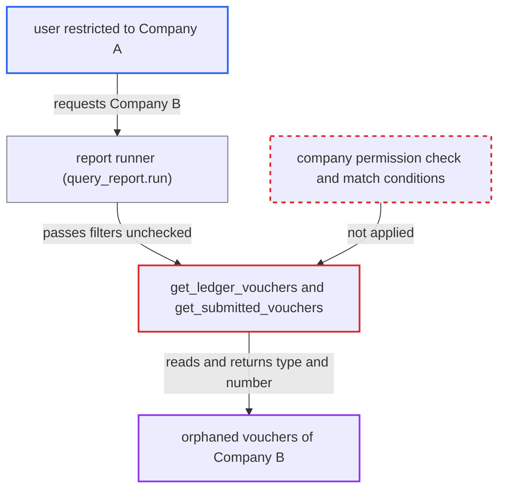

# Invalid Ledger Entries report scans any company's ledgers, ignoring User Permissions

| Field | Value |
|---|---|
| ID | `find_01VoXYLLuH1HHUuoW47VJaUZ` |
| Severity | **Low** |
| Status | open |
| CWE | CWE-862 — Missing Authorization |
| Created | 2026-10-27T21:12:50.965257Z |
| Claude Security | https://claude.ai/security/findings/find_01VoXYLLuH1HHUuoW47VJaUZ |

## Description

A logged-in user limited to one company by User Permissions can list vouchers in other companies, or other cost centers and projects, that still have active ledger rows but are not submitted. The user needs report permission on GL Entry (Accounts User, Accounts Manager or Auditor). The report code `get_ledger_vouchers` filters only by the `company` the caller supplies and never applies permission checks.

1. **Attacker** calls the report runner with another company's name. The attacker is restricted to Company A. They call `/api/method/frappe.desk.query_report.run` with `report_name=Invalid Ledger Entries` and filters `company` set to Company B plus a wide date range (`from_date` 2000-01-01, `to_date` 2100-01-01). ([`erpnext/accounts/report/invalid_ledger_entries/invalid_ledger_entries.json`](https://github.com/cx-benchmark/erpnext/blob/90e7aefca73da3c440d2e8da7472fcb67838e678/erpnext/accounts/report/invalid_ledger_entries/invalid_ledger_entries.json))
2. **the report runner** lets the request through. The role and `report` permission checks pass, and the runner validates no filter value. ([`erpnext/accounts/report/invalid_ledger_entries/invalid_ledger_entries.json`](https://github.com/cx-benchmark/erpnext/blob/90e7aefca73da3c440d2e8da7472fcb67838e678/erpnext/accounts/report/invalid_ledger_entries/invalid_ledger_entries.json))
3. **the function `validate_filters`** accepts the filters. It checks only that the company is present and the dates are in order, not that the user may access that company. ([`erpnext/accounts/report/invalid_ledger_entries/invalid_ledger_entries.py:70-79`](https://github.com/cx-benchmark/erpnext/blob/90e7aefca73da3c440d2e8da7472fcb67838e678/erpnext/accounts/report/invalid_ledger_entries/invalid_ledger_entries.py#L70-L79))
4. **the function `get_ledger_vouchers`** scans Company B's ledgers without restriction. The query is scoped only by `ledger.company.eq(filters.company)`, the date range and the optional `account` and `voucher_no` filters, with no permission condition. ([`erpnext/accounts/report/invalid_ledger_entries/invalid_ledger_entries.py:111-128`](https://github.com/cx-benchmark/erpnext/blob/90e7aefca73da3c440d2e8da7472fcb67838e678/erpnext/accounts/report/invalid_ledger_entries/invalid_ledger_entries.py#L111-L128))
5. **the function `get_submitted_vouchers`** reads the voucher tables and returns the vouchers that are not submitted. It does this without permission checks, so the attacker gets the voucher type and number of each one. ([`erpnext/accounts/report/invalid_ledger_entries/invalid_ledger_entries.py:51-67`](https://github.com/cx-benchmark/erpnext/blob/90e7aefca73da3c440d2e8da7472fcb67838e678/erpnext/accounts/report/invalid_ledger_entries/invalid_ledger_entries.py#L51-L67))
6. **Attacker** fixes `voucher_no` and varies the date range or `account` filter. This lets the attacker learn the posting dates and accounts of those vouchers. ([`erpnext/accounts/report/invalid_ledger_entries/invalid_ledger_entries.py:81-108`](https://github.com/cx-benchmark/erpnext/blob/90e7aefca73da3c440d2e8da7472fcb67838e678/erpnext/accounts/report/invalid_ledger_entries/invalid_ledger_entries.py#L81-L108))

## Assessment

The attacker is a logged-in Accounts User, Accounts Manager or Auditor. A Company User Permission confines them to Company A. The site has several companies, and Company B has orphaned ledger rows. No victim action is needed. The same gap applies to Cost Center and Project User Permissions within a company. The report's `roles` and `filters` are empty and its `ref_doctype` is `GL Entry`, so anyone with GL Entry `report` permission can run it.

Impact: The attacker can read the voucher type and number of vouchers whose ledger rows are still active but which are not submitted, across companies, cost centers and projects they should not see. By fixing `voucher_no` and varying the filters they can also learn those vouchers' posting dates and accounts. No amounts or parties are returned. The set is normally empty, and nothing is written or made unavailable.

## Recommendation

`get_ledger_vouchers` trusts the caller-supplied `company` and runs unrestricted `frappe.qb` scans over `GL Entry` and `Payment Ledger Entry`. Company and other User Permissions are never enforced on the rows this report reads.

Fix criteria: The report reads only ledger rows the session user is permitted to see. A `company` the user may not select raises a PermissionError or returns nothing. The user's match conditions for GL Entry and Payment Ledger Entry limit every scan. To verify, run the report as a user restricted to Company A with `company` set to Company B, with an orphaned voucher seeded there. Confirm that no Company B voucher is returned.

## Evidence

**https://github.com/cx-benchmark/erpnext**

- [`erpnext/accounts/report/invalid_ledger_entries/invalid_ledger_entries.py:111-128`](https://github.com/cx-benchmark/erpnext/blob/90e7aefca73da3c440d2e8da7472fcb67838e678/erpnext/accounts/report/invalid_ledger_entries/invalid_ledger_entries.py#L111-L128)
- [`erpnext/accounts/report/invalid_ledger_entries/invalid_ledger_entries.py:70-79`](https://github.com/cx-benchmark/erpnext/blob/90e7aefca73da3c440d2e8da7472fcb67838e678/erpnext/accounts/report/invalid_ledger_entries/invalid_ledger_entries.py#L70-L79)
- [`erpnext/accounts/report/invalid_ledger_entries/invalid_ledger_entries.py:81-108`](https://github.com/cx-benchmark/erpnext/blob/90e7aefca73da3c440d2e8da7472fcb67838e678/erpnext/accounts/report/invalid_ledger_entries/invalid_ledger_entries.py#L81-L108)
- [`erpnext/accounts/report/invalid_ledger_entries/invalid_ledger_entries.py:51-67`](https://github.com/cx-benchmark/erpnext/blob/90e7aefca73da3c440d2e8da7472fcb67838e678/erpnext/accounts/report/invalid_ledger_entries/invalid_ledger_entries.py#L51-L67)
- [`erpnext/accounts/report/invalid_ledger_entries/invalid_ledger_entries.json`](https://github.com/cx-benchmark/erpnext/blob/90e7aefca73da3c440d2e8da7472fcb67838e678/erpnext/accounts/report/invalid_ledger_entries/invalid_ledger_entries.json)
- [`erpnext/accounts/report/trial_balance/trial_balance.py:48-50`](https://github.com/cx-benchmark/erpnext/blob/90e7aefca73da3c440d2e8da7472fcb67838e678/erpnext/accounts/report/trial_balance/trial_balance.py#L48-L50)
- [`erpnext/stock/doctype/company_restriction/company_restriction.py:62-74`](https://github.com/cx-benchmark/erpnext/blob/90e7aefca73da3c440d2e8da7472fcb67838e678/erpnext/stock/doctype/company_restriction/company_restriction.py#L62-L74)

