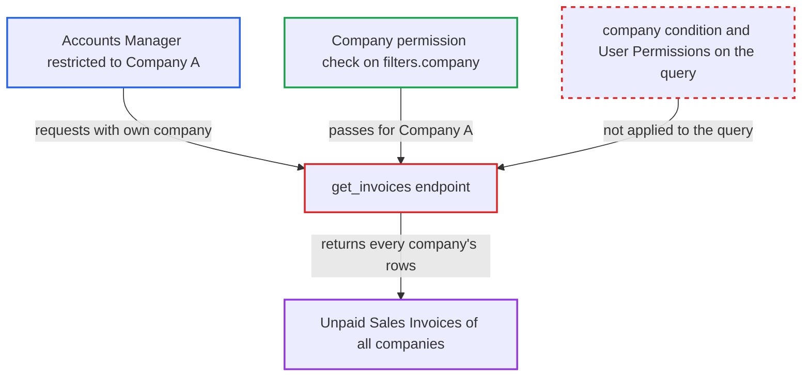

# Invoice Discounting get_invoices leaks other companies' unpaid Sales Invoices

| Field | Value |
|---|---|
| ID | `find_0111ruoadWnoU7NEg6xckGnJ` |
| Severity | **Low** |
| Status | open |
| CWE | CWE-863 — Improper Authorization |
| Created | 2026-10-27T21:18:25.694005Z |
| Claude Security | https://claude.ai/security/findings/find_0111ruoadWnoU7NEg6xckGnJ |

## Description

A user with the `Accounts Manager` role who is limited to one company can read summary data of other companies' unpaid Sales Invoices. This needs a multi-company site that uses `Company` User Permissions. The whitelisted `get_invoices` checks permission on the caller's own company but then queries Sales Invoices with no company condition. It also uses raw `frappe.qb`, which skips permission checks.

1. **Attacker (Accounts Manager restricted to Company A)** calls the `get_invoices` endpoint with their own company. The request goes to `/api/method/erpnext.accounts.doctype.invoice_discounting.invoice_discounting.get_invoices` with `filters={"company":"A"}`, so the company check passes. ([`erpnext/accounts/doctype/invoice_discounting/invoice_discounting.py:319-355`](https://github.com/cx-benchmark/erpnext/blob/90e7aefca73da3c440d2e8da7472fcb67838e678/erpnext/accounts/doctype/invoice_discounting/invoice_discounting.py#L319-L355))
2. **the endpoint `get_invoices`** checks permission on `filters.company` and read access to Invoice Discounting. Both checks (lines 326 and 327) pass because the caller is authorised for Company A and holds the role. ([`erpnext/accounts/doctype/invoice_discounting/invoice_discounting.py:319-355`](https://github.com/cx-benchmark/erpnext/blob/90e7aefca73da3c440d2e8da7472fcb67838e678/erpnext/accounts/doctype/invoice_discounting/invoice_discounting.py#L319-L355))
3. **the endpoint `get_invoices`** runs a raw `frappe.qb` query over Sales Invoice. The query filters only on `docstatus`, `outstanding_amount`, not-already-discounted and optional customer, date and `base_grand_total` filters. It has no `si.company == filters.company` condition and applies no User Permissions. ([`erpnext/accounts/doctype/invoice_discounting/invoice_discounting.py:319-355`](https://github.com/cx-benchmark/erpnext/blob/90e7aefca73da3c440d2e8da7472fcb67838e678/erpnext/accounts/doctype/invoice_discounting/invoice_discounting.py#L319-L355))
4. **the endpoint `get_invoices`** returns unpaid invoices of every company on the site. The `Company` User Permission would normally hide these rows, because the Sales Invoice `company` field does not set `ignore_user_permissions`, but the raw query bypasses it. ([`erpnext/accounts/doctype/sales_invoice/sales_invoice.json:361`](https://github.com/cx-benchmark/erpnext/blob/90e7aefca73da3c440d2e8da7472fcb67838e678/erpnext/accounts/doctype/sales_invoice/sales_invoice.json#L361))
5. **Attacker** optionally sets `min_amount` or `max_amount` to probe invoice totals. These filters apply to `base_grand_total`, so the matching rows reveal each invoice's grand total. ([`erpnext/accounts/doctype/invoice_discounting/invoice_discounting.py:319-355`](https://github.com/cx-benchmark/erpnext/blob/90e7aefca73da3c440d2e8da7472fcb67838e678/erpnext/accounts/doctype/invoice_discounting/invoice_discounting.py#L319-L355))

## Assessment

The attacker is an authenticated user with the `Accounts Manager` role, the only role with read access to Invoice Discounting. They are confined to Company A by a `Company` User Permission on a multi-company site. They send the request over the network with no victim action. The attack does not work on sites without multiple companies using Company User Permissions.

Impact: The attacker reads invoice ids, customers, posting dates, outstanding amounts and receivable accounts (`debit_to`) of submitted, unpaid, not-yet-discounted Sales Invoices of all companies. They can also probe grand totals with the amount filters. Disclosure is limited to these summary fields, and nothing is modified: a missing company check in `validate_invoices` lets such rows be saved into a draft, but submission fails on the GL Entry account/company check.

## Recommendation

The Sales Invoice query in `get_invoices` is not restricted to the company the caller was authorised for. It uses raw `frappe.qb`, which ignores role and User Permissions, so the Company permission check does not limit the data returned.

Fix criteria: `get_invoices` returns only Sales Invoices of the requested `filters.company` that the caller may read under their Sales Invoice role and User Permissions. Calling the endpoint as an Accounts Manager restricted to Company A returns no Company B invoice, customer, amount or account. The amount filters no longer match Company B invoices.

## Evidence

**https://github.com/cx-benchmark/erpnext**

- [`erpnext/accounts/doctype/invoice_discounting/invoice_discounting.py:319-355`](https://github.com/cx-benchmark/erpnext/blob/90e7aefca73da3c440d2e8da7472fcb67838e678/erpnext/accounts/doctype/invoice_discounting/invoice_discounting.py#L319-L355)
- [`erpnext/accounts/doctype/invoice_discounting/invoice_discounting.js:137-144`](https://github.com/cx-benchmark/erpnext/blob/90e7aefca73da3c440d2e8da7472fcb67838e678/erpnext/accounts/doctype/invoice_discounting/invoice_discounting.js#L137-L144)
- [`erpnext/accounts/doctype/sales_invoice/sales_invoice.json:361`](https://github.com/cx-benchmark/erpnext/blob/90e7aefca73da3c440d2e8da7472fcb67838e678/erpnext/accounts/doctype/sales_invoice/sales_invoice.json#L361)

