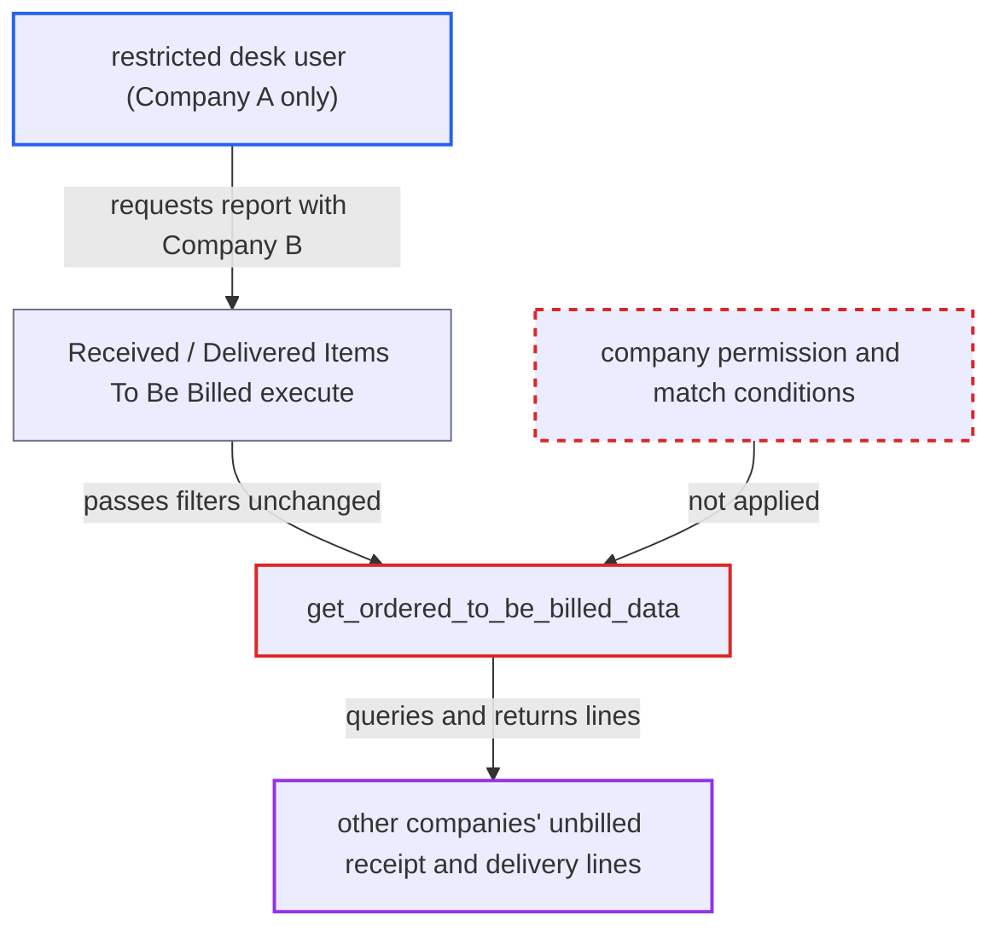

# Items To Be Billed reports ignore User Permissions on caller-chosen company

| Field | Value |
|---|---|
| ID | `find_012gm2PXv6Z8d6bhDUuLDxbx` |
| Severity | **Low** |
| Status | open |
| CWE | CWE-862 — Missing Authorization |
| Created | 2026-10-27T21:08:05.345406Z |
| Claude Security | https://claude.ai/security/findings/find_012gm2PXv6Z8d6bhDUuLDxbx |

## Description

A logged-in user who is restricted to one company can read unbilled Purchase Receipt and Delivery Note lines belonging to other companies. The attack needs a role that can run these reports (Accounts User, Purchase User, Accounts Manager or Auditor) and a multi-company site. The shared function `get_ordered_to_be_billed_data` filters only on the caller-supplied `company` and applies no permission checks.

1. **attacker (restricted desk user)** posts a report run request naming another company. The request goes to `/api/method/frappe.desk.query_report.run` with `report_name` set to `Received Items To Be Billed` or `Delivered Items To Be Billed`, and filters `company` set to Company B and a chosen `posting_date`. ([`erpnext/accounts/report/received_items_to_be_billed/received_items_to_be_billed.json`](https://github.com/cx-benchmark/erpnext/blob/90e7aefca73da3c440d2e8da7472fcb67838e678/erpnext/accounts/report/received_items_to_be_billed/received_items_to_be_billed.json))
2. **report runner** checks only the role and the doctype-level `report` permission. The check is made on `Purchase Invoice` or `Sales Invoice`, and User Permissions do not narrow it, so the request passes. The report has no `filters` table that would validate the `company` value. ([`erpnext/accounts/report/received_items_to_be_billed/received_items_to_be_billed.json`](https://github.com/cx-benchmark/erpnext/blob/90e7aefca73da3c440d2e8da7472fcb67838e678/erpnext/accounts/report/received_items_to_be_billed/received_items_to_be_billed.json))
3. **report `execute`** passes the caller's `filters` unchanged to `get_ordered_to_be_billed_data`. The Delivered report does the same with Delivery Note as the doctype, so there are two ways into the same helper. ([`erpnext/accounts/report/received_items_to_be_billed/received_items_to_be_billed.py:11-15`](https://github.com/cx-benchmark/erpnext/blob/90e7aefca73da3c440d2e8da7472fcb67838e678/erpnext/accounts/report/received_items_to_be_billed/received_items_to_be_billed.py#L11-L15))
4. **`get_ordered_to_be_billed_data`** runs an unrestricted query scoped only by the requested company. The only scope is `doctype.company == filters.get("company")` (line 97), and `query.run(as_dict=True)` applies no permission logic. ([`erpnext/accounts/report/non_billed_report.py:39-114`](https://github.com/cx-benchmark/erpnext/blob/90e7aefca73da3c440d2e8da7472fcb67838e678/erpnext/accounts/report/non_billed_report.py#L39-L114))
5. **attacker** receives the rows and may repeat with earlier dates. Because `posting_date` is also chosen by the caller, stepping it back exposes nearly every historical line that was unbilled at some date.

## Assessment

The attacker is an authenticated desk user with Accounts User or Purchase User, restricted by User Permission to Company A on a multi-company site. They need no victim action. They can use either of two reports, Received Items To Be Billed or Delivered Items To Be Billed, which share the same helper. They set `company` to another company and choose the `posting_date`.

Impact: The attacker gets read-only access to other companies' data, and to data for suppliers, customers and projects they are restricted from. The data covers document numbers, dates, party and name, item, description, line amount, billed, returned and pending amounts, and project. It is limited to stock or fixed-asset lines unbilled as on the chosen date and to these two doctypes. It includes no rates, terms or ledgers, and nothing can be written or disrupted.

## Recommendation

`get_ordered_to_be_billed_data` in `non_billed_report.py` trusts the caller-supplied `company` and runs an unrestricted `frappe.qb` query over Purchase Receipt and Delivery Note. Company, party and project User Permissions and the fork's company restrictions are never applied to either report.

Fix criteria: Both reports return only documents the session user may read. A `company` the user is not permitted for is refused or yields no rows, and the user's match conditions (User Permissions and permission query conditions) for the queried doctype constrain the rows. Running each report as a user restricted to Company A with `company` set to Company B gives a PermissionError or no rows. Running it as a user restricted to one Supplier or Customer returns only that party's lines.

## Evidence

**https://github.com/cx-benchmark/erpnext**

- [`erpnext/accounts/report/non_billed_report.py:39-114`](https://github.com/cx-benchmark/erpnext/blob/90e7aefca73da3c440d2e8da7472fcb67838e678/erpnext/accounts/report/non_billed_report.py#L39-L114)
- [`erpnext/accounts/report/received_items_to_be_billed/received_items_to_be_billed.py:11-15`](https://github.com/cx-benchmark/erpnext/blob/90e7aefca73da3c440d2e8da7472fcb67838e678/erpnext/accounts/report/received_items_to_be_billed/received_items_to_be_billed.py#L11-L15)
- [`erpnext/accounts/report/received_items_to_be_billed/received_items_to_be_billed.json`](https://github.com/cx-benchmark/erpnext/blob/90e7aefca73da3c440d2e8da7472fcb67838e678/erpnext/accounts/report/received_items_to_be_billed/received_items_to_be_billed.json)
- [`erpnext/accounts/report/delivered_items_to_be_billed/delivered_items_to_be_billed.py:11-15`](https://github.com/cx-benchmark/erpnext/blob/90e7aefca73da3c440d2e8da7472fcb67838e678/erpnext/accounts/report/delivered_items_to_be_billed/delivered_items_to_be_billed.py#L11-L15)
- [`erpnext/stock/doctype/company_restriction/company_restriction.py:62-74`](https://github.com/cx-benchmark/erpnext/blob/90e7aefca73da3c440d2e8da7472fcb67838e678/erpnext/stock/doctype/company_restriction/company_restriction.py#L62-L74)
- [`erpnext/selling/report/sales_partner_commission_summary/test_sales_partner_commission_summary.py:265-300`](https://github.com/cx-benchmark/erpnext/blob/90e7aefca73da3c440d2e8da7472fcb67838e678/erpnext/selling/report/sales_partner_commission_summary/test_sales_partner_commission_summary.py#L265-L300)

