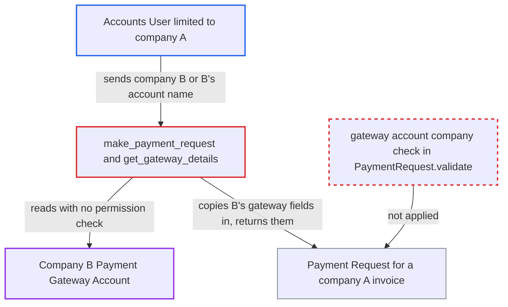

# make_payment_request binds a Payment Request to another company's Payment Gateway Account

| Field | Value |
|---|---|
| ID | `find_01UKwCVtDw9LW19NDL31sz8q` |
| Severity | **Low** |
| Status | open |
| CWE | CWE-639 — Authorization bypass via user-controlled key |
| Created | 2026-10-27T22:04:40.771008Z |
| Claude Security | https://claude.ai/security/findings/find_01UKwCVtDw9LW19NDL31sz8q |

## Description

A user restricted to company A, such as an Accounts User, can read company B's payment gateway setup. They can also bind a company-A invoice's payment request to company B's gateway, so the customer's payment goes to B. The ledger is not falsified, but A's invoice stays unpaid. The cause is `make_payment_request` and `PaymentRequest.validate()`: neither checks that the gateway account belongs to the request's company.

1. **Accounts User limited to company A** posts to `make_payment_request` for a company-A invoice they can read. The call adds `company` set to company B, or `payment_gateway_account` set to B's account. The endpoint checks only `create` on Payment Request and `read` on the reference document. ([`erpnext/accounts/doctype/payment_request/payment_request.py:798-815`](https://github.com/cx-benchmark/erpnext/blob/90e7aefca73da3c440d2e8da7472fcb67838e678/erpnext/accounts/doctype/payment_request/payment_request.py#L798-L815))
2. **the function `get_gateway_details`** picks company B's gateway account from the caller's input. It uses the account the caller names, or the default account of the caller-supplied `company`. `get_payment_gateway_account` reads it with `frappe.db.get_value`, which checks no permissions. ([`erpnext/accounts/doctype/payment_request/payment_request.py:1173-1186`](https://github.com/cx-benchmark/erpnext/blob/90e7aefca73da3c440d2e8da7472fcb67838e678/erpnext/accounts/doctype/payment_request/payment_request.py#L1173-L1186))
3. **the function `make_payment_request`** copies B's gateway fields into the new request. The account's `name`, `payment_gateway`, `payment_account`, `payment_channel` and `message` are copied, while `company` is set to the reference document's company. ([`erpnext/accounts/doctype/payment_request/payment_request.py:934-950`](https://github.com/cx-benchmark/erpnext/blob/90e7aefca73da3c440d2e8da7472fcb67838e678/erpnext/accounts/doctype/payment_request/payment_request.py#L934-L950))
4. **the function `make_payment_request`** inserts the request and returns it in full. The insert uses `ignore_permissions=True`, and `pr.as_dict()` returns B's gateway fields to a caller who cannot read that record. ([`erpnext/accounts/doctype/payment_request/payment_request.py:993-1010`](https://github.com/cx-benchmark/erpnext/blob/90e7aefca73da3c440d2e8da7472fcb67838e678/erpnext/accounts/doctype/payment_request/payment_request.py#L993-L1010))
5. **the method `PaymentRequest.validate()`** accepts the mismatched gateway account. It checks the reference document's company and the `bank_account` company, but never the company of `payment_gateway_account`. ([`erpnext/accounts/doctype/payment_request/payment_request.py:133-145`](https://github.com/cx-benchmark/erpnext/blob/90e7aefca73da3c440d2e8da7472fcb67838e678/erpnext/accounts/doctype/payment_request/payment_request.py#L133-L145))
6. **Accounts Manager or the caller** submits the request, and `before_submit` emails a pay link built from B's gateway controller. The link goes to the caller-chosen `email_to`. The caller can submit it themselves through a separate confirmed defect in `submit_doc`. ([`erpnext/accounts/doctype/payment_request/payment_request.py:519-551`](https://github.com/cx-benchmark/erpnext/blob/90e7aefca73da3c440d2e8da7472fcb67838e678/erpnext/accounts/doctype/payment_request/payment_request.py#L519-L551))
7. **the customer** pays through B's gateway, and the later company-A Payment Entry is rejected. `create_payment_entry` passes B's account as `bank_account`, and the GL Entry company check rejects it. A's invoice stays outstanding. ([`erpnext/accounts/doctype/gl_entry/gl_entry.py:250-255`](https://github.com/cx-benchmark/erpnext/blob/90e7aefca73da3c440d2e8da7472fcb67838e678/erpnext/accounts/doctype/gl_entry/gl_entry.py#L250-L255))

## Assessment

The attacker is an authenticated Accounts User limited by User Permission to company A. They need a company-A invoice they can read, and they call the whitelisted `make_payment_request` with `company` set to company B, or with `payment_gateway_account` naming B's account. Account names are easy to guess (`<gateway> - <currency> - <abbr>`), and `company=<B>` alone returns B's default account. The disclosure needs no further step. Redirecting the payment also needs the request to be submitted. An Accounts Manager can do that in routine work, or the caller can do it through the confirmed `submit_doc` defect. A direct save of a Payment Request has the same gap. The report assumes the gateway controllers in the optional `payments` app, which is not in the checkout, and that each company has its own gateway and merchant credentials.

Impact: The attacker reads company B's gateway, its receiving GL account, the channel and the message template. This is limited, because no gateway credentials are included. They can also make the customer's payment for a company-A invoice be collected by B's gateway. The ledger is not falsified, because the later Payment Entry is rejected, but A's invoice stays outstanding.

## Recommendation

(1) `PaymentRequest.validate()` checks the company of the reference document and of `bank_account`, but never checks that `payment_gateway_account` belongs to the request's `company`.

Fix criteria: Saving or submitting a Payment Request fails with a validation error when its Payment Gateway Account belongs to a different company. This holds for the `make_payment_request` path and for a direct insert or save. To verify, request a payment for a company-A invoice while naming a company-B gateway account, or passing `company=<B>`. It must be rejected.

(2) `make_payment_request` and `get_gateway_details` choose the gateway account from a caller-supplied `company` or account name. They read it with an unpermissioned `frappe.db.get_value` and return its fields to a caller who may not read that record.

Fix criteria: The default gateway account is resolved from the reference document's company, not from a caller-supplied `company`. A gateway account named by the caller must belong to that company. To verify, a caller who cannot read another company's Payment Gateway Account gets none of its fields, either in the response or in the stored request.

## Evidence

**https://github.com/cx-benchmark/erpnext**

- [`erpnext/accounts/doctype/payment_request/payment_request.py:133-145`](https://github.com/cx-benchmark/erpnext/blob/90e7aefca73da3c440d2e8da7472fcb67838e678/erpnext/accounts/doctype/payment_request/payment_request.py#L133-L145)
- [`erpnext/accounts/doctype/payment_request/payment_request.py:148-178`](https://github.com/cx-benchmark/erpnext/blob/90e7aefca73da3c440d2e8da7472fcb67838e678/erpnext/accounts/doctype/payment_request/payment_request.py#L148-L178)
- [`erpnext/accounts/doctype/payment_request/payment_request.py:798-815`](https://github.com/cx-benchmark/erpnext/blob/90e7aefca73da3c440d2e8da7472fcb67838e678/erpnext/accounts/doctype/payment_request/payment_request.py#L798-L815)
- [`erpnext/accounts/doctype/payment_request/payment_request.py:1173-1186`](https://github.com/cx-benchmark/erpnext/blob/90e7aefca73da3c440d2e8da7472fcb67838e678/erpnext/accounts/doctype/payment_request/payment_request.py#L1173-L1186)
- [`erpnext/accounts/doctype/payment_request/payment_request.py:934-950`](https://github.com/cx-benchmark/erpnext/blob/90e7aefca73da3c440d2e8da7472fcb67838e678/erpnext/accounts/doctype/payment_request/payment_request.py#L934-L950)
- [`erpnext/accounts/doctype/payment_request/payment_request.py:993-1010`](https://github.com/cx-benchmark/erpnext/blob/90e7aefca73da3c440d2e8da7472fcb67838e678/erpnext/accounts/doctype/payment_request/payment_request.py#L993-L1010)
- [`erpnext/accounts/doctype/payment_gateway_account/payment_gateway_account.json:95-108`](https://github.com/cx-benchmark/erpnext/blob/90e7aefca73da3c440d2e8da7472fcb67838e678/erpnext/accounts/doctype/payment_gateway_account/payment_gateway_account.json#L95-L108)
- [`erpnext/accounts/doctype/payment_request/payment_request.js:11-17`](https://github.com/cx-benchmark/erpnext/blob/90e7aefca73da3c440d2e8da7472fcb67838e678/erpnext/accounts/doctype/payment_request/payment_request.js#L11-L17)
- [`erpnext/accounts/doctype/payment_request/payment_request.py:519-551`](https://github.com/cx-benchmark/erpnext/blob/90e7aefca73da3c440d2e8da7472fcb67838e678/erpnext/accounts/doctype/payment_request/payment_request.py#L519-L551)
- [`erpnext/accounts/doctype/gl_entry/gl_entry.py:250-255`](https://github.com/cx-benchmark/erpnext/blob/90e7aefca73da3c440d2e8da7472fcb67838e678/erpnext/accounts/doctype/gl_entry/gl_entry.py#L250-L255)

