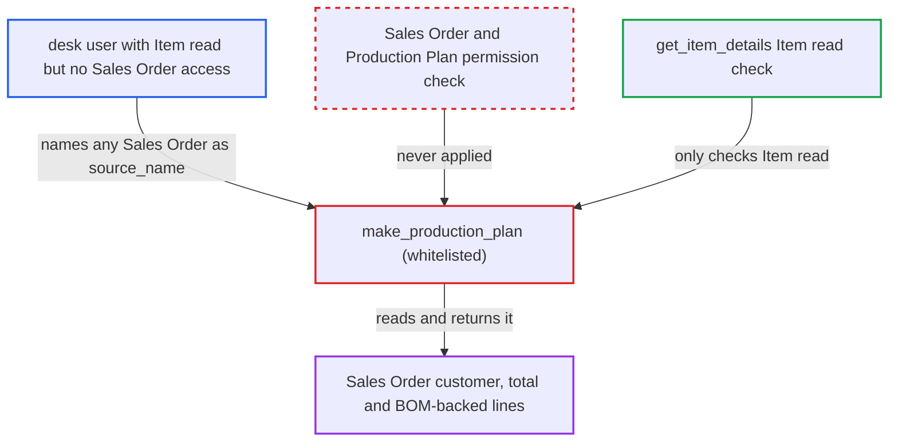

# make_production_plan discloses any Sales Order's customer, total and items without Sales Order permission

| Field | Value |
|---|---|
| ID | `find_01FEjmLoiFoMG6SeFZZ83xae` |
| Severity | **Low** |
| Status | open |
| CWE | CWE-862 — Missing authorization |
| Created | 2026-10-27T21:07:44.867700Z |
| Claude Security | https://claude.ai/security/findings/find_01FEjmLoiFoMG6SeFZZ83xae |

## Description

A signed-in desk user who has no right to read a Sales Order can still see its customer, date, grand total and BOM-backed item lines, in any company. The caller only needs read access to Item, which many roles have. The whitelisted `make_production_plan` loads the order with `frappe.get_doc` and never checks Sales Order or Production Plan permission.

1. **attacker with Item read** calls `make_production_plan` with another user's Sales Order name as `source_name`. The function is whitelisted and accepts any Sales Order name, so the caller picks which order to read. ([`erpnext/selling/doctype/sales_order/mapper.py:990-1018`](https://github.com/cx-benchmark/erpnext/blob/90e7aefca73da3c440d2e8da7472fcb67838e678/erpnext/selling/doctype/sales_order/mapper.py#L990-L1018))
2. **`make_production_plan`** loads the order with `frappe.get_doc`. This call checks no permission, and the function calls neither `check_permission` nor `has_permission` on the Sales Order or on Production Plan. ([`erpnext/selling/doctype/sales_order/mapper.py:990-1018`](https://github.com/cx-benchmark/erpnext/blob/90e7aefca73da3c440d2e8da7472fcb67838e678/erpnext/selling/doctype/sales_order/mapper.py#L990-L1018))
3. **`get_sales_orders`** confirms the order is open and submitted. It uses a `frappe.qb` query with no user-permission or company filter, so it passes for any open order with a BOM-backed item in the order's own company. ([`erpnext/manufacturing/doctype/production_plan/services/planning_queries.py:127-158`](https://github.com/cx-benchmark/erpnext/blob/90e7aefca73da3c440d2e8da7472fcb67838e678/erpnext/manufacturing/doctype/production_plan/services/planning_queries.py#L127-L158))
4. **`make_production_plan`** copies `customer`, `transaction_date` and `base_grand_total` into the `sales_orders` row. These values come straight from the order the caller was not allowed to read. ([`erpnext/selling/doctype/sales_order/mapper.py:990-1018`](https://github.com/cx-benchmark/erpnext/blob/90e7aefca73da3c440d2e8da7472fcb67838e678/erpnext/selling/doctype/sales_order/mapper.py#L990-L1018))
5. **`get_items()`** reads the order's Sales Order Item rows and adds each BOM-backed line to `po_items`. The `frappe.qb` reads have no permission filter; each line carries item_code, description, BOM, pending and planned qty, warehouse and `sales_order_item`. ([`erpnext/manufacturing/doctype/production_plan/services/sales_order_planning.py:145-176`](https://github.com/cx-benchmark/erpnext/blob/90e7aefca73da3c440d2e8da7472fcb67838e678/erpnext/manufacturing/doctype/production_plan/services/sales_order_planning.py#L145-L176))
6. **`get_item_details`** checks only that the caller can read each Item. This is the only authorization on the path, and it says nothing about the Sales Order. ([`erpnext/manufacturing/doctype/work_order/mapper.py:27-29`](https://github.com/cx-benchmark/erpnext/blob/90e7aefca73da3c440d2e8da7472fcb67838e678/erpnext/manufacturing/doctype/work_order/mapper.py#L27-L29))
7. **`make_production_plan`** returns the unsaved Production Plan to the caller. The response contains the customer, date, grand total and item lines; nothing is saved. ([`erpnext/selling/doctype/sales_order/mapper.py:990-1018`](https://github.com/cx-benchmark/erpnext/blob/90e7aefca73da3c440d2e8da7472fcb67838e678/erpnext/selling/doctype/sales_order/mapper.py#L990-L1018))

## Assessment

The attacker is a desk user with Item read but no read access to the target Sales Order. Examples are a Purchase User or Manufacturing User without Sales Order read, or a Sales, Accounts or Stock User limited by User Permission to another company, customer or territory. They guess or enumerate Sales Order names, which are sequential. The errors `DoesNotExistError` and 'not available for production' let them tell real open orders from other names. They then call `/api/method/erpnext.selling.doctype.sales_order.mapper.make_production_plan?source_name=<SO>`. The order must be submitted, open and have at least one BOM-backed item. Portal (Website) users are stopped by the Item read check. They can still tell existing open orders apart from other names by the error they get.

Impact: The attacker can read the customer, order date, company-currency grand total and each BOM-backed line's item, description, qty, warehouse and BOM for any matching order, across company, customer and territory boundaries. Line prices, addresses and contacts are not returned, and nothing is written, so the exposure is partial.

## Recommendation

The whitelisted `make_production_plan` reads a Sales Order and derived item data and returns it without checking that the caller may read that Sales Order or create a Production Plan.

Fix criteria: Before any data is read, the function checks read permission on the named Sales Order, including user permissions, and create permission on Production Plan. It raises `PermissionError` otherwise. Calling the endpoint as a user without access to the order fails before any customer, total or item data is returned. The error does not differ between existing and non-existing orders beyond what `frappe.get_doc` already reports.

## Evidence

**https://github.com/cx-benchmark/erpnext**

- [`erpnext/selling/doctype/sales_order/mapper.py:990-1018`](https://github.com/cx-benchmark/erpnext/blob/90e7aefca73da3c440d2e8da7472fcb67838e678/erpnext/selling/doctype/sales_order/mapper.py#L990-L1018)
- [`erpnext/manufacturing/doctype/production_plan/services/planning_queries.py:127-158`](https://github.com/cx-benchmark/erpnext/blob/90e7aefca73da3c440d2e8da7472fcb67838e678/erpnext/manufacturing/doctype/production_plan/services/planning_queries.py#L127-L158)
- [`erpnext/manufacturing/doctype/production_plan/services/sales_order_planning.py:145-176`](https://github.com/cx-benchmark/erpnext/blob/90e7aefca73da3c440d2e8da7472fcb67838e678/erpnext/manufacturing/doctype/production_plan/services/sales_order_planning.py#L145-L176)
- [`erpnext/manufacturing/doctype/work_order/mapper.py:27-29`](https://github.com/cx-benchmark/erpnext/blob/90e7aefca73da3c440d2e8da7472fcb67838e678/erpnext/manufacturing/doctype/work_order/mapper.py#L27-L29)

