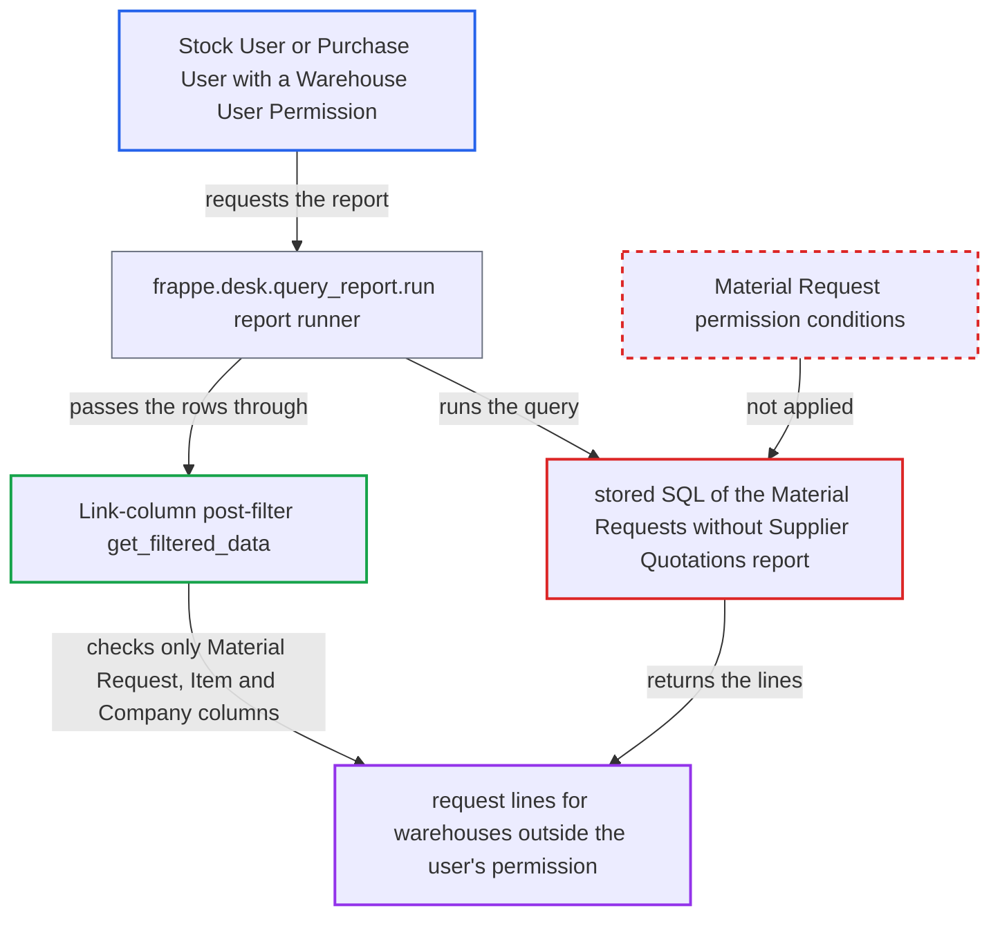

# Material Requests without Supplier Quotations report bypasses Material Request warehouse user permissions

| Field | Value |
|---|---|
| ID | `find_01YNhuw5raRWbVfdeDzZQHeZ` |
| Severity | **Low** |
| Status | open |
| CWE | CWE-862 — Missing authorization |
| Created | 2026-10-27T21:28:18.557705Z |
| Claude Security | https://claude.ai/security/findings/find_01YNhuw5raRWbVfdeDzZQHeZ |

## Description

A Stock User or Purchase User whose Material Request access is limited by a Warehouse User Permission can read pending purchase request lines for warehouses they are not allowed to see. They get the request ID, date, item, quantity, description and company. The stored SQL of the `Material Requests for which Supplier Quotations are not created` report applies no Material Request permission conditions. The framework's post-filter checks only the Link columns `Material Request`, `Item` and `Company`.

1. **the attacker (a Stock User or Purchase User)** calls the report through the API. The request goes to `/api/method/frappe.desk.query_report.run` with `report_name=Material Requests for which Supplier Quotations are not created`. ([`erpnext/stock/report/material_requests_for_which_supplier_quotations_are_not_created/material_requests_for_which_supplier_quotations_are_not_created.json:16-32`](https://github.com/cx-benchmark/erpnext/blob/90e7aefca73da3c440d2e8da7472fcb67838e678/erpnext/stock/report/material_requests_for_which_supplier_quotations_are_not_created/material_requests_for_which_supplier_quotations_are_not_created.json#L16-L32))
2. **the report runner `frappe.desk.query_report.run`** checks only the role and the Material Request `report` permission. The report is granted to Purchase Manager, Stock Manager, Stock User and Purchase User, so this user passes. ([`erpnext/stock/report/material_requests_for_which_supplier_quotations_are_not_created/material_requests_for_which_supplier_quotations_are_not_created.json:16-32`](https://github.com/cx-benchmark/erpnext/blob/90e7aefca73da3c440d2e8da7472fcb67838e678/erpnext/stock/report/material_requests_for_which_supplier_quotations_are_not_created/material_requests_for_which_supplier_quotations_are_not_created.json#L16-L32))
3. **the stored SQL of the report** selects all submitted, non-stopped purchase Material Request lines that have no submitted Supplier Quotation. The query has no permission predicate, and the report is a Query Report with no Python `execute` in which scoping could be added. ([`erpnext/stock/report/material_requests_for_which_supplier_quotations_are_not_created/material_requests_for_which_supplier_quotations_are_not_created.json:15`](https://github.com/cx-benchmark/erpnext/blob/90e7aefca73da3c440d2e8da7472fcb67838e678/erpnext/stock/report/material_requests_for_which_supplier_quotations_are_not_created/material_requests_for_which_supplier_quotations_are_not_created.json#L15))
4. **the framework post-filter `get_filtered_data`** removes rows only by the user's User Permissions on the Link columns. The result has Link columns `Material Request`, `Item` and `Company`. Permissions on `set_warehouse`, `work_order` and `job_card` are never checked, because those fields are not result columns. ([`erpnext/projects/report/timesheet_billing_summary/timesheet_billing_summary.py:3-17`](https://github.com/cx-benchmark/erpnext/blob/90e7aefca73da3c440d2e8da7472fcb67838e678/erpnext/projects/report/timesheet_billing_summary/timesheet_billing_summary.py#L3-L17))
5. **the attacker** receives lines of Material Requests whose target warehouse is outside their permission. The `set_warehouse` value is kept on the request when all lines share it, and the list-view restriction keys on that value. Those requests are hidden from this user in the list and report views. ([`erpnext/utilities/transaction_base.py:220-241`](https://github.com/cx-benchmark/erpnext/blob/90e7aefca73da3c440d2e8da7472fcb67838e678/erpnext/utilities/transaction_base.py#L220-L241))

## Assessment

The attacker is a desk user with the Stock User or Purchase User role. Their Material Request visibility must be limited by a Warehouse User Permission, or by a Work Order or Job Card User Permission. The attack matters only on sites that use such restrictions and where requests have Set Target Warehouse filled. If the user has no Company User Permission, the rows span every company. The report relies on the pinned Frappe version (`>=17.0.0-dev,<18.0.0`, not in the checkout) applying `get_filtered_data`, which checks Link columns only. The report states this as an assumption.

Impact: The attacker gets read-only disclosure of pending purchase Material Request lines: ID, date, item, quantity, description and company. These belong to requests targeting warehouses outside their permission. They still cannot open those documents. Company and Item restrictions are still enforced by the post-filter, so a user restricted by a Company User Permission loses other companies' rows. Nothing can be modified, and availability is not affected.

## Recommendation

The report's stored SQL reads Material Requests without the session user's Material Request permission conditions. The Link-column post-filter cannot enforce restrictions on fields that are not result columns, such as `set_warehouse`, `work_order` and `job_card`.

Fix criteria: Every returned line belongs to a Material Request the session user may see under their Material Request User Permissions. This is the same set that `frappe.get_list("Material Request")` returns for them. Verify this as a Stock User restricted to one warehouse: requests whose Set Target Warehouse is another warehouse no longer appear. The listed requests match the user's Material Request list view.

## Evidence

**https://github.com/cx-benchmark/erpnext**

- [`erpnext/stock/report/material_requests_for_which_supplier_quotations_are_not_created/material_requests_for_which_supplier_quotations_are_not_created.json:15`](https://github.com/cx-benchmark/erpnext/blob/90e7aefca73da3c440d2e8da7472fcb67838e678/erpnext/stock/report/material_requests_for_which_supplier_quotations_are_not_created/material_requests_for_which_supplier_quotations_are_not_created.json#L15)
- [`erpnext/stock/report/material_requests_for_which_supplier_quotations_are_not_created/material_requests_for_which_supplier_quotations_are_not_created.json:16-32`](https://github.com/cx-benchmark/erpnext/blob/90e7aefca73da3c440d2e8da7472fcb67838e678/erpnext/stock/report/material_requests_for_which_supplier_quotations_are_not_created/material_requests_for_which_supplier_quotations_are_not_created.json#L16-L32)
- [`erpnext/stock/doctype/material_request/material_request.json:286-292`](https://github.com/cx-benchmark/erpnext/blob/90e7aefca73da3c440d2e8da7472fcb67838e678/erpnext/stock/doctype/material_request/material_request.json#L286-L292)
- [`erpnext/utilities/transaction_base.py:220-241`](https://github.com/cx-benchmark/erpnext/blob/90e7aefca73da3c440d2e8da7472fcb67838e678/erpnext/utilities/transaction_base.py#L220-L241)
- [`erpnext/projects/report/timesheet_billing_summary/timesheet_billing_summary.py:3-17`](https://github.com/cx-benchmark/erpnext/blob/90e7aefca73da3c440d2e8da7472fcb67838e678/erpnext/projects/report/timesheet_billing_summary/timesheet_billing_summary.py#L3-L17)

