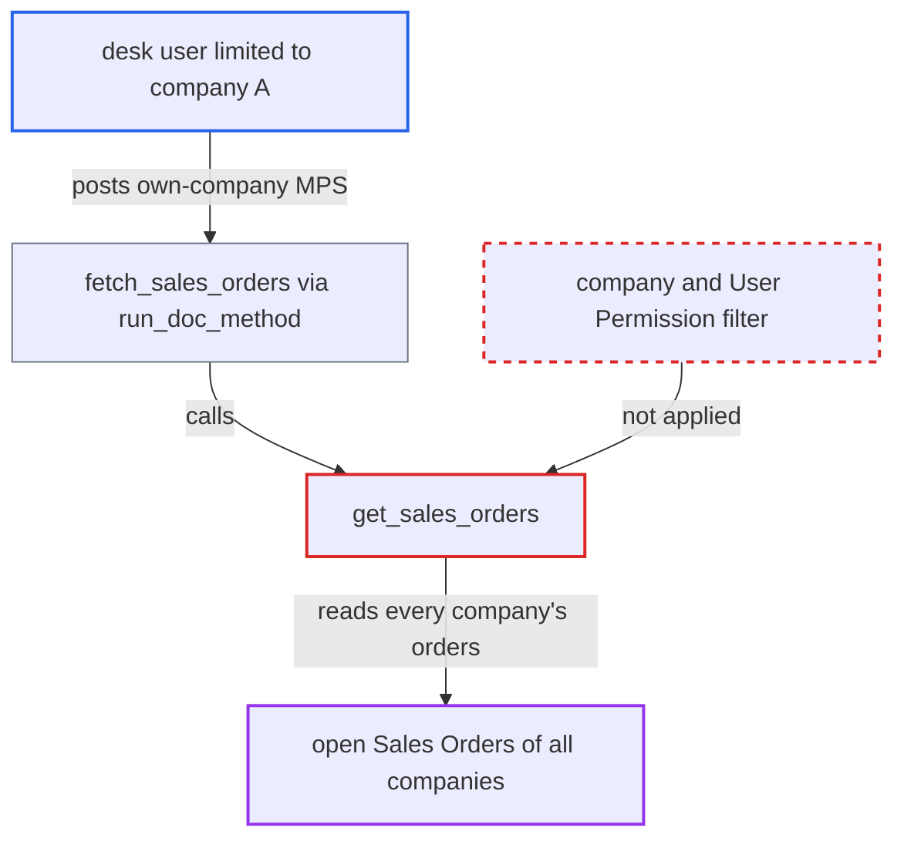

# MPS fetch_sales_orders lists Sales Orders of all companies ignoring user permissions

| Field | Value |
|---|---|
| ID | `find_01J25e8cd24kJMQ6w1mqAeqi` |
| Severity | **Low** |
| Status | open |
| CWE | CWE-862 — Missing authorization |
| Created | 2026-10-27T21:22:38.811174Z |
| Claude Security | https://claude.ai/security/findings/find_01J25e8cd24kJMQ6w1mqAeqi |

## Description

A logged-in user limited to one company can see other companies' open Sales Orders: order name, date, customer, status and grand total. This works only where the operator restricts users with User Permissions, and the user needs a Manufacturing User or Stock User role. The whitelisted `fetch_sales_orders` calls `get_sales_orders`, which has no company filter and no permission conditions.

1. **authenticated desk user** posts a `run_doc_method` request for `fetch_sales_orders`. The request carries an MPS of the user's own company, which may be unsaved, and `args` of `{}` or a customer/date filter.
2. **Frappe `run_doc_method`** checks only read permission on the posted MPS. It does not check the caller's rights on Sales Orders, so the call goes through. ([`erpnext/manufacturing/doctype/master_production_schedule/master_production_schedule.json:206-258`](https://github.com/cx-benchmark/erpnext/blob/90e7aefca73da3c440d2e8da7472fcb67838e678/erpnext/manufacturing/doctype/master_production_schedule/master_production_schedule.json#L206-L258))
3. **the method `fetch_sales_orders`** calls `get_sales_orders` and appends each returned order to the `sales_orders` table. Each order's `name`, `transaction_date`, `customer`, `status` and `grand_total` is copied, and `delivery_date` is dropped because the table has no such field. ([`erpnext/manufacturing/doctype/master_production_schedule/master_production_schedule.py:461-485`](https://github.com/cx-benchmark/erpnext/blob/90e7aefca73da3c440d2e8da7472fcb67838e678/erpnext/manufacturing/doctype/master_production_schedule/master_production_schedule.py#L461-L485))
4. **the function `get_sales_orders`** queries `Sales Order` with the raw `frappe.qb` builder. It filters only on `docstatus = 1`, an open status, the caller's optional customer/date filters and the MPS item selection. It has no `company == self.company` clause and no User Permission or match conditions. ([`erpnext/manufacturing/doctype/master_production_schedule/master_production_schedule.py:487-524`](https://github.com/cx-benchmark/erpnext/blob/90e7aefca73da3c440d2e8da7472fcb67838e678/erpnext/manufacturing/doctype/master_production_schedule/master_production_schedule.py#L487-L524))
5. **Frappe** returns the MPS with the foreign orders in `response.docs`. An existing MPS is also saved with `self.save()`, but the response already shows the data to the caller. ([`erpnext/manufacturing/doctype/master_production_schedule/master_production_schedule.py:461-485`](https://github.com/cx-benchmark/erpnext/blob/90e7aefca73da3c440d2e8da7472fcb67838e678/erpnext/manufacturing/doctype/master_production_schedule/master_production_schedule.py#L461-L485))

## Assessment

The attacker is an authenticated desk user with Manufacturing User or Stock User, who can read and create an MPS. The user is limited by a Company User Permission to company A. Customer or Territory User Permissions on Sales Order are also bypassed. Manufacturing User has no Sales Order permission at all, and Stock User can read Sales Orders only within User Permissions. The user posts `run_doc_method` with `method=fetch_sales_orders` on an MPS of company A. The MPS may be unsaved. Frappe checks only read access on that MPS. The gain exists only where the operator restricts users with User Permissions. The sibling `fetch_materials_requests` has the same omission, and the report files it separately.

Impact: The attacker reads the customer names, order values, dates and status of every other company's open submitted Sales Orders. Line items, prices, addresses and contacts are not returned. Nothing else changes: for a saved MPS only the attacker's own MPS rows are written, and the save can fail if a returned order's Customer is company-restricted, a check the unsaved-MPS path skips.

## Recommendation

`get_sales_orders` queries Sales Orders with the permission-blind `frappe.qb` builder. It omits the company scope and the user-permission conditions, so the whitelisted `fetch_sales_orders` leaks other companies' orders.

Fix criteria: Only Sales Orders the caller may read are returned or stored: at least `company == self.company`, and preferably the Sales Order permission conditions via `frappe.get_list` or `get_match_conditions_qb`. Verify as a user scoped to company A: `fetch_sales_orders` must not return or save any company-B Sales Order.

## Evidence

**https://github.com/cx-benchmark/erpnext**

- [`erpnext/manufacturing/doctype/master_production_schedule/master_production_schedule.py:487-524`](https://github.com/cx-benchmark/erpnext/blob/90e7aefca73da3c440d2e8da7472fcb67838e678/erpnext/manufacturing/doctype/master_production_schedule/master_production_schedule.py#L487-L524)
- [`erpnext/manufacturing/doctype/master_production_schedule/master_production_schedule.py:461-485`](https://github.com/cx-benchmark/erpnext/blob/90e7aefca73da3c440d2e8da7472fcb67838e678/erpnext/manufacturing/doctype/master_production_schedule/master_production_schedule.py#L461-L485)
- [`erpnext/manufacturing/doctype/master_production_schedule/master_production_schedule.py:281-300`](https://github.com/cx-benchmark/erpnext/blob/90e7aefca73da3c440d2e8da7472fcb67838e678/erpnext/manufacturing/doctype/master_production_schedule/master_production_schedule.py#L281-L300)
- [`erpnext/manufacturing/doctype/production_plan/services/planning_queries.py:145-158`](https://github.com/cx-benchmark/erpnext/blob/90e7aefca73da3c440d2e8da7472fcb67838e678/erpnext/manufacturing/doctype/production_plan/services/planning_queries.py#L145-L158)
- [`erpnext/manufacturing/doctype/master_production_schedule/master_production_schedule.json:206-258`](https://github.com/cx-benchmark/erpnext/blob/90e7aefca73da3c440d2e8da7472fcb67838e678/erpnext/manufacturing/doctype/master_production_schedule/master_production_schedule.json#L206-L258)
- [`erpnext/selling/doctype/sales_order/sales_order.json:1880-1895`](https://github.com/cx-benchmark/erpnext/blob/90e7aefca73da3c440d2e8da7472fcb67838e678/erpnext/selling/doctype/sales_order/sales_order.json#L1880-L1895)

