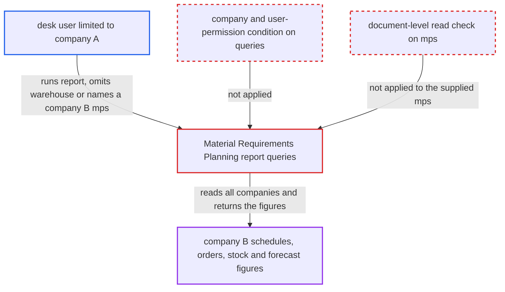

# MRP report returns other companies' schedules, orders and stock despite Company user permissions

| Field | Value |
|---|---|
| ID | `find_01QpS2jp4K8Pi7bNf3sKm4h1` |
| Severity | **Low** |
| Status | open |
| CWE | CWE-862 — Missing Authorization |
| Created | 2026-10-27T21:24:26.573103Z |
| Claude Security | https://claude.ai/security/findings/find_01QpS2jp4K8Pi7bNf3sKm4h1 |

## Description

A desk user who is limited to company A by a Company User Permission can read company B's planning data through the Material Requirements Planning report. This covers planned quantities and dates, open sales-order demand, and work-order, purchase-order, subcontracting and stock quantities. The user needs Manufacturing User or Stock User on a multi-company site. The report's queries in `material_requirements_planning_report.py` skip permissions and company conditions, and a caller-supplied `mps` is never read-checked.

1. **restricted desk user** calls the report runner with only a company filter. The user holds Manufacturing User or Stock User, calls `/api/method/frappe.desk.query_report.run` for `Material Requirements Planning Report`, and sends `company` set to A with the dates, leaving out `warehouse` and `mps`, or naming a company-B `mps`. ([`erpnext/manufacturing/report/material_requirements_planning_report/material_requirements_planning_report.json:9-46`](https://github.com/cx-benchmark/erpnext/blob/90e7aefca73da3c440d2e8da7472fcb67838e678/erpnext/manufacturing/report/material_requirements_planning_report/material_requirements_planning_report.json#L9-L46))
2. **Frappe report runner** lets the call through on role checks alone. The Report doc's `filters` table is empty, so no filter value is validated, and the role-level `report` permission on `Master Production Schedule` is enough. ([`erpnext/manufacturing/report/material_requirements_planning_report/material_requirements_planning_report.json:9-46`](https://github.com/cx-benchmark/erpnext/blob/90e7aefca73da3c440d2e8da7472fcb67838e678/erpnext/manufacturing/report/material_requirements_planning_report/material_requirements_planning_report.json#L9-L46))
3. **the function `get_mps_data`** reads every schedule item in the date range. It uses a raw `frappe.qb` query with no company or user-permission condition, and `warehouse`, `mps` and `item_code` are optional and unchecked. ([`erpnext/manufacturing/report/material_requirements_planning_report/material_requirements_planning_report.py:825-865`](https://github.com/cx-benchmark/erpnext/blob/90e7aefca73da3c440d2e8da7472fcb67838e678/erpnext/manufacturing/report/material_requirements_planning_report/material_requirements_planning_report.py#L825-L865))
4. **the function `add_non_planned_orders`** adds open sales-order demand from all companies. It reads item, warehouse, pending quantity and delivery date from `Sales Order Item` with a raw query. ([`erpnext/manufacturing/report/material_requirements_planning_report/material_requirements_planning_report.py:61-120`](https://github.com/cx-benchmark/erpnext/blob/90e7aefca73da3c440d2e8da7472fcb67838e678/erpnext/manufacturing/report/material_requirements_planning_report/material_requirements_planning_report.py#L61-L120))
5. **the supply and stock readers** net work-order, purchase-order, subcontracting and bin quantities of all companies against the demand. Without a warehouse filter, `get_item_wise_bin_details` sums `tabBin` over every company's warehouses, and the order readers also run without a company condition. ([`erpnext/manufacturing/report/material_requirements_planning_report/material_requirements_planning_report.py:581-787`](https://github.com/cx-benchmark/erpnext/blob/90e7aefca73da3c440d2e8da7472fcb67838e678/erpnext/manufacturing/report/material_requirements_planning_report/material_requirements_planning_report.py#L581-L787))
6. **the function `get_items_from_mps`** loads the named company-B schedule and its Sales Forecast. It uses `frappe.get_all` with no document-level read check, unlike `get_mps_details`. ([`erpnext/manufacturing/report/material_requirements_planning_report/material_requirements_planning_report.py:867-890`](https://github.com/cx-benchmark/erpnext/blob/90e7aefca73da3c440d2e8da7472fcb67838e678/erpnext/manufacturing/report/material_requirements_planning_report/material_requirements_planning_report.py#L867-L890))
7. **Frappe row filter** fails to remove company B's rows. The output Link columns are only `item_code`, a hidden `warehouse` that is empty for MPS and raw-material rows, and `bom_no`. There is no Company column to filter on, so the figures reach the user. ([`erpnext/manufacturing/report/material_requirements_planning_report/material_requirements_planning_report.py:952-1095`](https://github.com/cx-benchmark/erpnext/blob/90e7aefca73da3c440d2e8da7472fcb67838e678/erpnext/manufacturing/report/material_requirements_planning_report/material_requirements_planning_report.py#L952-L1095))

## Assessment

The attacker is a logged-in desk user with Manufacturing User or Stock User, the roles that hold `report` on `Master Production Schedule`. A Company User Permission limits them to company A on a site with several companies. They call `frappe.desk.query_report.run` for the report with `company` set to A and the dates, and leave out `warehouse` and `mps`. Alternatively, they pass `mps` with the name of a company-B schedule, which also loads that schedule's items and its linked Sales Forecast. The `company` filter only affects Item Default lookups, so it does not limit the data.

Impact: The user reads company B's planned quantities and delivery dates, open sales-order pending quantities per item, warehouse and date, and the work-order, purchase-order, subcontracting and stock quantities netted against them. A named schedule's forecast is exposed as well. This is read-only. The report does not emit customer, supplier, price or order identifiers, and nothing can be written or disrupted.

## Recommendation

(1) The queries on `Master Production Schedule`, `Sales Order`, `Work Order`, `Purchase Order`, `Subcontracting Order`, `Sales Forecast`, `Bin` and Stock Reservation are raw `frappe.qb` or `frappe.get_all` calls with no company or user-permission condition. Company and Warehouse User Permissions are therefore bypassed.

Fix criteria: Every demand and supply query is limited to the caller's permitted companies and warehouses and, where given, to the chosen company. A user restricted to company A who runs the report with no `warehouse` or `mps` filter gets no quantity or chart value derived from company-B documents.

(2) A caller-supplied `mps`, and through it its Sales Forecast, is loaded without a document-level read check, unlike `get_mps_details`.

Fix criteria: A supplied `mps` passes a document-level read check for the caller before any of its data is used. Naming another company's `mps` raises a permission error instead of returning its items.

## Evidence

**https://github.com/cx-benchmark/erpnext**

- [`erpnext/manufacturing/report/material_requirements_planning_report/material_requirements_planning_report.py:825-865`](https://github.com/cx-benchmark/erpnext/blob/90e7aefca73da3c440d2e8da7472fcb67838e678/erpnext/manufacturing/report/material_requirements_planning_report/material_requirements_planning_report.py#L825-L865)
- [`erpnext/manufacturing/report/material_requirements_planning_report/material_requirements_planning_report.py:61-120`](https://github.com/cx-benchmark/erpnext/blob/90e7aefca73da3c440d2e8da7472fcb67838e678/erpnext/manufacturing/report/material_requirements_planning_report/material_requirements_planning_report.py#L61-L120)
- [`erpnext/manufacturing/report/material_requirements_planning_report/material_requirements_planning_report.py:152-197`](https://github.com/cx-benchmark/erpnext/blob/90e7aefca73da3c440d2e8da7472fcb67838e678/erpnext/manufacturing/report/material_requirements_planning_report/material_requirements_planning_report.py#L152-L197)
- [`erpnext/manufacturing/report/material_requirements_planning_report/material_requirements_planning_report.py:581-787`](https://github.com/cx-benchmark/erpnext/blob/90e7aefca73da3c440d2e8da7472fcb67838e678/erpnext/manufacturing/report/material_requirements_planning_report/material_requirements_planning_report.py#L581-L787)
- [`erpnext/manufacturing/report/material_requirements_planning_report/material_requirements_planning_report.py:867-890`](https://github.com/cx-benchmark/erpnext/blob/90e7aefca73da3c440d2e8da7472fcb67838e678/erpnext/manufacturing/report/material_requirements_planning_report/material_requirements_planning_report.py#L867-L890)
- [`erpnext/manufacturing/report/material_requirements_planning_report/material_requirements_planning_report.py:892-922`](https://github.com/cx-benchmark/erpnext/blob/90e7aefca73da3c440d2e8da7472fcb67838e678/erpnext/manufacturing/report/material_requirements_planning_report/material_requirements_planning_report.py#L892-L922)
- [`erpnext/manufacturing/report/material_requirements_planning_report/material_requirements_planning_report.py:952-1095`](https://github.com/cx-benchmark/erpnext/blob/90e7aefca73da3c440d2e8da7472fcb67838e678/erpnext/manufacturing/report/material_requirements_planning_report/material_requirements_planning_report.py#L952-L1095)
- [`erpnext/manufacturing/report/material_requirements_planning_report/material_requirements_planning_report.json:9-46`](https://github.com/cx-benchmark/erpnext/blob/90e7aefca73da3c440d2e8da7472fcb67838e678/erpnext/manufacturing/report/material_requirements_planning_report/material_requirements_planning_report.json#L9-L46)
- [`erpnext/manufacturing/doctype/master_production_schedule/master_production_schedule.py:566-574`](https://github.com/cx-benchmark/erpnext/blob/90e7aefca73da3c440d2e8da7472fcb67838e678/erpnext/manufacturing/doctype/master_production_schedule/master_production_schedule.py#L566-L574)

