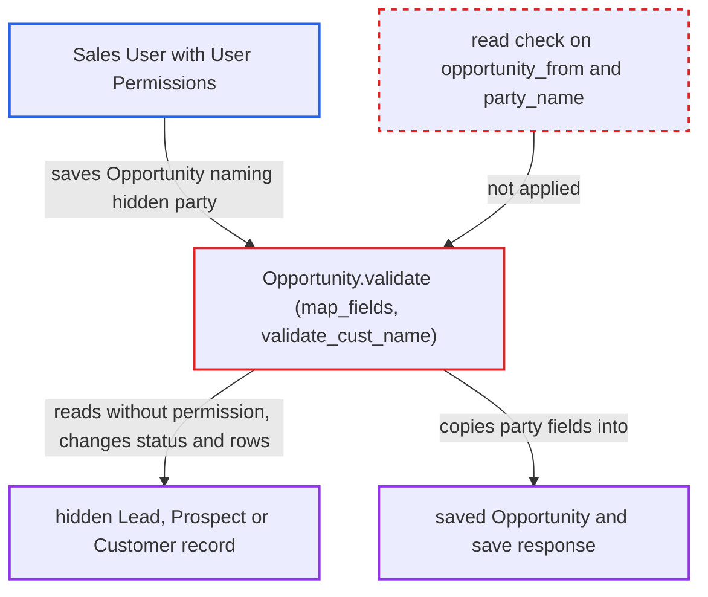

# Opportunity save copies fields of a party the user cannot read

| Field | Value |
|---|---|
| ID | `find_01VC33n2uXvJUFvzuPuLp7rs` |
| Severity | **Low** |
| Status | open |
| CWE | CWE-862 — Missing authorization |
| Created | 2026-10-27T21:23:00.895977Z |
| Claude Security | https://claude.ai/security/findings/find_01VC33n2uXvJUFvzuPuLp7rs |

## Description

A Sales User whose User Permissions hide a Lead, Prospect or Customer can still read some of that party's fields and change its state. They create an Opportunity that names the hidden party. This only matters on sites that use User Permissions to restrict these parties. The cause is that `Opportunity.validate` copies data from the party named in `opportunity_from`/`party_name` without checking read access.

1. **Sales User** sends a new Opportunity naming a hidden party. The request goes through `frappe.client.insert`, `/api/resource/Opportunity` or `savedocs`, with `opportunity_from` set to Lead, `party_name` set to the hidden Lead's name, and the optional fields left blank.
2. **Frappe create check** lets the save continue. It runs `check_permission("create")`, which does not test the `Dynamic Link` field `party_name` against User Permissions. ([`erpnext/crm/doctype/opportunity/opportunity.py:133-144`](https://github.com/cx-benchmark/erpnext/blob/90e7aefca73da3c440d2e8da7472fcb67838e678/erpnext/crm/doctype/opportunity/opportunity.py#L133-L144))
3. **the method `map_fields`** copies the party's fields onto the Opportunity. It fills every empty Opportunity column that the party doctype also has, using `frappe.db.get_value`, which checks no permission. ([`erpnext/crm/doctype/opportunity/opportunity.py:232-239`](https://github.com/cx-benchmark/erpnext/blob/90e7aefca73da3c440d2e8da7472fcb67838e678/erpnext/crm/doctype/opportunity/opportunity.py#L232-L239))
4. **the method `validate_cust_name`** sets `customer_name` from the party. It reads the Lead's `lead_name`/`company_name`, the name of the Lead's Prospect, or the Customer's `customer_name`, again without a permission check. ([`erpnext/crm/doctype/opportunity/opportunity.py:489-503`](https://github.com/cx-benchmark/erpnext/blob/90e7aefca73da3c440d2e8da7472fcb67838e678/erpnext/crm/doctype/opportunity/opportunity.py#L489-L503))
5. **the hooks `after_insert` and `update_prospect`** change the hidden party's records. `after_insert` sets the Lead's `status`, and `update_prospect` adds a row to the Prospect using `ignore_permissions`. ([`erpnext/crm/doctype/opportunity/opportunity.py:116-118`](https://github.com/cx-benchmark/erpnext/blob/90e7aefca73da3c440d2e8da7472fcb67838e678/erpnext/crm/doctype/opportunity/opportunity.py#L116-L118))
6. **Frappe save response** returns the copied data to the attacker. The save response, and the Opportunity the attacker owns afterwards, carry the hidden party's data.

## Assessment

The attacker is a desk user with the `Sales User` role, which grants create on Opportunity. User Permissions on Lead, Territory, Company or Customer hide some parties from them. Hidden Lead names are enumerable, because they follow the pattern `CRM-LEAD-.YYYY.-`. The attack works through `frappe.client.insert`, `/api/resource/Opportunity` or `savedocs`. It matters only on a site that uses User Permissions to restrict these parties. The fork's Company Restriction hook covers dynamic links only for Customer, Supplier and Item, so it does not help for a Lead or Prospect.

Impact: The attacker reads a hidden Lead's name or company, `phone`, `city`, `state`, `country`, `job_title`, `website`, revenue, headcount and `utm_*` data. They can also read a hidden Prospect's firmographic fields or a hidden Customer's descriptive fields. `email_id`, `mobile_no`, notes and communications stay protected. The attacker also changes the hidden Lead's `status`, adds an Opportunity row to the hidden Prospect, and creates an Opportunity against a party they may not access. There is no availability impact.

## Recommendation

`Opportunity.validate` (`map_fields`, `validate_cust_name`) and its insert/update hooks read and change the party named by a caller-supplied `Dynamic Link` without checking that the caller may read it. Frappe's User Permission check does not cover Dynamic Link fields.

Fix criteria: An interactive save is refused before any party field is copied or any party record is changed when the current user fails `frappe.has_permission(opportunity_from, "read", party_name)`. Trusted server paths that set `ignore_permissions` are exempt. To verify, insert an Opportunity naming a hidden Lead as a Sales User whose User Permissions hide that Lead. The insert must fail with a permission error and return none of the Lead's fields. The Lead's status and the Prospect's rows must stay unchanged.

## Evidence

**https://github.com/cx-benchmark/erpnext**

- [`erpnext/crm/doctype/opportunity/opportunity.py:232-239`](https://github.com/cx-benchmark/erpnext/blob/90e7aefca73da3c440d2e8da7472fcb67838e678/erpnext/crm/doctype/opportunity/opportunity.py#L232-L239)
- [`erpnext/crm/doctype/opportunity/opportunity.py:489-503`](https://github.com/cx-benchmark/erpnext/blob/90e7aefca73da3c440d2e8da7472fcb67838e678/erpnext/crm/doctype/opportunity/opportunity.py#L489-L503)
- [`erpnext/crm/doctype/opportunity/opportunity.py:133-144`](https://github.com/cx-benchmark/erpnext/blob/90e7aefca73da3c440d2e8da7472fcb67838e678/erpnext/crm/doctype/opportunity/opportunity.py#L133-L144)
- [`erpnext/crm/doctype/opportunity/opportunity.py:101-104`](https://github.com/cx-benchmark/erpnext/blob/90e7aefca73da3c440d2e8da7472fcb67838e678/erpnext/crm/doctype/opportunity/opportunity.py#L101-L104)
- [`erpnext/crm/utils.py:202-204`](https://github.com/cx-benchmark/erpnext/blob/90e7aefca73da3c440d2e8da7472fcb67838e678/erpnext/crm/utils.py#L202-L204)
- [`erpnext/stock/doctype/company_restriction/company_restriction.py:213-223`](https://github.com/cx-benchmark/erpnext/blob/90e7aefca73da3c440d2e8da7472fcb67838e678/erpnext/stock/doctype/company_restriction/company_restriction.py#L213-L223)
- [`erpnext/crm/doctype/opportunity/opportunity.py:116-118`](https://github.com/cx-benchmark/erpnext/blob/90e7aefca73da3c440d2e8da7472fcb67838e678/erpnext/crm/doctype/opportunity/opportunity.py#L116-L118)

