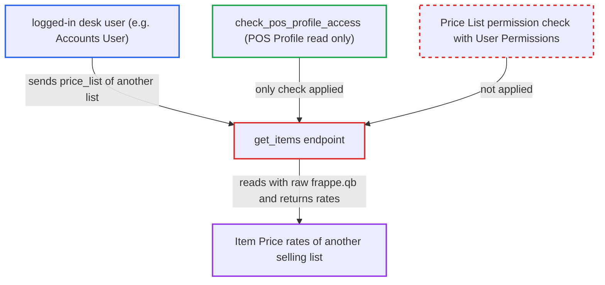

# POS get_items returns rates of any caller-chosen Price List, bypassing Price List User Permissions

| Field | Value |
|---|---|
| ID | `find_016RinAP9cVm5FuoA3tyGXJJ` |
| Severity | **Low** |
| Status | open |
| CWE | CWE-862 — Missing authorization |
| Created | 2026-10-27T21:50:25.484854Z |
| Claude Security | https://claude.ai/security/findings/find_016RinAP9cVm5FuoA3tyGXJJ |

## Description

A logged-in desk user, such as an `Accounts User` who can read a POS Profile, can read item rates from selling price lists that a Price List User Permission is meant to hide from them. This matters only where such a restriction is set up. The whitelisted `get_items` takes `price_list` from the caller, checks only POS Profile access, and reads `tabItem Price` with a raw `frappe.qb` query.

1. **attacker (logged-in desk user)** posts a request to the `get_items` endpoint with another selling list as `price_list`. The attacker sends their own POS Profile, `item_group` set to the root, a large `page_length`, no `search_term`, and a `price_list` they are not permitted, such as `Standard Selling` or a guessed name. ([`erpnext/selling/page/point_of_sale/point_of_sale.py:203-231`](https://github.com/cx-benchmark/erpnext/blob/90e7aefca73da3c440d2e8da7472fcb67838e678/erpnext/selling/page/point_of_sale/point_of_sale.py#L203-L231))
2. **the function `check_pos_profile_access`** lets the request through after a POS Profile read check. It only requires `frappe.has_permission("POS Profile", doc=pos_profile)`, so nothing checks the Price List. ([`erpnext/selling/page/point_of_sale/point_of_sale.py:167-174`](https://github.com/cx-benchmark/erpnext/blob/90e7aefca73da3c440d2e8da7472fcb67838e678/erpnext/selling/page/point_of_sale/point_of_sale.py#L167-L174))
3. **the handler `get_items`** queries `tabItem Price` for the caller's `price_list` with raw `frappe.qb`. The query filters on `selling == 1` and has no `customer` filter. The report assumes `frappe.qb` applies neither role permissions nor User Permissions, so the restriction is never consulted. ([`erpnext/selling/page/point_of_sale/point_of_sale.py:291-309`](https://github.com/cx-benchmark/erpnext/blob/90e7aefca73da3c440d2e8da7472fcb67838e678/erpnext/selling/page/point_of_sale/point_of_sale.py#L291-L309))
4. **the handler `get_items`** returns the rates for every item on the page. The response holds `price_list_rate`, `currency`, `uom` and `batch_no` for each item, and customer-specific rows of that list can be included. ([`erpnext/selling/page/point_of_sale/point_of_sale.py:333-343`](https://github.com/cx-benchmark/erpnext/blob/90e7aefca73da3c440d2e8da7472fcb67838e678/erpnext/selling/page/point_of_sale/point_of_sale.py#L333-L343))

## Assessment

The attacker is a logged-in desk user who can read a POS Profile (for example `Accounts User`). A Price List User Permission limits them to one list, called A here. They call `/api/method/erpnext.selling.page.point_of_sale.point_of_sale.get_items` with their own profile and another selling list B as `price_list`, for example `Standard Selling` or a guessed name. No victim interaction is needed. Without a Price List User Permission, the same rates are already reachable through normal transaction pricing, so the exposure depends on that configured restriction.

Impact: The attacker can read every rate of other selling price lists in pages of up to `page_length` items. This includes `currency`, `uom`, `batch_no` and customer-specific Item Price rows. It is read-only and limited to lists with `selling == 1` and to items the POS Profile sells.

## Recommendation

`get_items` trusts the caller-supplied `price_list` and reads Item Price with a permission-less query builder. This bypasses Price List User Permissions and the POS Profile's own list.

Fix criteria: Before Item Price is read, the supplied `price_list` is either the POS Profile's `selling_price_list` or passes a record-level Price List permission check that honours User Permissions. Otherwise the call raises `PermissionError`. Customer-specific rows are not returned to callers who are not permitted that customer. A user restricted to list A who calls `get_items(price_list=B)` receives no rates, and calls with A still work.

## Evidence

**https://github.com/cx-benchmark/erpnext**

- [`erpnext/selling/page/point_of_sale/point_of_sale.py:291-309`](https://github.com/cx-benchmark/erpnext/blob/90e7aefca73da3c440d2e8da7472fcb67838e678/erpnext/selling/page/point_of_sale/point_of_sale.py#L291-L309)
- [`erpnext/selling/page/point_of_sale/point_of_sale.py:203-231`](https://github.com/cx-benchmark/erpnext/blob/90e7aefca73da3c440d2e8da7472fcb67838e678/erpnext/selling/page/point_of_sale/point_of_sale.py#L203-L231)
- [`erpnext/selling/page/point_of_sale/point_of_sale.py:167-174`](https://github.com/cx-benchmark/erpnext/blob/90e7aefca73da3c440d2e8da7472fcb67838e678/erpnext/selling/page/point_of_sale/point_of_sale.py#L167-L174)
- [`erpnext/selling/page/point_of_sale/point_of_sale.py:333-343`](https://github.com/cx-benchmark/erpnext/blob/90e7aefca73da3c440d2e8da7472fcb67838e678/erpnext/selling/page/point_of_sale/point_of_sale.py#L333-L343)
- [`erpnext/stock/doctype/item_price/item_price.json:236-270`](https://github.com/cx-benchmark/erpnext/blob/90e7aefca73da3c440d2e8da7472fcb67838e678/erpnext/stock/doctype/item_price/item_price.json#L236-L270)
- [`erpnext/accounts/party.py:412-454`](https://github.com/cx-benchmark/erpnext/blob/90e7aefca73da3c440d2e8da7472fcb67838e678/erpnext/accounts/party.py#L412-L454)
- [`erpnext/selling/page/point_of_sale/point_of_sale.py:79-83`](https://github.com/cx-benchmark/erpnext/blob/90e7aefca73da3c440d2e8da7472fcb67838e678/erpnext/selling/page/point_of_sale/point_of_sale.py#L79-L83)

