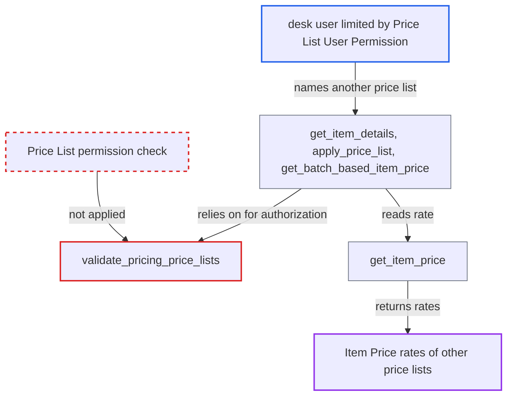

# Pricing entry points ignore Price List user permissions, exposing restricted price lists' rates

| Field | Value |
|---|---|
| ID | `find_01673TwpnaXCjhyj6qy2MSQK` |
| Severity | **Low** |
| Status | open |
| CWE | CWE-862 — Missing Authorization |
| Created | 2026-10-27T21:19:05.088455Z |
| Claude Security | https://claude.ai/security/findings/find_01673TwpnaXCjhyj6qy2MSQK |

## Description

A logged-in desk user who is limited by a User Permission on Price List can read the item rates of other enabled selling or buying price lists. The rates come back together with any pricing-rule discounts. The pricing entry points `get_item_details`, `apply_price_list` and `get_batch_based_item_price` rely on `validate_pricing_price_lists`, which only checks that the list is for the right side and never checks that the caller may read the Price List.

1. **authenticated desk user** sends a pricing request naming a price list they are restricted from. The user needs read access to a sales or purchase doctype and has a User Permission on Price List. The request is a POST to `/api/method/erpnext.stock.get_item_details.apply_price_list` with `ctx` holding `doctype`, `company`, `price_list` and `items`, or a call to `get_item_details` with `price_list`. ([`erpnext/stock/get_item_details.py:1820-1826`](https://github.com/cx-benchmark/erpnext/blob/90e7aefca73da3c440d2e8da7472fcb67838e678/erpnext/stock/get_item_details.py#L1820-L1826))
2. **the entry point `apply_price_list`** passes the price list to the shared pricing check. The entry points `get_item_details` and `apply_price_list` authorize the price list only through `validate_pricing_context`. ([`erpnext/stock/get_item_details.py:82-96`](https://github.com/cx-benchmark/erpnext/blob/90e7aefca73da3c440d2e8da7472fcb67838e678/erpnext/stock/get_item_details.py#L82-L96))
3. **`validate_pricing_price_lists`** accepts the list after checking only its selling or buying side. `fits_price_list_side` checks only the selling or buying flag, or an internal party/return exception. It does not call `frappe.has_permission` on the Price List or apply User Permissions. ([`erpnext/accounts/doctype/pricing_rule/pricing_rule.py:804-836`](https://github.com/cx-benchmark/erpnext/blob/90e7aefca73da3c440d2e8da7472fcb67838e678/erpnext/accounts/doctype/pricing_rule/pricing_rule.py#L804-L836))
4. **`get_item_price`** reads the rate from the Item Price table for the chosen list. The query uses `frappe.qb` with no user-permission filtering. ([`erpnext/stock/get_item_details.py:1387-1430`](https://github.com/cx-benchmark/erpnext/blob/90e7aefca73da3c440d2e8da7472fcb67838e678/erpnext/stock/get_item_details.py#L1387-L1430))
5. **`get_price_list_rate`** returns the rate as `price_list_rate` to the caller. The caller can repeat this for other items and price lists to list every rate. ([`erpnext/stock/get_item_details.py:1213-1261`](https://github.com/cx-benchmark/erpnext/blob/90e7aefca73da3c440d2e8da7472fcb67838e678/erpnext/stock/get_item_details.py#L1213-L1261))

## Assessment

The attacker is an authenticated desk user with read access to a sales or purchase doctype, such as a Sales User. The deployment restricts this user with a User Permission on Price List, for example to their region's list. The user calls `get_item_details` or `apply_price_list` with a `price_list` or `selling_price_list` they are not allowed to see. `get_batch_based_item_price` is a third entry point that uses the same gate, and `buying_price_list` is checked the same way. The target list must be enabled and flagged for the right side (selling or buying).

Impact: The user can read every rate in any other enabled selling or buying price list, item by item, plus the pricing-rule discounts returned with it. This is read-only disclosure, and the report states no modification and no availability impact.

## Recommendation

The shared check `validate_pricing_price_lists` validates only the side of the caller-chosen Price List. It does not check whether the caller may read that list, so User Permission isolation on Price List and Item Price is bypassed by every whitelisted pricing entry point.

Fix criteria: A caller-supplied `price_list`, `selling_price_list` or `buying_price_list` is refused with a PermissionError when the caller's record-level permission on that Price List fails, for example `frappe.has_permission("Price List", doc=price_list, ptype="select")`, honouring User Permissions. A user with a Price List User Permission for "Retail" who calls `get_item_details`, `apply_price_list` or `get_batch_based_item_price` with `price_list="Wholesale"` gets an error and no rate. Calls with "Retail" and in-process pricing during document save are unaffected.

## Evidence

**https://github.com/cx-benchmark/erpnext**

- [`erpnext/accounts/doctype/pricing_rule/pricing_rule.py:804-836`](https://github.com/cx-benchmark/erpnext/blob/90e7aefca73da3c440d2e8da7472fcb67838e678/erpnext/accounts/doctype/pricing_rule/pricing_rule.py#L804-L836)
- [`erpnext/stock/get_item_details.py:1213-1261`](https://github.com/cx-benchmark/erpnext/blob/90e7aefca73da3c440d2e8da7472fcb67838e678/erpnext/stock/get_item_details.py#L1213-L1261)
- [`erpnext/stock/get_item_details.py:1387-1430`](https://github.com/cx-benchmark/erpnext/blob/90e7aefca73da3c440d2e8da7472fcb67838e678/erpnext/stock/get_item_details.py#L1387-L1430)
- [`erpnext/stock/get_item_details.py:82-96`](https://github.com/cx-benchmark/erpnext/blob/90e7aefca73da3c440d2e8da7472fcb67838e678/erpnext/stock/get_item_details.py#L82-L96)
- [`erpnext/stock/get_item_details.py:1820-1826`](https://github.com/cx-benchmark/erpnext/blob/90e7aefca73da3c440d2e8da7472fcb67838e678/erpnext/stock/get_item_details.py#L1820-L1826)
- [`erpnext/stock/get_item_details.py:217-227`](https://github.com/cx-benchmark/erpnext/blob/90e7aefca73da3c440d2e8da7472fcb67838e678/erpnext/stock/get_item_details.py#L217-L227)

