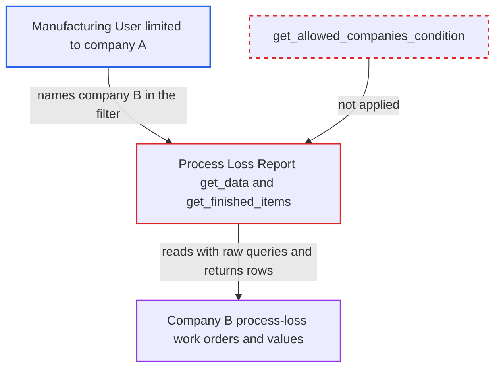

# Process Loss Report ignores Company user permissions on caller-chosen company

| Field | Value |
|---|---|
| ID | `find_01KUPPsQTV1ogwpVmAoEinYk` |
| Severity | **Low** |
| Status | open |
| CWE | CWE-639 — Missing Authorization |
| Created | 2026-10-27T21:17:35.014708Z |
| Claude Security | https://claude.ai/security/findings/find_01KUPPsQTV1ogwpVmAoEinYk |

## Description

A Manufacturing User who is limited to company A by Company User Permissions can read company B's process-loss work orders and their valuation figures. The attacker needs a desk login on a multi-company site and names company B in the report's `company` filter. The Process Loss Report runs raw `frappe.qb` queries and scopes them only by that caller-supplied filter, so the user's permissions are never applied.

1. **Manufacturing User limited to company A** runs the Process Loss Report through `/api/method/frappe.desk.query_report.run` with company B. The request sets `filters.company` to company B, plus `from_date` and `to_date`, and the role check passes because the `Manufacturing User` role may run the report. ([`erpnext/manufacturing/report/process_loss_report/process_loss_report.json:9-25`](https://github.com/cx-benchmark/erpnext/blob/90e7aefca73da3c440d2e8da7472fcb67838e678/erpnext/manufacturing/report/process_loss_report/process_loss_report.json#L9-L25))
2. **Frappe report runner** accepts the filters without checking them against the user's permissions. The Report doc declares `filters: []`, so Frappe validates no Link-filter permission for the company value. ([`erpnext/manufacturing/report/process_loss_report/process_loss_report.json:9-25`](https://github.com/cx-benchmark/erpnext/blob/90e7aefca73da3c440d2e8da7472fcb67838e678/erpnext/manufacturing/report/process_loss_report/process_loss_report.json#L9-L25))
3. **the function `get_data`** reads Work Order and Stock Entry data through raw `frappe.qb`. Raw `frappe.qb` queries add no permission conditions, so the data is limited only by the company in the filter. ([`erpnext/manufacturing/report/process_loss_report/process_loss_report.py:24-63`](https://github.com/cx-benchmark/erpnext/blob/90e7aefca73da3c440d2e8da7472fcb67838e678/erpnext/manufacturing/report/process_loss_report/process_loss_report.py#L24-L63))
4. **the function `get_stock_entry_conditions`** limits rows to `se.company` equal to `filters.company`. This is the only company scoping, and it is never intersected with the companies the caller is allowed to see. The subquery `get_finished_items` uses the same condition. ([`erpnext/manufacturing/report/process_loss_report/process_loss_report.py:87-93`](https://github.com/cx-benchmark/erpnext/blob/90e7aefca73da3c440d2e8da7472fcb67838e678/erpnext/manufacturing/report/process_loss_report/process_loss_report.py#L87-L93))
5. **Frappe desk row filter** fails to remove company B's rows from the result. The output has only `Work Order` and `Item` Link columns and no Company column, so there is no Company value to test against the user's Company User Permission. ([`erpnext/manufacturing/report/process_loss_report/process_loss_report.py:96-149`](https://github.com/cx-benchmark/erpnext/blob/90e7aefca73da3c440d2e8da7472fcb67838e678/erpnext/manufacturing/report/process_loss_report/process_loss_report.py#L96-L149))
6. **the report** returns company B's process-loss work orders and values to the attacker. The rows include work order IDs, items, status, quantities, process-loss value, `total_incoming_value` and `total_outgoing_value`. ([`erpnext/manufacturing/report/process_loss_report/process_loss_report.py:24-63`](https://github.com/cx-benchmark/erpnext/blob/90e7aefca73da3c440d2e8da7472fcb67838e678/erpnext/manufacturing/report/process_loss_report/process_loss_report.py#L24-L63))

## Assessment

The attacker is a logged-in desk user with the `Manufacturing User` role. Their Company User Permission limits them to company A on a site that has more than one company. They call `/api/method/frappe.desk.query_report.run` with `report_name` set to "Process Loss Report" and `filters.company` set to company B. The report does not say of any other way in.

Impact: The attacker can read, across company boundaries, the process-loss work orders of another company. This includes IDs, items, status, quantities, process-loss value and summed finished-goods and raw-material values. It is read-only and covers only work orders with recorded process loss in the date range. There is no write or availability impact.

## Recommendation

The report scopes its raw `frappe.qb` queries only by the caller-supplied `company` filter, so the caller's Company User Permissions on Work Order and Stock Entry are bypassed. The project's `get_allowed_companies_condition` is used in the sibling reports `bom_variance_report.py` and `work_order_stock_report.py` but not here.

Fix criteria: Both the main query in `get_data` and the `get_finished_items` subquery return only rows whose company is among the caller's permitted companies. A `company` filter outside that set yields no rows or a permission error. A Manufacturing User restricted to company A who calls `frappe.desk.query_report.run` naming company B gets no company B rows.

## Evidence

**https://github.com/cx-benchmark/erpnext**

- [`erpnext/manufacturing/report/process_loss_report/process_loss_report.py:87-93`](https://github.com/cx-benchmark/erpnext/blob/90e7aefca73da3c440d2e8da7472fcb67838e678/erpnext/manufacturing/report/process_loss_report/process_loss_report.py#L87-L93)
- [`erpnext/manufacturing/report/process_loss_report/process_loss_report.py:24-63`](https://github.com/cx-benchmark/erpnext/blob/90e7aefca73da3c440d2e8da7472fcb67838e678/erpnext/manufacturing/report/process_loss_report/process_loss_report.py#L24-L63)
- [`erpnext/manufacturing/report/process_loss_report/process_loss_report.py:66-84`](https://github.com/cx-benchmark/erpnext/blob/90e7aefca73da3c440d2e8da7472fcb67838e678/erpnext/manufacturing/report/process_loss_report/process_loss_report.py#L66-L84)
- [`erpnext/manufacturing/report/process_loss_report/process_loss_report.py:96-149`](https://github.com/cx-benchmark/erpnext/blob/90e7aefca73da3c440d2e8da7472fcb67838e678/erpnext/manufacturing/report/process_loss_report/process_loss_report.py#L96-L149)
- [`erpnext/manufacturing/report/process_loss_report/process_loss_report.json:9-25`](https://github.com/cx-benchmark/erpnext/blob/90e7aefca73da3c440d2e8da7472fcb67838e678/erpnext/manufacturing/report/process_loss_report/process_loss_report.json#L9-L25)
- [`erpnext/manufacturing/report/bom_variance_report/bom_variance_report.py:105-117`](https://github.com/cx-benchmark/erpnext/blob/90e7aefca73da3c440d2e8da7472fcb67838e678/erpnext/manufacturing/report/bom_variance_report/bom_variance_report.py#L105-L117)

