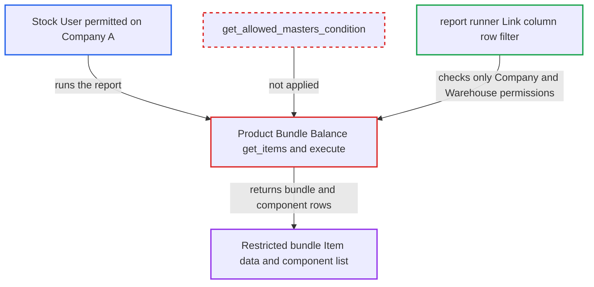

# Product Bundle Balance report lists bundles whose Items are restricted to other companies

| Field | Value |
|---|---|
| ID | `find_01R7YT4DU51V5SKvzgy5FR6q` |
| Severity | **Low** |
| Status | open |
| CWE | CWE-862 — Missing authorization |
| Created | 2026-10-27T21:25:03.256138Z |
| Claude Security | https://claude.ai/security/findings/find_01R7YT4DU51V5SKvzgy5FR6q |

## Description

A logged-in Stock User can see Item master data and the component lists of Product Bundles that an admin restricted to other companies. The user needs a Company User Permission for a company whose warehouses hold stock of the bundle's components. The report `Product Bundle Balance` builds its list in `get_items` with `frappe.qb` and never applies `get_allowed_masters_condition`.

1. **admin** restricts a bundle's Item X to Company B. Company Restriction hides X from users whose Company User Permissions do not include Company B, but the hooks that enforce this cover only ORM reads. ([`erpnext/hooks.py:355-374`](https://github.com/cx-benchmark/erpnext/blob/90e7aefca73da3c440d2e8da7472fcb67838e678/erpnext/hooks.py#L355-L374))
2. **attacker (Stock User with a Company User Permission for Company A)** calls `/api/method/frappe.desk.query_report.run` for the report `Product Bundle Balance`. The request uses `report_name=Product Bundle Balance` and the filters `{"company":"A","date":<today>}`, and no victim action is needed.
3. **`get_items`** selects every active submitted Product Bundle with its parent Item and its component Items. The `frappe.qb` queries add no `get_allowed_masters_condition(pb.new_item_code, "Item")`, so the bundle for the restricted Item X is included along with its components. ([`erpnext/stock/report/product_bundle_balance/product_bundle_balance.py:123-156`](https://github.com/cx-benchmark/erpnext/blob/90e7aefca73da3c440d2e8da7472fcb67838e678/erpnext/stock/report/product_bundle_balance/product_bundle_balance.py#L123-L156))
4. **`execute`** emits a parent row and child rows for each warehouse where a component has positive stock. The parent row holds the bundle's item code, name, description, item group and brand, and the child rows list each component with its per-bundle quantity and `parent_item`. ([`erpnext/stock/report/product_bundle_balance/product_bundle_balance.py:22-72`](https://github.com/cx-benchmark/erpnext/blob/90e7aefca73da3c440d2e8da7472fcb67838e678/erpnext/stock/report/product_bundle_balance/product_bundle_balance.py#L22-L72))
5. **report runner** keeps the rows and returns them to the attacker. It filters only by User Permission values in Link columns, and the rows carry Company A's warehouse and company values, so it never evaluates the Company Restriction hooks. ([`erpnext/hooks.py:355-374`](https://github.com/cx-benchmark/erpnext/blob/90e7aefca73da3c440d2e8da7472fcb67838e678/erpnext/hooks.py#L355-L374))

## Assessment

The attacker is a logged-in Stock User with a Company User Permission for Company A. An admin has restricted bundle Item X to Company B, and X's components hold positive stock in Company A's warehouses. The attacker runs the `Product Bundle Balance` report through `/api/method/frappe.desk.query_report.run`. No victim action is needed.

Impact: The attacker reads Item master data that the Company Restriction hides from them: the restricted bundle's code, name, description, item group and brand, plus its component list and per-bundle quantities. Stock quantities of other companies are not exposed, because the runner drops rows outside the user's Company and Warehouse User Permissions. The report is read-only, so nothing is changed.

## Recommendation

`get_items` reads Product Bundle and Item with `frappe.qb`, which bypasses the Company Restriction permission hooks. It never applies `get_allowed_masters_condition`, so bundles and components restricted to other companies reach any Stock User.

Fix criteria: Bundles whose parent Item is restricted to companies outside the user's permitted companies no longer appear, and restricted component Items are not listed. Test with a user permitted only on Company A and a bundle whose Item is restricted to Company B, built from components stocked in A. Running the report with and without a company filter must return no row for that bundle. An unrestricted bundle must still appear.

## Evidence

**https://github.com/cx-benchmark/erpnext**

- [`erpnext/stock/report/product_bundle_balance/product_bundle_balance.py:123-156`](https://github.com/cx-benchmark/erpnext/blob/90e7aefca73da3c440d2e8da7472fcb67838e678/erpnext/stock/report/product_bundle_balance/product_bundle_balance.py#L123-L156)
- [`erpnext/stock/report/product_bundle_balance/product_bundle_balance.py:163-202`](https://github.com/cx-benchmark/erpnext/blob/90e7aefca73da3c440d2e8da7472fcb67838e678/erpnext/stock/report/product_bundle_balance/product_bundle_balance.py#L163-L202)
- [`erpnext/stock/report/product_bundle_balance/product_bundle_balance.py:22-72`](https://github.com/cx-benchmark/erpnext/blob/90e7aefca73da3c440d2e8da7472fcb67838e678/erpnext/stock/report/product_bundle_balance/product_bundle_balance.py#L22-L72)
- [`erpnext/hooks.py:355-374`](https://github.com/cx-benchmark/erpnext/blob/90e7aefca73da3c440d2e8da7472fcb67838e678/erpnext/hooks.py#L355-L374)
- [`erpnext/stock/doctype/company_restriction/company_restriction.py:95-109`](https://github.com/cx-benchmark/erpnext/blob/90e7aefca73da3c440d2e8da7472fcb67838e678/erpnext/stock/doctype/company_restriction/company_restriction.py#L95-L109)
- [`erpnext/selling/report/available_stock_for_packing_items/available_stock_for_packing_items.py:79-93`](https://github.com/cx-benchmark/erpnext/blob/90e7aefca73da3c440d2e8da7472fcb67838e678/erpnext/selling/report/available_stock_for_packing_items/available_stock_for_packing_items.py#L79-L93)
- [`erpnext/stock/doctype/company_restriction/test_company_restriction.py:374-386`](https://github.com/cx-benchmark/erpnext/blob/90e7aefca73da3c440d2e8da7472fcb67838e678/erpnext/stock/doctype/company_restriction/test_company_restriction.py#L374-L386)

