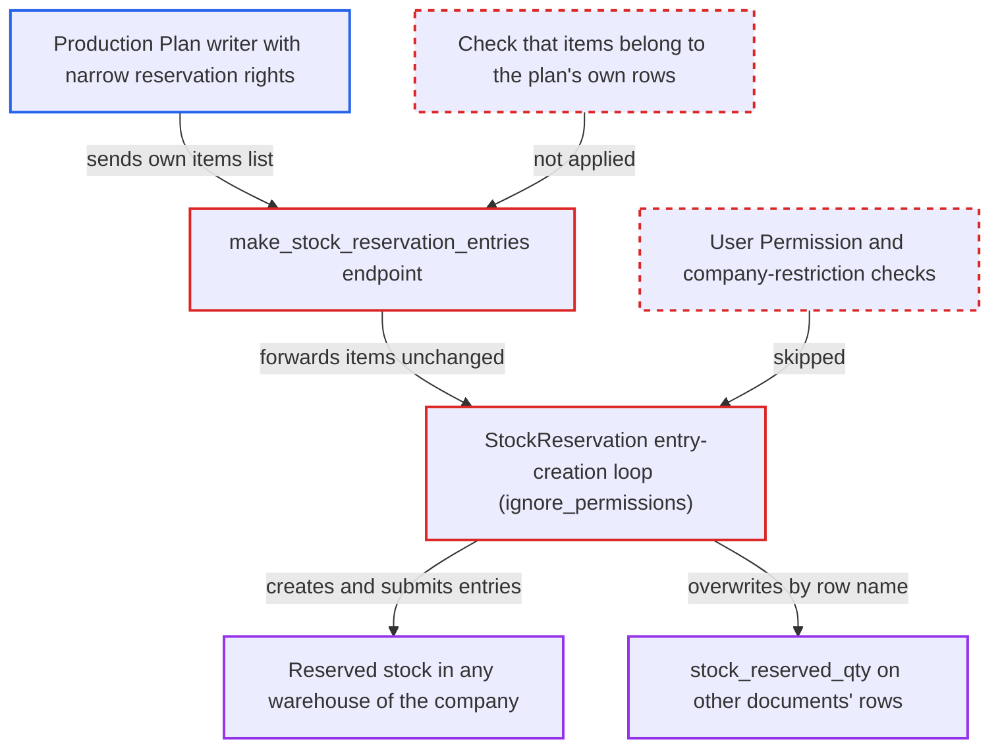

# Production Plan Reserve Stock endpoint builds Stock Reservation Entries from client-supplied item dicts

| Field | Value |
|---|---|
| ID | `find_01PNCZvH1a2qHK34wLczqzAF` |
| Severity | **Low** |
| Status | open |
| CWE | CWE-915 — Mass assignment |
| Created | 2026-10-27T21:13:33.834369Z |
| Claude Security | https://claude.ai/security/findings/find_01PNCZvH1a2qHK34wLczqzAF |

## Description

A user who can write one Production Plan can reserve all unreserved stock of any item in any warehouse of the plan's company. This includes warehouses and items their User Permissions exclude. Other deliveries and transfers of that stock are then refused. The gain over the default role matters only for writers with narrower reservation rights, such as User Permissions, a document share or a custom role. The cause is the whitelisted `make_stock_reservation_entries`, which checks only write access to the plan and then builds entries from the caller's `items` with `ignore_permissions`.

1. **Plan writer** posts a request to the whitelisted `make_stock_reservation_entries` endpoint. The request names a plan they can write in `doc`, sets `table_name` to `mr_items`, and sends its own `items` list with any `item_code`, `warehouse`, qty and `voucher_detail_no`. ([`erpnext/manufacturing/doctype/production_plan/services/reservation.py:193-200`](https://github.com/cx-benchmark/erpnext/blob/90e7aefca73da3c440d2e8da7472fcb67838e678/erpnext/manufacturing/doctype/production_plan/services/reservation.py#L193-L200))
2. **the endpoint `make_stock_reservation_entries`** checks write permission on the plan and passes `items` on unchanged. The only check is `frappe.has_permission("Production Plan", "write", doc=doc)` on the plan loaded from the database. `reserve` then hands the parsed dicts to `StockReservation`. ([`erpnext/manufacturing/doctype/production_plan/services/reservation.py:167-183`](https://github.com/cx-benchmark/erpnext/blob/90e7aefca73da3c440d2e8da7472fcb67838e678/erpnext/manufacturing/doctype/production_plan/services/reservation.py#L167-L183))
3. **the loop in `StockReservation.make_stock_reservation_entries`** creates, saves and submits one Stock Reservation Entry per dict with `flags.ignore_permissions = True`. Item, warehouse, qty, `voucher_type`, `voucher_no`, `voucher_detail_no` and `from_voucher_*` are copied from the caller's dict. Nothing ties the dict to a row of the plan. ([`erpnext/stock/doctype/stock_reservation_entry/stock_reservation_entry.py:1329-1412`](https://github.com/cx-benchmark/erpnext/blob/90e7aefca73da3c440d2e8da7472fcb67838e678/erpnext/stock/doctype/stock_reservation_entry/stock_reservation_entry.py#L1329-L1412))
4. **`get_voucher_qty`** returns `None` for a name that is not a row of the plan. `voucher_qty` then becomes the caller's qty. With `allow_partial_reservation` (default on), the entry takes all unreserved stock of the item in that warehouse. ([`erpnext/stock/doctype/stock_reservation_entry/stock_reservation_entry.py:1417-1423`](https://github.com/cx-benchmark/erpnext/blob/90e7aefca73da3c440d2e8da7472fcb67838e678/erpnext/stock/doctype/stock_reservation_entry/stock_reservation_entry.py#L1417-L1423))
5. **the entry's `validate`** applies only weak checks. It requires the warehouse to belong to the plan's company and the named voucher to be submitted. Only a Sales Order target is also checked for row membership (and needs `enable_stock_reservation`). ([`erpnext/stock/doctype/stock_reservation_entry/stock_reservation_entry.py:78-118`](https://github.com/cx-benchmark/erpnext/blob/90e7aefca73da3c440d2e8da7472fcb67838e678/erpnext/stock/doctype/stock_reservation_entry/stock_reservation_entry.py#L78-L118))
6. **the submit handlers `update_reserved_qty_in_voucher` and `update_reserved_qty_in_pick_list`** write `stock_reserved_qty` on the row the caller named and raise the bin's reserved stock. The row can be a Work Order Item, Production Plan Sub Assembly Item, Material Request Plan Item or Pick List Item. The bin's `reserved_stock` rises for the caller's item and warehouse, so `validate_reserved_stock` refuses other outgoing transactions of that stock. ([`erpnext/stock/doctype/stock_reservation_entry/stock_reservation_entry.py:587-656`](https://github.com/cx-benchmark/erpnext/blob/90e7aefca73da3c440d2e8da7472fcb67838e678/erpnext/stock/doctype/stock_reservation_entry/stock_reservation_entry.py#L587-L656))

## Assessment

The attacker is a desk user with write access on one submitted Production Plan. By default only `Manufacturing User` can write a plan, and that role can already create Stock Reservation Entries, so the extra gain is for writers with narrower reservation rights. These are users limited by User Permissions to certain warehouses or items, and users with write on one plan through a document share or a custom role without Stock Reservation Entry rights. They POST to `/api/method/erpnext.manufacturing.doctype.production_plan.production_plan.make_stock_reservation_entries` with `doc={"name": PP}`, `table_name="mr_items"` and an `items` list. An example item is `{"item_code": X, "warehouse": W, "required_bom_qty": 1e9, "voucher_detail_no": "x"}`. They can also name any submitted Work Order as `voucher_type`/`voucher_no`. Overwriting `stock_reserved_qty` on other documents' rows needs the attacker to know the row names. The shipped Reserve Stock dialog in `stock_reservation.js` sends only the plan's own rows, but the server does not enforce that.

Impact: The attacker reserves all unreserved stock of any item in any warehouse of the plan's company, so deliveries and transfers from that stock are refused until a stock user cancels the entries. Entries naming another voucher are not released by the plan's own unreserve action. They can also overwrite `stock_reserved_qty` on other documents' rows. The company boundary holds, and the report says no ledger, valuation or data disclosure is affected.

## Recommendation

(1) The whitelisted `make_stock_reservation_entries` forwards the request's `items` into `StockReservation`. The HTTP caller therefore sets the item, warehouse, qty, voucher and source-voucher fields of entries that are inserted and submitted with `ignore_permissions`.

Fix criteria: Reservations started from the endpoint are derived from, or strictly validated as a subset of, the plan's own `sub_assembly_items` / `mr_items`. `voucher_type`/`voucher_no` are forced to the plan, `voucher_detail_no` must be a row of it, qty is capped by the row, and `from_voucher_*` cannot be set by the caller. Posting an item dict naming another voucher, a foreign row or an item not on the plan creates no Stock Reservation Entry and changes no other row's `stock_reserved_qty`.

(2) Entries created on the user's behalf skip permission checks entirely. User Permissions on the entry's warehouse and item, and the company-restriction hook, are never applied to the requesting user.

Fix criteria: A user restricted by User Permissions to certain warehouses or items cannot reserve stock in other warehouses or of other items through this endpoint. Verify that such a request is refused with a permission error. Verify that the same user's reservation for a permitted plan row still succeeds.

## Evidence

**https://github.com/cx-benchmark/erpnext**

- [`erpnext/manufacturing/doctype/production_plan/services/reservation.py:193-200`](https://github.com/cx-benchmark/erpnext/blob/90e7aefca73da3c440d2e8da7472fcb67838e678/erpnext/manufacturing/doctype/production_plan/services/reservation.py#L193-L200)
- [`erpnext/manufacturing/doctype/production_plan/services/reservation.py:167-183`](https://github.com/cx-benchmark/erpnext/blob/90e7aefca73da3c440d2e8da7472fcb67838e678/erpnext/manufacturing/doctype/production_plan/services/reservation.py#L167-L183)
- [`erpnext/stock/doctype/stock_reservation_entry/stock_reservation_entry.py:1329-1412`](https://github.com/cx-benchmark/erpnext/blob/90e7aefca73da3c440d2e8da7472fcb67838e678/erpnext/stock/doctype/stock_reservation_entry/stock_reservation_entry.py#L1329-L1412)
- [`erpnext/stock/doctype/stock_reservation_entry/stock_reservation_entry.py:1417-1423`](https://github.com/cx-benchmark/erpnext/blob/90e7aefca73da3c440d2e8da7472fcb67838e678/erpnext/stock/doctype/stock_reservation_entry/stock_reservation_entry.py#L1417-L1423)
- [`erpnext/stock/doctype/stock_reservation_entry/stock_reservation_entry.py:78-118`](https://github.com/cx-benchmark/erpnext/blob/90e7aefca73da3c440d2e8da7472fcb67838e678/erpnext/stock/doctype/stock_reservation_entry/stock_reservation_entry.py#L78-L118)
- [`erpnext/stock/doctype/stock_reservation_entry/stock_reservation_entry.py:587-656`](https://github.com/cx-benchmark/erpnext/blob/90e7aefca73da3c440d2e8da7472fcb67838e678/erpnext/stock/doctype/stock_reservation_entry/stock_reservation_entry.py#L587-L656)
- [`erpnext/public/js/stock_reservation.js:118-204`](https://github.com/cx-benchmark/erpnext/blob/90e7aefca73da3c440d2e8da7472fcb67838e678/erpnext/public/js/stock_reservation.js#L118-L204)
- [`erpnext/manufacturing/doctype/production_plan/production_plan.json:495-507`](https://github.com/cx-benchmark/erpnext/blob/90e7aefca73da3c440d2e8da7472fcb67838e678/erpnext/manufacturing/doctype/production_plan/production_plan.json#L495-L507)

