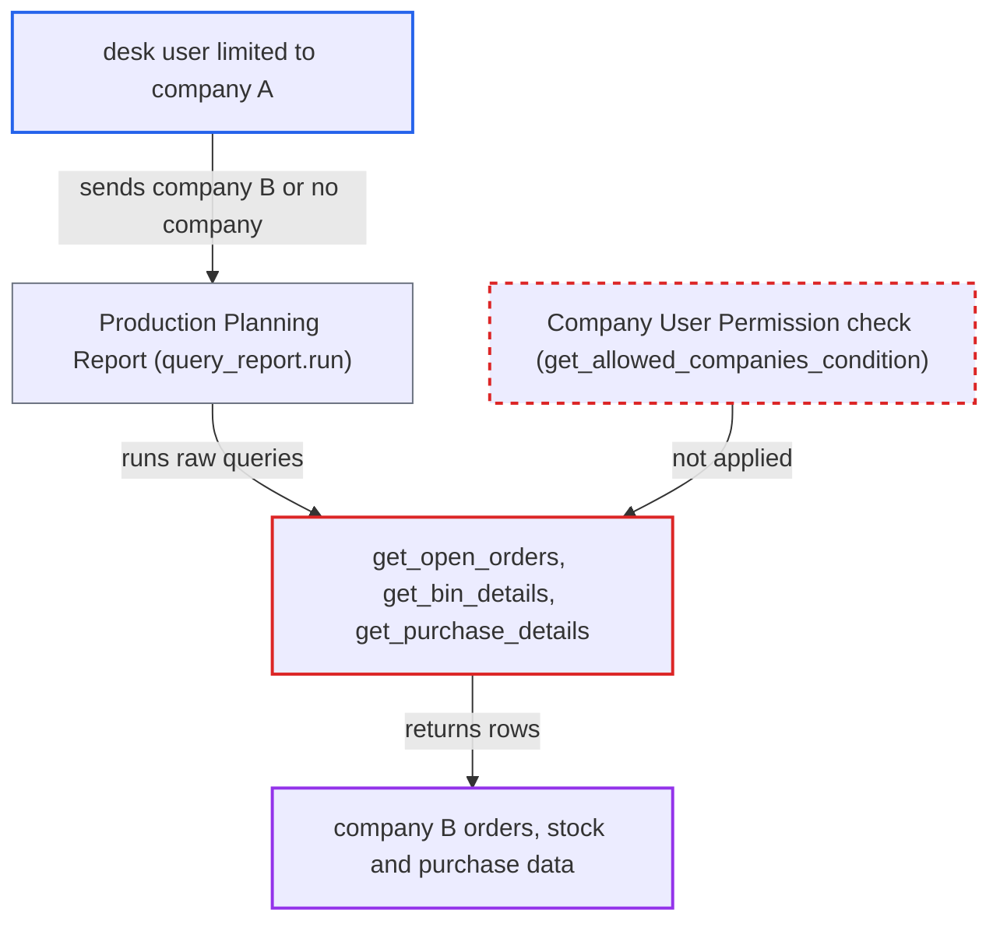

# Production Planning Report ignores Company user permissions on orders, stock and purchases

| Field | Value |
|---|---|
| ID | `find_0147fCV8kXwQtdyrKy69cGB3` |
| Severity | **Low** |
| Status | open |
| CWE | CWE-862 — Missing Authorization |
| Created | 2026-10-27T21:23:00.837575Z |
| Claude Security | https://claude.ai/security/findings/find_0147fCV8kXwQtdyrKy69cGB3 |

## Description

A logged-in user restricted to company A can read company B's open orders, material requests, work orders, per-warehouse stock and pending purchase arrivals. It needs a Manufacturing User or Stock User role and a multi-company site. The report only scopes by a caller-supplied, optional `company` filter and ignores Company User Permissions. Impact is read-only.

1. **attacker** calls the report API directly. The attacker is a desk user limited to company A who calls `/api/method/frappe.desk.query_report.run` with `report_name="Production Planning Report"` and names company B in `company`, or sends no `company`. The `reqd` on `company` exists only in the browser script, so the server accepts either. ([`erpnext/manufacturing/report/production_planning_report/production_planning_report.js:6-13`](https://github.com/cx-benchmark/erpnext/blob/90e7aefca73da3c440d2e8da7472fcb67838e678/erpnext/manufacturing/report/production_planning_report/production_planning_report.js#L6-L13))
2. **Frappe report layer** lets the call through. The role check passes, and the report has no `filters` table, so no Link filter permission is validated. ([`erpnext/manufacturing/report/production_planning_report/production_planning_report.json:17-31`](https://github.com/cx-benchmark/erpnext/blob/90e7aefca73da3c440d2e8da7472fcb67838e678/erpnext/manufacturing/report/production_planning_report/production_planning_report.json#L17-L31))
3. **`get_open_orders`** reads orders with raw `frappe.qb`. Raw queries add no permission conditions. The only scoping is `parent.company == self.filters.company`, added only when `company` is sent, so company B's orders are returned, or every company's if `company` is omitted. ([`erpnext/manufacturing/report/production_planning_report/production_planning_report.py:115-120`](https://github.com/cx-benchmark/erpnext/blob/90e7aefca73da3c440d2e8da7472fcb67838e678/erpnext/manufacturing/report/production_planning_report/production_planning_report.py#L115-L120))
4. **`get_bin_details` and `get_purchase_details`** read stock and purchase data for those orders' warehouses. `get_bin_details` uses `frappe.get_all` on `Bin`, which ignores permissions. `get_purchase_details` uses raw qb on Purchase Orders. Neither is limited to the caller's companies. ([`erpnext/manufacturing/report/production_planning_report/production_planning_report.py:231-280`](https://github.com/cx-benchmark/erpnext/blob/90e7aefca73da3c440d2e8da7472fcb67838e678/erpnext/manufacturing/report/production_planning_report/production_planning_report.py#L231-L280))
5. **desk row filter** fails to remove company B's rows. The output has Link columns only for the order doctype, Item and Warehouse, with no Company column. A Company User Permission therefore has nothing to match against, and company B's rows come back to the attacker. ([`erpnext/manufacturing/report/production_planning_report/production_planning_report.py:386-469`](https://github.com/cx-benchmark/erpnext/blob/90e7aefca73da3c440d2e8da7472fcb67838e678/erpnext/manufacturing/report/production_planning_report/production_planning_report.py#L386-L469))

## Assessment

The attacker is a logged-in desk user with Manufacturing User or Stock User whose Company User Permission limits them to company A on a multi-company site. They call the report API directly with `based_on` set to `Sales Order`, and optionally `order_by` set to `Total Amount`, with `company` set to another company or left out. The report supports Work Order, Sales Order and Material Request as `based_on`, and the report says the cross-company access applies for each. The report assumes Frappe >=17.0.0-dev,\<18, which is not in the checkout.

Impact: The attacker reads company B's open order IDs, items, pending quantities and delivery dates, and `base_grand_total` with `order_by="Total Amount"`. They also read B's material request and work order IDs, per-warehouse actual, ordered and projected stock, and pending PO arrival dates and quantities. Only orders whose BOM has raw materials produce rows, no customer, supplier or pricing details beyond the order total are returned, and nothing can be written.

## Recommendation

The report reads orders, `Bin` and Purchase Order data with permission-ignoring queries. It scopes them only by an optional `company` filter supplied by the caller, so the caller's Company User Permissions are bypassed.

Fix criteria: Every order, `Bin` and Purchase Order row the report uses belongs to a company, or a warehouse of a company, that the caller may read. This holds whether `company` is omitted, allowed or disallowed, and a disallowed company yields no rows or a permission error. Verify that a user restricted to company A gets no company B rows through `frappe.desk.query_report.run` in all three cases, for each `based_on` value.

## Evidence

**https://github.com/cx-benchmark/erpnext**

- [`erpnext/manufacturing/report/production_planning_report/production_planning_report.py:115-120`](https://github.com/cx-benchmark/erpnext/blob/90e7aefca73da3c440d2e8da7472fcb67838e678/erpnext/manufacturing/report/production_planning_report/production_planning_report.py#L115-L120)
- [`erpnext/manufacturing/report/production_planning_report/production_planning_report.py:35-100`](https://github.com/cx-benchmark/erpnext/blob/90e7aefca73da3c440d2e8da7472fcb67838e678/erpnext/manufacturing/report/production_planning_report/production_planning_report.py#L35-L100)
- [`erpnext/manufacturing/report/production_planning_report/production_planning_report.py:231-280`](https://github.com/cx-benchmark/erpnext/blob/90e7aefca73da3c440d2e8da7472fcb67838e678/erpnext/manufacturing/report/production_planning_report/production_planning_report.py#L231-L280)
- [`erpnext/manufacturing/report/production_planning_report/production_planning_report.py:386-469`](https://github.com/cx-benchmark/erpnext/blob/90e7aefca73da3c440d2e8da7472fcb67838e678/erpnext/manufacturing/report/production_planning_report/production_planning_report.py#L386-L469)
- [`erpnext/manufacturing/report/production_planning_report/production_planning_report.json:17-31`](https://github.com/cx-benchmark/erpnext/blob/90e7aefca73da3c440d2e8da7472fcb67838e678/erpnext/manufacturing/report/production_planning_report/production_planning_report.json#L17-L31)
- [`erpnext/manufacturing/report/production_planning_report/production_planning_report.js:6-13`](https://github.com/cx-benchmark/erpnext/blob/90e7aefca73da3c440d2e8da7472fcb67838e678/erpnext/manufacturing/report/production_planning_report/production_planning_report.js#L6-L13)
- [`erpnext/stock/doctype/company_restriction/company_restriction.py:62-81`](https://github.com/cx-benchmark/erpnext/blob/90e7aefca73da3c440d2e8da7472fcb67838e678/erpnext/stock/doctype/company_restriction/company_restriction.py#L62-L81)

