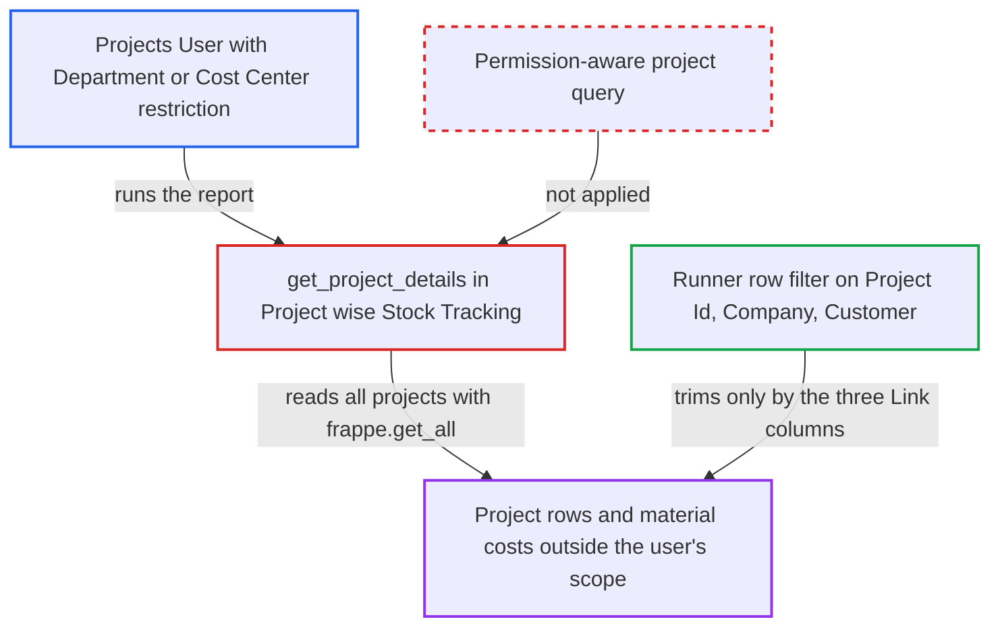

# Project Wise Stock Tracking ignores Department, Cost Center and other Project user permissions

| Field | Value |
|---|---|
| ID | `find_01Cv275i5ojwe4yJp88vsk9F` |
| Severity | **Low** |
| Status | open |
| CWE | CWE-862 — Missing Authorization |
| Created | 2026-10-27T21:25:20.938846Z |
| Claude Security | https://claude.ai/security/findings/find_01Cv275i5ojwe4yJp88vsk9F |

## Description

A logged-in Projects User can see projects they are not allowed to see. This happens when their User Permissions restrict projects by a field such as Department or Cost Center. The report shows each project's name, status, customer, estimated value and material costs. The cause is `get_project_details`, which reads projects with `frappe.get_all` and so applies no permissions.

1. **Projects User** runs the report `Project wise Stock Tracking`. The user has User Permissions on a Project field such as Department or Cost Center. They open the report, or call `/api/method/frappe.desk.query_report.run` with `report_name=Project wise Stock Tracking`. The report has no filters and the role check passes. ([`erpnext/projects/report/project_wise_stock_tracking/project_wise_stock_tracking.json`](https://github.com/cx-benchmark/erpnext/blob/90e7aefca73da3c440d2e8da7472fcb67838e678/erpnext/projects/report/project_wise_stock_tracking/project_wise_stock_tracking.json))
2. **the function `get_project_details`** reads every non-cancelled Project with `frappe.get_all`. `frappe.get_all` applies no permission conditions, so User Permissions on Project and its link fields are ignored. ([`erpnext/projects/report/project_wise_stock_tracking/project_wise_stock_tracking.py:53-67`](https://github.com/cx-benchmark/erpnext/blob/90e7aefca73da3c440d2e8da7472fcb67838e678/erpnext/projects/report/project_wise_stock_tracking/project_wise_stock_tracking.py#L53-L67))
3. **the cost aggregates** sum purchased, issued and delivered material cost for every project. The helper functions `get_purchased_items_cost`, `get_issued_items_cost` and `get_delivered_items_cost` also add no permission conditions. ([`erpnext/projects/report/project_wise_stock_tracking/project_wise_stock_tracking.py:9-34`](https://github.com/cx-benchmark/erpnext/blob/90e7aefca73da3c440d2e8da7472fcb67838e678/erpnext/projects/report/project_wise_stock_tracking/project_wise_stock_tracking.py#L9-L34))
4. **the report runner's row filter** drops only rows whose own Link columns fall outside the user's permissions. The rows have only three Link columns: `Project Id`, `Company` and `Customer`. A permission on Department, Cost Center, Project Type or Sales Order has no column to match, so those rows stay. ([`erpnext/projects/report/project_wise_stock_tracking/project_wise_stock_tracking.py:37-50`](https://github.com/cx-benchmark/erpnext/blob/90e7aefca73da3c440d2e8da7472fcb67838e678/erpnext/projects/report/project_wise_stock_tracking/project_wise_stock_tracking.py#L37-L50))
5. **the report** returns all projects of the user's permitted companies. Each row holds the project name, status, customer, `estimated_costing` and the three material costs. This includes projects outside the user's Department or Cost Center scope. ([`erpnext/projects/report/project_wise_stock_tracking/project_wise_stock_tracking.py:9-34`](https://github.com/cx-benchmark/erpnext/blob/90e7aefca73da3c440d2e8da7472fcb67838e678/erpnext/projects/report/project_wise_stock_tracking/project_wise_stock_tracking.py#L9-L34))

## Assessment

The attacker is an authenticated desk user with the Projects User role (the report is also open to Projects Manager). Their User Permissions restrict Projects through a field the report does not output, such as Department or Cost Center. The report names Project Type and Sales Order as further fields of this kind. They open the report, or call `/api/method/frappe.desk.query_report.run` with `report_name=Project wise Stock Tracking`. No victim action is needed. The report assumes the Frappe runner (`>=17.0.0-dev,<18`, not in the checkout) filters rows only by the doctypes of their Link columns.

Impact: The attacker sees projects outside their Department, Cost Center, Project Type or Sales Order scope. This is limited to the companies, projects and customers they may already read. The data is only read: name, status, customer, estimated value and purchased, issued and delivered material cost. Company, Project and Customer restrictions still hold, so no other company's projects are shown.

## Recommendation

`get_project_details` reads Project with `frappe.get_all`, so the report depends on the runner's link-column row filter. That filter cannot enforce User Permissions on Project fields the report does not output, such as department, cost center, project type and sales order.

Fix criteria: The project list comes from a permission-aware query that applies role permissions, every User Permission on Project and its link fields, and `permission_query_conditions`. The cost aggregates cover only those projects. To verify, run the report as a Projects User whose Department (or Cost Center) User Permission is D1. No project with department D2 may appear, and the result must match the Project list view for that user.

## Evidence

**https://github.com/cx-benchmark/erpnext**

- [`erpnext/projects/report/project_wise_stock_tracking/project_wise_stock_tracking.py:53-67`](https://github.com/cx-benchmark/erpnext/blob/90e7aefca73da3c440d2e8da7472fcb67838e678/erpnext/projects/report/project_wise_stock_tracking/project_wise_stock_tracking.py#L53-L67)
- [`erpnext/projects/report/project_wise_stock_tracking/project_wise_stock_tracking.py:37-50`](https://github.com/cx-benchmark/erpnext/blob/90e7aefca73da3c440d2e8da7472fcb67838e678/erpnext/projects/report/project_wise_stock_tracking/project_wise_stock_tracking.py#L37-L50)
- [`erpnext/projects/report/project_wise_stock_tracking/project_wise_stock_tracking.py:9-34`](https://github.com/cx-benchmark/erpnext/blob/90e7aefca73da3c440d2e8da7472fcb67838e678/erpnext/projects/report/project_wise_stock_tracking/project_wise_stock_tracking.py#L9-L34)
- [`erpnext/projects/doctype/project/project.json:198-203`](https://github.com/cx-benchmark/erpnext/blob/90e7aefca73da3c440d2e8da7472fcb67838e678/erpnext/projects/doctype/project/project.json#L198-L203)
- [`erpnext/projects/report/project_wise_stock_tracking/project_wise_stock_tracking.json`](https://github.com/cx-benchmark/erpnext/blob/90e7aefca73da3c440d2e8da7472fcb67838e678/erpnext/projects/report/project_wise_stock_tracking/project_wise_stock_tracking.json)
- [`erpnext/projects/report/delayed_tasks_summary/delayed_tasks_summary.py:20`](https://github.com/cx-benchmark/erpnext/blob/90e7aefca73da3c440d2e8da7472fcb67838e678/erpnext/projects/report/delayed_tasks_summary/delayed_tasks_summary.py#L20)

