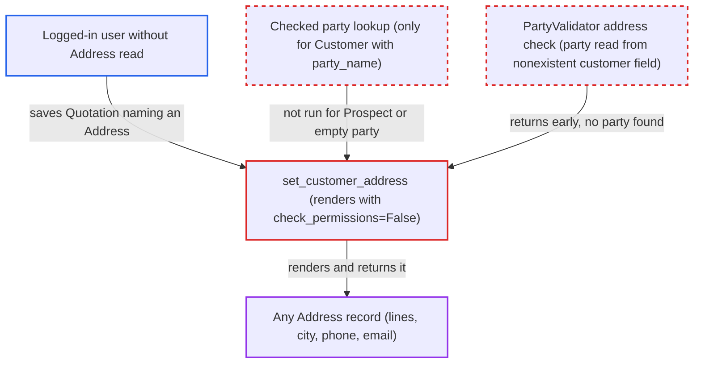

# Quotation save renders any caller-named Address without permission or party check

| Field | Value |
|---|---|
| ID | `find_019y8LG2LRsDHDe8pN3KJKLu` |
| Severity | **Low** |
| Status | open |
| CWE | CWE-862 — Missing Authorization |
| Created | 2026-10-27T21:55:11.638060Z |
| Claude Security | https://claude.ai/security/findings/find_019y8LG2LRsDHDe8pN3KJKLu |

## Description

A logged-in user who can save Quotations but cannot read Address records can make the server render any Address they name and return its text. That text covers street lines, city, state, pincode, country, phone and email. It works on a Quotation with `quotation_to` set to `Prospect` or with no `party_name`. The cause is `set_customer_address`, which renders linked Addresses with `check_permissions=False`, while the checks that should tie them to the party do not run for Quotation.

1. **the attacker** saves a Quotation naming a target Address. The request sets `quotation_to` to `Prospect` (or leaves `party_name` empty) and puts the target Address name in `customer_address` or `shipping_address_name`. The server does not require `party_name`. ([`erpnext/selling/doctype/quotation/quotation.json:170-190`](https://github.com/cx-benchmark/erpnext/blob/90e7aefca73da3c440d2e8da7472fcb67838e678/erpnext/selling/doctype/quotation/quotation.json#L170-L190))
2. **the method `set_missing_lead_customer_details`** skips the permission-checked party lookup. The checked lookup runs only when `quotation_to` is `Customer` and `party_name` is set. Lead, Prospect, CRM Deal or an empty party get no Address read check, and the Lead path ignores the caller's `customer_address`. ([`erpnext/controllers/selling_controller.py:161-192`](https://github.com/cx-benchmark/erpnext/blob/90e7aefca73da3c440d2e8da7472fcb67838e678/erpnext/controllers/selling_controller.py#L161-L192))
3. **the helper `PartyValidator.get_party`** finds no party for the Quotation. It reads the party from `doc.get("customer")`, but Quotation has no `customer` field (its party is `party_name`), so the result is always None. ([`erpnext/accounts/services/party_validation.py:36-56`](https://github.com/cx-benchmark/erpnext/blob/90e7aefca73da3c440d2e8da7472fcb67838e678/erpnext/accounts/services/party_validation.py#L36-L56))
4. **the method `validate_address_and_contact`** returns early without checking the addresses. With no party found, `customer_address` and `shipping_address_name` are never tied to `party_name`. ([`erpnext/accounts/services/party_validation.py:190-205`](https://github.com/cx-benchmark/erpnext/blob/90e7aefca73da3c440d2e8da7472fcb67838e678/erpnext/accounts/services/party_validation.py#L190-L205))
5. **the method `set_customer_address`** renders the named Address with `check_permissions=False`. It runs on every `validate` and stores the formatted Address in display fields such as `address_display` and `shipping_address`, without checking the saving user's Address read. ([`erpnext/controllers/selling_controller.py:893-905`](https://github.com/cx-benchmark/erpnext/blob/90e7aefca73da3c440d2e8da7472fcb67838e678/erpnext/controllers/selling_controller.py#L893-L905))
6. **the server** returns the saved Quotation to the attacker. The response contains `address_display`, so the attacker reads the Address contents.

## Assessment

The attacker is a logged-in user who may create Quotations but lacks Address read. Examples are a Maintenance Manager or a Sales Manager without the matching User role. The attacker sends `POST /api/resource/Quotation` with `quotation_to` set to `Prospect` (or no `party_name`) and `customer_address` set to the target Address name, which follows a predictable `Title-Type` pattern. The attack works only where the account lacks Address read through role assignment, or where Company Restriction is meant to hide the target party. Two other ways in exist. One is `dispatch_address_name` on a Sales Order or Sales Invoice with a drop-ship row. The other is `company_address` on a POS Invoice, which is outside `sales_doctypes`. Delivery Note, Purchase Receipt and Supplier Quotation are protected, so Stock, Delivery and Manufacturing users are stopped there.

Impact: The attacker reads the formatted contents of any Address they name, one or two per save, despite lacking Address read. Nothing else is disclosed, and the only write is to the attacker's own draft Quotation.

## Recommendation

`set_customer_address` renders caller-linked Address fields with `check_permissions=False`. It relies on the party lookup and `PartyValidator` to tie them to the party or company. That tie is missing for Quotation, whose party is read from a non-existent `customer` field. It is also missing for drop-ship `dispatch_address_name` and for POS Invoice `company_address`.

Fix criteria: Every Address rendered on save is either shown to belong to the document's party (`quotation_to`/`party_name` on Quotation) or company, or passes the saving user's Address read check. Saving a Quotation with `quotation_to=Prospect` or no party and an unrelated `customer_address`, as a user without Address read, is refused or leaves the display empty. The same holds for drop-ship `dispatch_address_name` and POS Invoice `company_address`.

## Evidence

**https://github.com/cx-benchmark/erpnext**

- [`erpnext/controllers/selling_controller.py:893-905`](https://github.com/cx-benchmark/erpnext/blob/90e7aefca73da3c440d2e8da7472fcb67838e678/erpnext/controllers/selling_controller.py#L893-L905)
- [`erpnext/accounts/services/party_validation.py:36-56`](https://github.com/cx-benchmark/erpnext/blob/90e7aefca73da3c440d2e8da7472fcb67838e678/erpnext/accounts/services/party_validation.py#L36-L56)
- [`erpnext/accounts/services/party_validation.py:190-205`](https://github.com/cx-benchmark/erpnext/blob/90e7aefca73da3c440d2e8da7472fcb67838e678/erpnext/accounts/services/party_validation.py#L190-L205)
- [`erpnext/controllers/selling_controller.py:161-192`](https://github.com/cx-benchmark/erpnext/blob/90e7aefca73da3c440d2e8da7472fcb67838e678/erpnext/controllers/selling_controller.py#L161-L192)
- [`erpnext/accounts/party.py:229-256`](https://github.com/cx-benchmark/erpnext/blob/90e7aefca73da3c440d2e8da7472fcb67838e678/erpnext/accounts/party.py#L229-L256)
- [`erpnext/accounts/services/party_validation.py:207-247`](https://github.com/cx-benchmark/erpnext/blob/90e7aefca73da3c440d2e8da7472fcb67838e678/erpnext/accounts/services/party_validation.py#L207-L247)
- [`erpnext/selling/doctype/quotation/quotation.json:170-190`](https://github.com/cx-benchmark/erpnext/blob/90e7aefca73da3c440d2e8da7472fcb67838e678/erpnext/selling/doctype/quotation/quotation.json#L170-L190)
- [`erpnext/selling/doctype/quotation/quotation.json:1190-1252`](https://github.com/cx-benchmark/erpnext/blob/90e7aefca73da3c440d2e8da7472fcb67838e678/erpnext/selling/doctype/quotation/quotation.json#L1190-L1252)
- [`erpnext/selling/report/address_and_contacts/address_and_contacts.json:18-30`](https://github.com/cx-benchmark/erpnext/blob/90e7aefca73da3c440d2e8da7472fcb67838e678/erpnext/selling/report/address_and_contacts/address_and_contacts.json#L18-L30)

