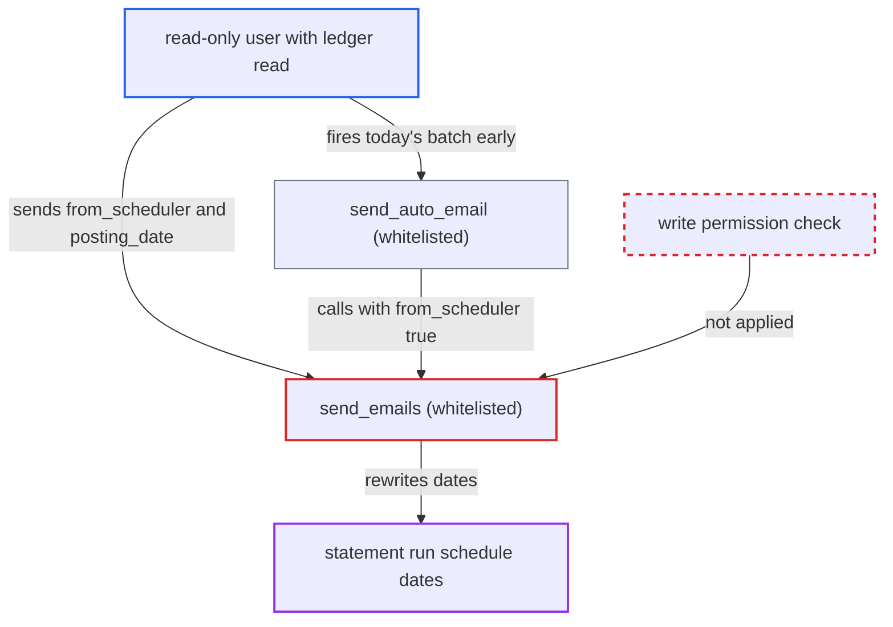

# Read-only PSOA users can rewrite the auto-email schedule via send_emails scheduler parameters

| Field | Value |
|---|---|
| ID | `find_015dVmz2oHvY6hUNtgxGmNhF` |
| Severity | **Low** |
| Status | open |
| CWE | CWE-285 — Improper Authorization |
| Created | 2026-10-27T21:30:11.241490Z |
| Claude Security | https://claude.ai/security/findings/find_015dVmz2oHvY6hUNtgxGmNhF |

## Description

A user with read-only access to a statement run (Process Statement Of Accounts) can move or suppress its automated e-mail schedule and re-send its statements. The user also needs read access to the ledgers, and auto-email must be enabled on the document. The whitelisted `send_emails` checks only read permission, and it accepts the scheduler-only arguments `from_scheduler` and `posting_date` from the request.

1. **read-only user** sends a request to the whitelisted `send_emails` method. The request passes `document_name`, `from_scheduler=1` and a far-future `posting_date` such as `2099-01-01`. ([`erpnext/accounts/doctype/process_statement_of_accounts/process_statement_of_accounts.py:527-531`](https://github.com/cx-benchmark/erpnext/blob/90e7aefca73da3c440d2e8da7472fcb67838e678/erpnext/accounts/doctype/process_statement_of_accounts/process_statement_of_accounts.py#L527-L531))
2. **`send_emails`** checks only `doc.check_permission()`. The default permission type of that call is read, so a user who can only view the document passes, and `from_scheduler` and `posting_date` are taken from the request as ordinary arguments. ([`erpnext/accounts/doctype/process_statement_of_accounts/process_statement_of_accounts.py:527-531`](https://github.com/cx-benchmark/erpnext/blob/90e7aefca73da3c440d2e8da7472fcb67838e678/erpnext/accounts/doctype/process_statement_of_accounts/process_statement_of_accounts.py#L527-L531))
3. **`send_emails`** generates the statements using the caller's ledger read access. The report applies match conditions for `GL Entry` or `Payment Ledger Entry`, so the caller needs read on those ledgers, and the schedule write happens only if at least one statement is produced. ([`erpnext/accounts/report/general_ledger/general_ledger.py:342-345`](https://github.com/cx-benchmark/erpnext/blob/90e7aefca73da3c440d2e8da7472fcb67838e678/erpnext/accounts/report/general_ledger/general_ledger.py#L342-L345))
4. **`send_emails`** recomputes the period from the caller's `posting_date` and saves it with `frappe.db.set_value`. This runs when `enable_auto_email` is set and `from_scheduler` is truthy. It stores `to_date` and `from_date` (General Ledger) or `posting_date` (Accounts Receivable), and skips the write-permission check and `validate()`. ([`erpnext/accounts/doctype/process_statement_of_accounts/process_statement_of_accounts.py:566-579`](https://github.com/cx-benchmark/erpnext/blob/90e7aefca73da3c440d2e8da7472fcb67838e678/erpnext/accounts/doctype/process_statement_of_accounts/process_statement_of_accounts.py#L566-L579))

## Assessment

The attacker is a logged-in user who has only read access to a Process Statement Of Accounts document that has `enable_auto_email` set. In the shipped roles, Accounts User and Accounts Manager both have read and write, so a read-only reader comes from a read-only document share (both roles have `share: 1`) or from a custom role. The attacker also needs read on `GL Entry` or `Payment Ledger Entry`, for example through the shipped Auditor role, and at least one statement must be produced. These conditions are runtime state the attacker does not control. The attacker posts to `/api/method/erpnext.accounts.doctype.process_statement_of_accounts.process_statement_of_accounts.send_emails` with `document_name`, `from_scheduler=1` and `posting_date=2099-01-01`. A second way in is `send_auto_email`, which is also open to doctype-level read. It calls `send_emails` with `from_scheduler=True` using today's date, and it only fires the batch due today early.

Impact: The attacker can push the schedule far into the future so the daily job never picks up the document, or choose the period the next automated statements cover. Each call also re-sends the statement e-mails to the configured customers. Assuming Frappe gives share-read holders `email` rights on the document, that part is mostly allowed already. The attacker cannot choose recipients or content, and sees no data beyond their own ledger read access.

## Recommendation

`send_emails` sends statements and advances the schedule with `frappe.db.set_value` after only a read-permission check. It also accepts the scheduler-only parameters `from_scheduler` and `posting_date` from HTTP callers.

Fix criteria: Sending statements and changing the schedule require write permission (or a dedicated permission) on the document. The schedule update runs only when the scheduler invokes it, not because of request arguments. A read-only (shared) user who calls `send_emails` with `from_scheduler=1&posting_date=...` gets a PermissionError, and `to_date`, `from_date` and `posting_date` stay unchanged.

## Evidence

**https://github.com/cx-benchmark/erpnext**

- [`erpnext/accounts/doctype/process_statement_of_accounts/process_statement_of_accounts.py:566-579`](https://github.com/cx-benchmark/erpnext/blob/90e7aefca73da3c440d2e8da7472fcb67838e678/erpnext/accounts/doctype/process_statement_of_accounts/process_statement_of_accounts.py#L566-L579)
- [`erpnext/accounts/doctype/process_statement_of_accounts/process_statement_of_accounts.py:527-531`](https://github.com/cx-benchmark/erpnext/blob/90e7aefca73da3c440d2e8da7472fcb67838e678/erpnext/accounts/doctype/process_statement_of_accounts/process_statement_of_accounts.py#L527-L531)
- [`erpnext/accounts/doctype/process_statement_of_accounts/process_statement_of_accounts.json`](https://github.com/cx-benchmark/erpnext/blob/90e7aefca73da3c440d2e8da7472fcb67838e678/erpnext/accounts/doctype/process_statement_of_accounts/process_statement_of_accounts.json)
- [`erpnext/accounts/report/general_ledger/general_ledger.py:342-345`](https://github.com/cx-benchmark/erpnext/blob/90e7aefca73da3c440d2e8da7472fcb67838e678/erpnext/accounts/report/general_ledger/general_ledger.py#L342-L345)
- [`erpnext/accounts/doctype/process_statement_of_accounts/process_statement_of_accounts.py:585-595`](https://github.com/cx-benchmark/erpnext/blob/90e7aefca73da3c440d2e8da7472fcb67838e678/erpnext/accounts/doctype/process_statement_of_accounts/process_statement_of_accounts.py#L585-L595)

