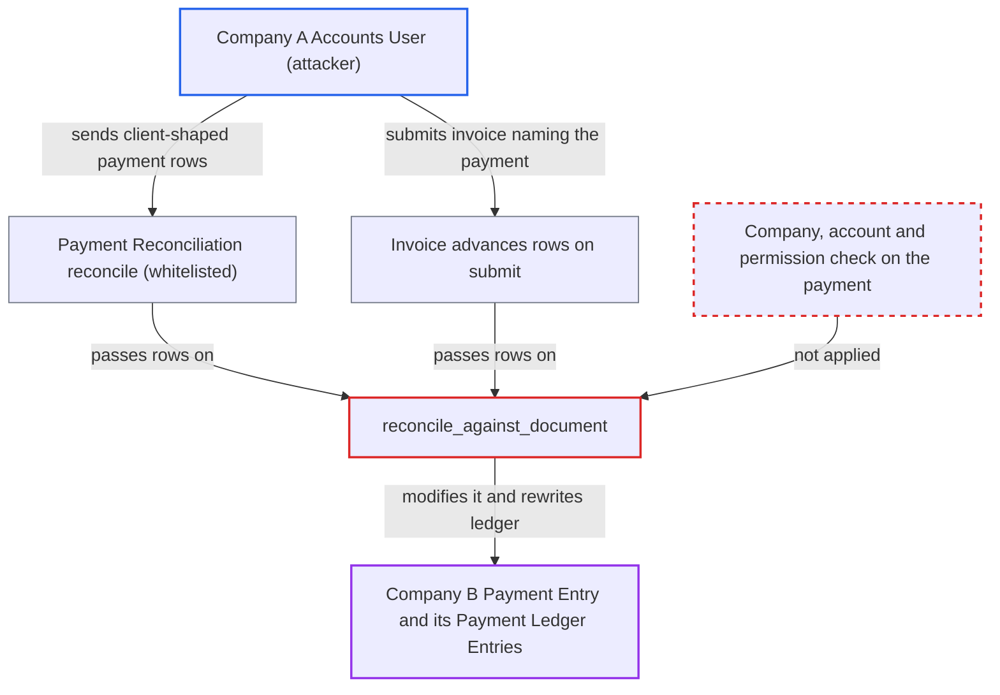

# Reconciliation re-allocates another company's Payment Entry: payment side never checked for company, account or permission

| Field | Value |
|---|---|
| ID | `find_01HB4zdQcDTKc4FXwGXWE8wo` |
| Severity | **Low** |
| Status | open |
| CWE | CWE-862 — Missing Authorization |
| Created | 2026-10-27T21:59:32.800259Z |
| Claude Security | https://claude.ai/security/findings/find_01HB4zdQcDTKc4FXwGXWE8wo |

## Description

A user restricted to Company A, such as an Accounts User, can change a submitted Payment Entry that belongs to Company B. This works when a customer or supplier is shared by both companies and the Payment Entry has an unallocated amount. The attacker's own Company A invoice is attached to it, and Company B's Payment Ledger is rewritten. The cause is `reconcile_against_document`, whose guard `check_if_advance_entry_modified` never checks the payment's company, its accounts or the user's permission. Balances do not change.

1. **Attacker (Company A Accounts User)** picks a Company B Payment Entry to target. The attacker needs a customer or supplier shared with Company B, the name of a submitted Payment Entry `PE-B` (names are sequential), and its exact unallocated amount `U`.
2. **Attacker** sends the payment reference through one of two entry points. Either the attacker submits a Company A invoice whose `advances[]` row names `PE-B` with `advance_amount = U`, or calls the whitelisted `reconcile` on `Payment Reconciliation` with `payments[]` and `allocation[]` naming `PE-B`. The attacker's own invoice must be one they can read. ([`erpnext/accounts/doctype/payment_reconciliation/payment_reconciliation.py:602-654`](https://github.com/cx-benchmark/erpnext/blob/90e7aefca73da3c440d2e8da7472fcb67838e678/erpnext/accounts/doctype/payment_reconciliation/payment_reconciliation.py#L602-L654))
3. **the invoice submit code in `update_against_document_in_jv`** turns the `advances[]` rows into reconcile arguments. `AccountsController.validate` only requires the reference fields to be non-empty, so the foreign Payment Entry is accepted as written. ([`erpnext/controllers/accounts_controller.py:1227-1298`](https://github.com/cx-benchmark/erpnext/blob/90e7aefca73da3c440d2e8da7472fcb67838e678/erpnext/controllers/accounts_controller.py#L1227-L1298))
4. **the guard `check_if_advance_entry_modified`** lets the request through. Its Payment Entry branch checks name, `docstatus == 1`, `party_type`/`party` and that `unallocated_amount` equals the caller's amount. It does not compare `company` or `paid_from`/`paid_to`, and it checks no permission. ([`erpnext/accounts/utils.py:625-655`](https://github.com/cx-benchmark/erpnext/blob/90e7aefca73da3c440d2e8da7472fcb67838e678/erpnext/accounts/utils.py#L625-L655))
5. **the function `update_reference_in_payment_entry`** adds a reference row for the Company A invoice to the Company B Payment Entry. The save uses `ignore_validate_update_after_submit`, so the Payment Entry's own `validate_reference_documents` party-account check never runs. ([`erpnext/accounts/utils.py:743-821`](https://github.com/cx-benchmark/erpnext/blob/90e7aefca73da3c440d2e8da7472fcb67838e678/erpnext/accounts/utils.py#L743-L821))
6. **the function `reconcile_against_document`** saves the foreign Payment Entry and rewrites its ledger. It loads the voucher with `frappe.get_doc`, saves it with `ignore_permissions=True`, deletes and recreates its Payment Ledger Entries, and recomputes outstanding amounts. ([`erpnext/accounts/utils.py:516-586`](https://github.com/cx-benchmark/erpnext/blob/90e7aefca73da3c440d2e8da7472fcb67838e678/erpnext/accounts/utils.py#L516-L586))

## Assessment

The attacker is an Accounts User restricted by User Permission to Company A. A customer or supplier is shared with Company B, because those are global masters. That party has a submitted Payment Entry in Company B with an unallocated amount. The attacker knows its name and the exact amount, since the equality check only gives a yes/no answer. The attacker needs a Company A invoice they can read. There are two ways in. One is an invoice `advances[]` row (`Sales Invoice Advance` or `Purchase Invoice Advance`) that names the foreign Payment Entry, processed on invoice submit. The other is a direct call to `reconcile` on `Payment Reconciliation`, whose invoice, payment and allocation tables all come from the client. No victim interaction is needed. The report assumes that Frappe User Permissions on Company apply only to Link fields targeting `Company`, so the Dynamic Link and client row naming the Payment Entry are not restricted. That Frappe code is not in the checkout. In the same-company case the attacker gains nothing, because an Accounts User already has write access to Payment Entry.

Impact: Company B's submitted Payment Entry gets a reference row to a foreign invoice, and its `unallocated_amount` drops. Company B's Payment Ledger is rewritten to show the amount applied against a document that does not exist in Company B. The attacker's own invoice records `total_advance` from money that never reached Company A. Balances do not change and no money is created, so the damage is bounded. Company B has to unreconcile to recover. The report found no confidentiality or availability impact.

## Recommendation

(1) `check_if_advance_entry_modified` and `reconcile_against_document` trust the payment voucher the caller names. The Payment Entry branch checks party and amount but not company or party account, and the voucher is modified with `ignore_permissions` and no permission check.

Fix criteria: Before a payment voucher is modified, the code confirms that its `company` equals the invoice's company and that its party account (`paid_from`/`paid_to`, or the advance account) equals the invoice's party account (`args.account`). Otherwise it confirms that the acting user has write permission on that voucher. A Company A user who allocates a Company B Payment Entry through invoice advances or `Payment Reconciliation` is refused. The Company B Payment Entry and its Payment Ledger Entries stay unchanged.

(2) `Payment Reconciliation` and invoice `advances[]` accept the payment rows from the client. They validate them only against other client-supplied data (`validate_allocation`, and the non-empty check in `AccountsController.validate`).

Fix criteria: Both callers re-derive the payment candidates on the server, scoped by company and party account, as `get_unreconciled_entries` and `get_advance_entries` do. They reject any allocation row that is not in that set.

## Evidence

**https://github.com/cx-benchmark/erpnext**

- [`erpnext/accounts/utils.py:625-655`](https://github.com/cx-benchmark/erpnext/blob/90e7aefca73da3c440d2e8da7472fcb67838e678/erpnext/accounts/utils.py#L625-L655)
- [`erpnext/accounts/utils.py:516-586`](https://github.com/cx-benchmark/erpnext/blob/90e7aefca73da3c440d2e8da7472fcb67838e678/erpnext/accounts/utils.py#L516-L586)
- [`erpnext/accounts/utils.py:743-821`](https://github.com/cx-benchmark/erpnext/blob/90e7aefca73da3c440d2e8da7472fcb67838e678/erpnext/accounts/utils.py#L743-L821)
- [`erpnext/accounts/doctype/payment_reconciliation/payment_reconciliation.py:602-654`](https://github.com/cx-benchmark/erpnext/blob/90e7aefca73da3c440d2e8da7472fcb67838e678/erpnext/accounts/doctype/payment_reconciliation/payment_reconciliation.py#L602-L654)
- [`erpnext/accounts/doctype/payment_reconciliation/payment_reconciliation.py:759-797`](https://github.com/cx-benchmark/erpnext/blob/90e7aefca73da3c440d2e8da7472fcb67838e678/erpnext/accounts/doctype/payment_reconciliation/payment_reconciliation.py#L759-L797)
- [`erpnext/controllers/accounts_controller.py:1227-1298`](https://github.com/cx-benchmark/erpnext/blob/90e7aefca73da3c440d2e8da7472fcb67838e678/erpnext/controllers/accounts_controller.py#L1227-L1298)
- [`erpnext/controllers/accounts_controller.py:343-357`](https://github.com/cx-benchmark/erpnext/blob/90e7aefca73da3c440d2e8da7472fcb67838e678/erpnext/controllers/accounts_controller.py#L343-L357)

