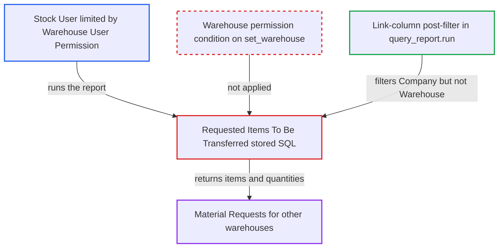

# Requested Items To Be Transferred report ignores Warehouse user permissions on Material Requests

| Field | Value |
|---|---|
| ID | `find_01KJ1j39N7f78Ny1oqF7NXxK` |
| Severity | **Low** |
| Status | open |
| CWE | CWE-862 — Missing Authorization |
| Created | 2026-10-27T21:28:37.198448Z |
| Claude Security | https://claude.ai/security/findings/find_01KJ1j39N7f78Ny1oqF7NXxK |

## Description

A Stock User whose Material Requests are limited by a Warehouse User Permission can still list open requests that target other warehouses. They see request names, dates, items and quantities. The user only needs access to the `Requested Items To Be Transferred` report. The stored SQL has no permission conditions, and the framework post-filter cannot check warehouse restrictions because the report has no warehouse column.

1. **Restricted desk user** calls `frappe.desk.query_report.run` for the report. The user has Stock User, Stock Manager or Manufacturing Manager access (the report is also granted to Manufacturing User), and the call needs no filters. It uses `report_name=Requested Items To Be Transferred`. ([`erpnext/stock/report/requested_items_to_be_transferred/requested_items_to_be_transferred.json:16-32`](https://github.com/cx-benchmark/erpnext/blob/90e7aefca73da3c440d2e8da7472fcb67838e678/erpnext/stock/report/requested_items_to_be_transferred/requested_items_to_be_transferred.json#L16-L32))
2. **stored SQL of the report** selects every open Material Transfer and Material Issue request. It reads submitted, non-stopped requests with outstanding quantity and applies no permission or warehouse condition. ([`erpnext/stock/report/requested_items_to_be_transferred/requested_items_to_be_transferred.json:15`](https://github.com/cx-benchmark/erpnext/blob/90e7aefca73da3c440d2e8da7472fcb67838e678/erpnext/stock/report/requested_items_to_be_transferred/requested_items_to_be_transferred.json#L15))
3. **framework post-filter in `frappe.desk.query_report.run`** checks the rows only against the user's permissions on the Link columns. Those columns are `Material Request`, `Item`, `UOM` and `Company`, so only Company restrictions remove rows. ([`erpnext/stock/doctype/material_request/material_request.json:422-433`](https://github.com/cx-benchmark/erpnext/blob/90e7aefca73da3c440d2e8da7472fcb67838e678/erpnext/stock/doctype/material_request/material_request.json#L422-L433))
4. **report result** returns requests that target other warehouses. `set_warehouse` is not a column of the result, so the user's Warehouse User Permission is never checked and requests of the user's permitted company come back with items and quantities. ([`erpnext/stock/doctype/material_request/material_request.json:287-291`](https://github.com/cx-benchmark/erpnext/blob/90e7aefca73da3c440d2e8da7472fcb67838e678/erpnext/stock/doctype/material_request/material_request.json#L287-L291))

## Assessment

The attacker is a desk user with Stock User, Stock Manager or Manufacturing Manager access. Their Material Request access is limited by a Warehouse User Permission. The same gap applies to restrictions by Customer, Work Order or Job Card. They call `/api/method/frappe.desk.query_report.run` with `report_name=Requested Items To Be Transferred`. This matters only on sites that restrict users by Warehouse (or by those other fields) and whose requests have `set_warehouse` filled. The report assumes the pinned Frappe (`>=17.0.0-dev,<18.0.0`) post-filters Query Report rows by Link-column User Permissions. That Frappe code is not in the checkout.

Impact: The attacker reads other warehouses' pending internal transfer and issue requests: request names, dates, item codes, names, descriptions and quantities. This is read-only. It is limited to companies the user may already see, because Company User Permissions are enforced.

## Recommendation

The report's SQL reads Material Requests without the session user's Material Request permission conditions. The framework post-filter only checks Link columns of the result, so restrictions through `set_warehouse` and the other parent Link fields of Material Request are never applied.

Fix criteria: Every returned row belongs to a Material Request the session user could list under their User Permissions. This matches what `frappe.get_list("Material Request")` returns for that user, Company and Warehouse restrictions included. Verify as a Stock User restricted to one warehouse: the report omits requests whose target warehouse is another warehouse. Also verify that a Company-restricted user still sees no other company's requests.

## Evidence

**https://github.com/cx-benchmark/erpnext**

- [`erpnext/stock/report/requested_items_to_be_transferred/requested_items_to_be_transferred.json:15`](https://github.com/cx-benchmark/erpnext/blob/90e7aefca73da3c440d2e8da7472fcb67838e678/erpnext/stock/report/requested_items_to_be_transferred/requested_items_to_be_transferred.json#L15)
- [`erpnext/stock/report/requested_items_to_be_transferred/requested_items_to_be_transferred.json:16-32`](https://github.com/cx-benchmark/erpnext/blob/90e7aefca73da3c440d2e8da7472fcb67838e678/erpnext/stock/report/requested_items_to_be_transferred/requested_items_to_be_transferred.json#L16-L32)
- [`erpnext/stock/doctype/material_request/material_request.json:287-291`](https://github.com/cx-benchmark/erpnext/blob/90e7aefca73da3c440d2e8da7472fcb67838e678/erpnext/stock/doctype/material_request/material_request.json#L287-L291)
- [`erpnext/stock/doctype/material_request/material_request.json:422-433`](https://github.com/cx-benchmark/erpnext/blob/90e7aefca73da3c440d2e8da7472fcb67838e678/erpnext/stock/doctype/material_request/material_request.json#L422-L433)
- [`erpnext/accounts/report/trial_balance_simple/test_trial_balance_simple.py:37-63`](https://github.com/cx-benchmark/erpnext/blob/90e7aefca73da3c440d2e8da7472fcb67838e678/erpnext/accounts/report/trial_balance_simple/test_trial_balance_simple.py#L37-L63)

