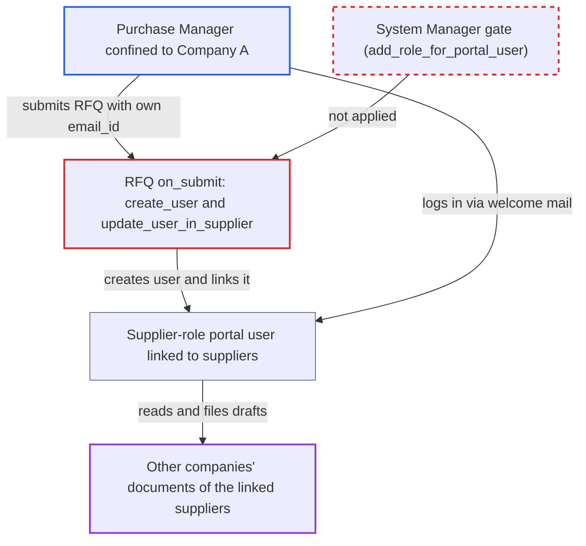

# RFQ submission mints Supplier-role portal accounts for arbitrary emails, bypassing company user permissions

| Field | Value |
|---|---|
| ID | `find_01T7ni3AoJraHtd54tby6chM` |
| Severity | **Low** |
| Status | open |
| CWE | CWE-269 — Improper privilege management |
| Created | 2026-10-27T21:29:34.346289Z |
| Claude Security | https://claude.ai/security/findings/find_01T7ni3AoJraHtd54tby6chM |

## Description

A Purchase Manager or Manufacturing Manager who is limited to one company by User Permissions can read other companies' documents for chosen suppliers. They can also file draft quotations and invoices in those suppliers' names. They do it by submitting an RFQ whose supplier row has an `email_id` they control, which creates a Supplier-role portal login. The cause is `create_user` and `update_user_in_supplier`, which create and link the user with permission checks off.

1. **RFQ author** creates an RFQ for Company A with target suppliers and sets each row's `email_id` to an address they control. `email_id` is an editable Data field and is filled from the Contact only when blank, so leaving `contact` empty lets the author choose the address.
2. **the submit hook `on_submit`** calls `send_to_supplier`, which calls `update_supplier_contact` for every row with `send_email` set. An existing User is reused, so one address can be linked to many suppliers in the same RFQ. ([`erpnext/buying/doctype/request_for_quotation/request_for_quotation.py:200-244`](https://github.com/cx-benchmark/erpnext/blob/90e7aefca73da3c440d2e8da7472fcb67838e678/erpnext/buying/doctype/request_for_quotation/request_for_quotation.py#L200-L244))
3. **`create_user`** inserts a Website User with the Supplier role and a welcome e-mail. It uses `user.save(ignore_permissions=True)`, so the submitter's own roles are never checked, and creating User records is normally a System Manager permission. ([`erpnext/buying/doctype/request_for_quotation/request_for_quotation.py:286-308`](https://github.com/cx-benchmark/erpnext/blob/90e7aefca73da3c440d2e8da7472fcb67838e678/erpnext/buying/doctype/request_for_quotation/request_for_quotation.py#L286-L308))
4. **`update_user_in_supplier`** appends the new user to the Supplier's `portal_users`. It sets `ignore_permissions` and `ignore_validate`, so `Supplier.validate` and `add_role_for_user` never run, and the System Manager-only gate in `add_role_for_portal_user` is bypassed. ([`erpnext/buying/doctype/request_for_quotation/request_for_quotation.py:269-284`](https://github.com/cx-benchmark/erpnext/blob/90e7aefca73da3c440d2e8da7472fcb67838e678/erpnext/buying/doctype/request_for_quotation/request_for_quotation.py#L269-L284))
5. **attacker** sets a password from the welcome or reset mail and logs in to the portal. The pages used are `/purchase-orders`, `/purchase-invoices`, `/supplier-quotations` and `/rfq`.
6. **portal list and permission code** returns every company's documents for the linked suppliers. Lists are fetched with `ignore_permissions=True` and filtered only by `supplier in suppliers`, and `has_website_permission` also decides by the Supplier link alone. ([`erpnext/controllers/website_list_for_contact.py:90-149`](https://github.com/cx-benchmark/erpnext/blob/90e7aefca73da3c440d2e8da7472fcb67838e678/erpnext/controllers/website_list_for_contact.py#L90-L149))

## Assessment

The attacker is a Purchase Manager or Manufacturing Manager, the roles that can submit an RFQ. User Permissions confine them to Company A. The site must have several companies with company-restricted purchasing users. Without that, the attacker could already see these documents. They need no one else's action. The pinned Frappe (`>=17.0.0-dev,<18`) is assumed to insert the User with its roles under `ignore_permissions` without a separate role-assignment check. Auto-creating supplier users is intended, as `test_portal_user_with_new_supplier` shows. The flaw is that it has no limit.

Impact: The attacker can read the named suppliers' Purchase Orders, Purchase Invoices, Supplier Quotations and RFQs across all companies, including items, rates, totals and taxes. They can create draft Supplier Quotations and draft Purchase Invoices in the suppliers' names, and they can create User accounts. This is limited to suppliers the attacker names. Nothing is submitted, and no desk or admin access is gained.

## Recommendation

RFQ submission creates a Supplier-role User for an arbitrary e-mail and links it to the Supplier's `portal_users` with permission checks disabled in `create_user` and `update_user_in_supplier`. Any RFQ submitter can therefore create portal identities whose access depends only on the Supplier link.

Fix criteria: Creating a Supplier-role user or adding a Portal User from an RFQ needs the same authority as on the Supplier form (User creation / System Manager), or approval by such a user. A check the submitter can satisfy alone, such as a Contact they create, is not enough. Verify with a Purchase Manager restricted to one company who submits an RFQ with an unlinked address: no User is created, no Portal User is added, and no portal login results.

## Evidence

**https://github.com/cx-benchmark/erpnext**

- [`erpnext/buying/doctype/request_for_quotation/request_for_quotation.py:286-308`](https://github.com/cx-benchmark/erpnext/blob/90e7aefca73da3c440d2e8da7472fcb67838e678/erpnext/buying/doctype/request_for_quotation/request_for_quotation.py#L286-L308)
- [`erpnext/buying/doctype/request_for_quotation/request_for_quotation.py:269-284`](https://github.com/cx-benchmark/erpnext/blob/90e7aefca73da3c440d2e8da7472fcb67838e678/erpnext/buying/doctype/request_for_quotation/request_for_quotation.py#L269-L284)
- [`erpnext/buying/doctype/request_for_quotation/request_for_quotation.py:200-244`](https://github.com/cx-benchmark/erpnext/blob/90e7aefca73da3c440d2e8da7472fcb67838e678/erpnext/buying/doctype/request_for_quotation/request_for_quotation.py#L200-L244)
- [`erpnext/controllers/website_list_for_contact.py:331-351`](https://github.com/cx-benchmark/erpnext/blob/90e7aefca73da3c440d2e8da7472fcb67838e678/erpnext/controllers/website_list_for_contact.py#L331-L351)
- [`erpnext/controllers/website_list_for_contact.py:296-311`](https://github.com/cx-benchmark/erpnext/blob/90e7aefca73da3c440d2e8da7472fcb67838e678/erpnext/controllers/website_list_for_contact.py#L296-L311)
- [`erpnext/controllers/website_list_for_contact.py:90-149`](https://github.com/cx-benchmark/erpnext/blob/90e7aefca73da3c440d2e8da7472fcb67838e678/erpnext/controllers/website_list_for_contact.py#L90-L149)

