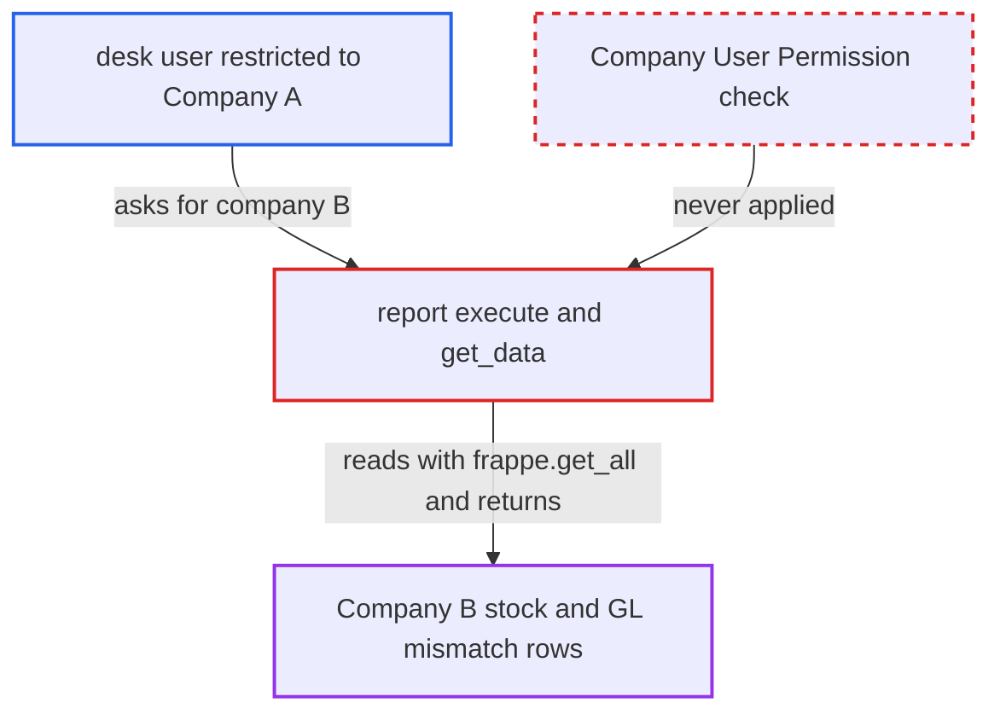

# Stock and Account Value Comparison report trusts caller's company, ignoring Company user permissions

| Field | Value |
|---|---|
| ID | `find_0141qk8k2RBtWbhhbv4P1j1X` |
| Severity | **Low** |
| Status | open |
| CWE | CWE-862 — Missing authorization |
| Created | 2026-10-27T21:22:13.306811Z |
| Claude Security | https://claude.ai/security/findings/find_0141qk8k2RBtWbhhbv4P1j1X |

## Description

A logged-in Stock User or Accounts Manager who is restricted to one company can read another company's stock and ledger mismatch data. This covers voucher numbers, posting dates and times, stock value, account value and the difference. Only vouchers with a stock/GL difference and GL-only stock-account postings are returned. The report `execute` trusts the caller's `filters.company` and reads with `frappe.get_all`, so User Permissions are never applied.

1. **restricted desk user** calls the report runner with another company's name. The user holds the Stock User or Accounts Manager role but is limited by User Permission to Company A. They call `/api/method/frappe.desk.query_report.run` with `report_name=Stock and Account Value Comparison` and `filters={company:'B', as_on_date, from_date}`. ([`erpnext/stock/report/stock_and_account_value_comparison/stock_and_account_value_comparison.json`](https://github.com/cx-benchmark/erpnext/blob/90e7aefca73da3c440d2e8da7472fcb67838e678/erpnext/stock/report/stock_and_account_value_comparison/stock_and_account_value_comparison.json))
2. **the report function `execute`** checks only that perpetual inventory is enabled for the named company. It never compares the company with the running user's Company User Permissions. The client-side `reqd` and default company exist only in the desk UI and do not stop a direct call. ([`erpnext/stock/report/stock_and_account_value_comparison/stock_and_account_value_comparison.py:18-38`](https://github.com/cx-benchmark/erpnext/blob/90e7aefca73da3c440d2e8da7472fcb67838e678/erpnext/stock/report/stock_and_account_value_comparison/stock_and_account_value_comparison.py#L18-L38))
3. **the readers `get_stock_ledger_data` and `get_gl_data`** read Company B's Stock Ledger Entry and GL Entry rows with `frappe.get_all`. `frappe.get_all` applies no User Permissions. The only company scope is the caller-supplied `filters.company`. ([`erpnext/stock/report/stock_and_account_value_comparison/stock_and_account_value_comparison.py:93-114`](https://github.com/cx-benchmark/erpnext/blob/90e7aefca73da3c440d2e8da7472fcb67838e678/erpnext/stock/report/stock_and_account_value_comparison/stock_and_account_value_comparison.py#L93-L114))
4. **`get_data`** returns the vouchers whose stock and account values differ by more than 0.1, plus GL-only stock-account vouchers. The rows include the ID, voucher type and number, posting date and time, stock value, account value and difference. ([`erpnext/stock/report/stock_and_account_value_comparison/stock_and_account_value_comparison.py:117-151`](https://github.com/cx-benchmark/erpnext/blob/90e7aefca73da3c440d2e8da7472fcb67838e678/erpnext/stock/report/stock_and_account_value_comparison/stock_and_account_value_comparison.py#L117-L151))
5. **the report runner** passes the rows back to the user unchanged. Its post-filter checks User Permissions only on Link columns. This report's Link columns point only to `DocType`, and `name` and `voucher_no` are Dynamic Links, so no Company value is ever tested. ([`erpnext/stock/report/stock_and_account_value_comparison/stock_and_account_value_comparison.py:154-198`](https://github.com/cx-benchmark/erpnext/blob/90e7aefca73da3c440d2e8da7472fcb67838e678/erpnext/stock/report/stock_and_account_value_comparison/stock_and_account_value_comparison.py#L154-L198))

## Assessment

The attacker is an authenticated desk user with the Stock User or Accounts Manager role. A Company User Permission limits them to Company A. They need no other access. They call `frappe.desk.query_report.run` directly with `filters.company` set to Company B. The report has no `filters` table, so any user with these roles passes the runner's role and report gate. Rows come back only where Company B has stock/GL mismatches or GL-only postings on stock accounts. The finding assumes Frappe >=17.0.0-dev,\<18 behaves as described. Frappe is not in the checkout.

Impact: The attacker can read another company's voucher-level stock values and GL stock-account amounts. This is limited to vouchers with a stock/GL difference and to GL-only postings on stock accounts. The report does not allow writes and does not affect availability.

## Recommendation

The report takes its company scope from the caller's `filters.company` and never checks it against the running user's Company User Permissions. The Stock Ledger Entry and GL Entry reads use `frappe.get_all`, which bypasses User Permissions.

Fix criteria: A request naming a company the user is not permitted by their Company User Permissions (applicable to Stock Ledger Entry / GL Entry) raises PermissionError or returns no rows. Both the SLE and GL reads stay within permitted companies. Verify that a Stock User restricted to Company A calling `query_report.run` with `company=B` gets no Company-B rows. The same user must still get Company A's rows.

## Evidence

**https://github.com/cx-benchmark/erpnext**

- [`erpnext/stock/report/stock_and_account_value_comparison/stock_and_account_value_comparison.py:18-38`](https://github.com/cx-benchmark/erpnext/blob/90e7aefca73da3c440d2e8da7472fcb67838e678/erpnext/stock/report/stock_and_account_value_comparison/stock_and_account_value_comparison.py#L18-L38)
- [`erpnext/stock/report/stock_and_account_value_comparison/stock_and_account_value_comparison.py:93-114`](https://github.com/cx-benchmark/erpnext/blob/90e7aefca73da3c440d2e8da7472fcb67838e678/erpnext/stock/report/stock_and_account_value_comparison/stock_and_account_value_comparison.py#L93-L114)
- [`erpnext/stock/report/stock_and_account_value_comparison/stock_and_account_value_comparison.py:117-151`](https://github.com/cx-benchmark/erpnext/blob/90e7aefca73da3c440d2e8da7472fcb67838e678/erpnext/stock/report/stock_and_account_value_comparison/stock_and_account_value_comparison.py#L117-L151)
- [`erpnext/stock/report/stock_and_account_value_comparison/stock_and_account_value_comparison.py:154-198`](https://github.com/cx-benchmark/erpnext/blob/90e7aefca73da3c440d2e8da7472fcb67838e678/erpnext/stock/report/stock_and_account_value_comparison/stock_and_account_value_comparison.py#L154-L198)
- [`erpnext/stock/report/stock_and_account_value_comparison/stock_and_account_value_comparison.json`](https://github.com/cx-benchmark/erpnext/blob/90e7aefca73da3c440d2e8da7472fcb67838e678/erpnext/stock/report/stock_and_account_value_comparison/stock_and_account_value_comparison.json)
- [`erpnext/stock/report/stock_and_account_value_comparison/stock_and_account_value_comparison.js:6-13`](https://github.com/cx-benchmark/erpnext/blob/90e7aefca73da3c440d2e8da7472fcb67838e678/erpnext/stock/report/stock_and_account_value_comparison/stock_and_account_value_comparison.js#L6-L13)
- [`erpnext/stock/doctype/stock_ledger_entry/stock_ledger_entry.json:248-256`](https://github.com/cx-benchmark/erpnext/blob/90e7aefca73da3c440d2e8da7472fcb67838e678/erpnext/stock/doctype/stock_ledger_entry/stock_ledger_entry.json#L248-L256)
- [`erpnext/stock/report/stock_ledger_entries_of_cancelled_vouchers/stock_ledger_entries_of_cancelled_vouchers.py:10-26`](https://github.com/cx-benchmark/erpnext/blob/90e7aefca73da3c440d2e8da7472fcb67838e678/erpnext/stock/report/stock_ledger_entries_of_cancelled_vouchers/stock_ledger_entries_of_cancelled_vouchers.py#L10-L26)

