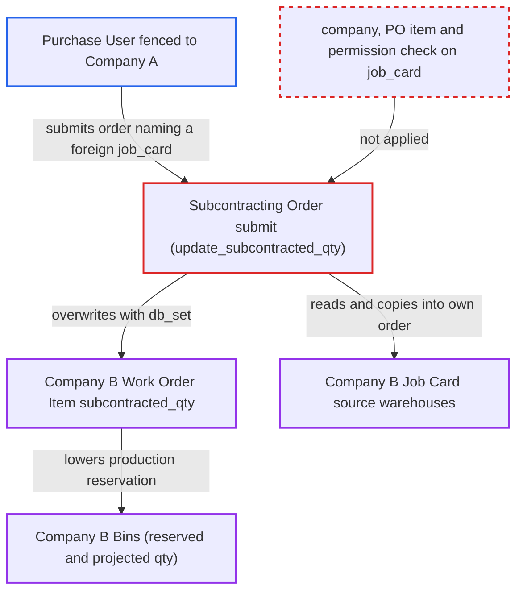

# Subcontracting Order job_card rows rewrite another company's Work Order subcontracted quantities

| Field | Value |
|---|---|
| ID | `find_01Sq31PGK9NHfMqA3N6SpMCM` |
| Severity | **Low** |
| Status | open |
| CWE | CWE-639 — Insecure Direct Object Reference |
| Created | 2026-10-27T22:33:19.533597Z |
| Claude Security | https://claude.ai/security/findings/find_01Sq31PGK9NHfMqA3N6SpMCM |

## Description

A Purchase User fenced to one company can corrupt another company's manufacturing planning figures and learn that company's warehouse names. They need only the right to create and submit Subcontracting Orders. The Subcontracting Order's `job_card` row value is never checked against the order's company, the row's Purchase Order item or the user's rights. Only planning fields change, not stock postings.

1. **Attacker (Purchase User)** sets an item row's `job_card` to a Job Card of another company. `job_card` is a plain Link with no filter, and the user can write it. Link validation only confirms the card exists and is not cancelled, and the names follow the sequential `PO-JOB#####` series. ([`erpnext/subcontracting/doctype/subcontracting_order_item/subcontracting_order_item.json:397-401`](https://github.com/cx-benchmark/erpnext/blob/90e7aefca73da3c440d2e8da7472fcb67838e678/erpnext/subcontracting/doctype/subcontracting_order_item/subcontracting_order_item.json#L397-L401))
2. **Subcontracting Order validate** accepts the foreign card and copies its source warehouses. When `set_reserve_warehouse` is empty, `get_job_card_source_warehouses` reads the card's Job Card Item source warehouses and `__update_reserve_warehouse` writes them into the attacker's supplied items as `reserve_warehouse`. ([`erpnext/controllers/subcontracting_controller.py:980-991`](https://github.com/cx-benchmark/erpnext/blob/90e7aefca73da3c440d2e8da7472fcb67838e678/erpnext/controllers/subcontracting_controller.py#L980-L991))
3. **the method `update_status`** calls `update_subcontracted_qty_in_work_orders` on submit. It finds the card's Work Order with `frappe.get_all`, which checks no permission. The same happens on cancel. ([`erpnext/subcontracting/doctype/subcontracting_order/subcontracting_order.py:335-343`](https://github.com/cx-benchmark/erpnext/blob/90e7aefca73da3c440d2e8da7472fcb67838e678/erpnext/subcontracting/doctype/subcontracting_order/subcontracting_order.py#L335-L343))
4. **the function `update_subcontracted_qty`** sums supplied required qty across all submitted orders and writes it to the other company's Work Order. The sum is joined through `order_item.job_card` regardless of company. The result is stored with `db_set` into `Work Order Item.subcontracted_qty`, keyed by `operation_row_id` and raw-material item. ([`erpnext/subcontracting/doctype/subcontracting_order/subcontracting_order.py:610-648`](https://github.com/cx-benchmark/erpnext/blob/90e7aefca73da3c440d2e8da7472fcb67838e678/erpnext/subcontracting/doctype/subcontracting_order/subcontracting_order.py#L610-L648))
5. **the function `_production_reserved_qty_field`** caps the production reservation using the inflated `subcontracted_qty`. The cap is `required_qty - subcontracted_qty`. The other company's Bins lose `reserved_qty_for_production` and gain `projected_qty` for the matched materials. ([`erpnext/manufacturing/doctype/work_order/services/reservation.py:736-751`](https://github.com/cx-benchmark/erpnext/blob/90e7aefca73da3c440d2e8da7472fcb67838e678/erpnext/manufacturing/doctype/work_order/services/reservation.py#L736-L751))
6. **the method `update_reserved_qty_for_subcontracting`** writes `reserved_qty_for_sub_contract` into the other company's Bins on submit. This uses the copied `reserve_warehouse` values, so the reservation lands in that company's warehouses. ([`erpnext/controllers/subcontracting_controller.py:980-991`](https://github.com/cx-benchmark/erpnext/blob/90e7aefca73da3c440d2e8da7472fcb67838e678/erpnext/controllers/subcontracting_controller.py#L980-L991))

## Assessment

The attacker is a Purchase User restricted to Company A by a Company User Permission. They submit a Company-A subcontracting Purchase Order and build a Subcontracting Order from it. They set an item row's `job_card` to a Company-B card, then set `set_reserve_warehouse` to their own warehouse or leave it empty. They submit through the form or REST. No victim action is needed. A match needs two things. The target Work Order's required items must carry an `operation_row_id` (operation-level BOM materials) equal to the card's. The attacker's BOM must share the raw material, and items and BOMs are not company-scoped by default. The report assumes Frappe `>=17.0.0-dev,<18`, which is not in the checkout, where a Company permission does not cover a `Job Card` link.

Impact: The attacker sets `subcontracted_qty` on another company's Work Order rows. That drops its `reserved_qty_for_production`, inflates its `projected_qty`, or moves the reservation into its Bins' `reserved_qty_for_sub_contract`. Planning and reorder figures stay wrong until the attacker cancels the order. The attacker also learns the other company's Job Card source warehouses, and link errors confirm card names. Only planning fields change, with no ledger or stock postings, and the report shows no availability impact.

## Recommendation

`SubcontractingOrder` trusts `items[].job_card` without checking that the Job Card belongs to the order's company and to the row's Purchase Order item. `update_subcontracted_qty` also writes the card's Work Order with calls that bypass permissions.

Fix criteria: A Subcontracting Order row whose `job_card` names a card of another company, or a card not linked to the row's Purchase Order item, is rejected at validate. The card's Work Order must pass a write-permission check for the submitting user before `update_subcontracted_qty` or `get_job_card_source_warehouses` use it. Verify that a Company-A-fenced user's order naming a Company-B Job Card is refused. Also verify that this leaves that Work Order's `subcontracted_qty` rows and Bins unchanged.

## Evidence

**https://github.com/cx-benchmark/erpnext**

- [`erpnext/subcontracting/doctype/subcontracting_order/subcontracting_order.py:335-343`](https://github.com/cx-benchmark/erpnext/blob/90e7aefca73da3c440d2e8da7472fcb67838e678/erpnext/subcontracting/doctype/subcontracting_order/subcontracting_order.py#L335-L343)
- [`erpnext/subcontracting/doctype/subcontracting_order/subcontracting_order.py:610-648`](https://github.com/cx-benchmark/erpnext/blob/90e7aefca73da3c440d2e8da7472fcb67838e678/erpnext/subcontracting/doctype/subcontracting_order/subcontracting_order.py#L610-L648)
- [`erpnext/manufacturing/doctype/work_order/services/reservation.py:736-751`](https://github.com/cx-benchmark/erpnext/blob/90e7aefca73da3c440d2e8da7472fcb67838e678/erpnext/manufacturing/doctype/work_order/services/reservation.py#L736-L751)
- [`erpnext/controllers/subcontracting_controller.py:980-991`](https://github.com/cx-benchmark/erpnext/blob/90e7aefca73da3c440d2e8da7472fcb67838e678/erpnext/controllers/subcontracting_controller.py#L980-L991)
- [`erpnext/subcontracting/doctype/subcontracting_order_item/subcontracting_order_item.json:397-401`](https://github.com/cx-benchmark/erpnext/blob/90e7aefca73da3c440d2e8da7472fcb67838e678/erpnext/subcontracting/doctype/subcontracting_order_item/subcontracting_order_item.json#L397-L401)
- [`erpnext/buying/doctype/purchase_order/mapper.py:290-291`](https://github.com/cx-benchmark/erpnext/blob/90e7aefca73da3c440d2e8da7472fcb67838e678/erpnext/buying/doctype/purchase_order/mapper.py#L290-L291)
- [`erpnext/manufacturing/doctype/job_card/job_card.json:713-759`](https://github.com/cx-benchmark/erpnext/blob/90e7aefca73da3c440d2e8da7472fcb67838e678/erpnext/manufacturing/doctype/job_card/job_card.json#L713-L759)
- [`erpnext/manufacturing/doctype/work_order/test_work_order.py:5133-5155`](https://github.com/cx-benchmark/erpnext/blob/90e7aefca73da3c440d2e8da7472fcb67838e678/erpnext/manufacturing/doctype/work_order/test_work_order.py#L5133-L5155)

