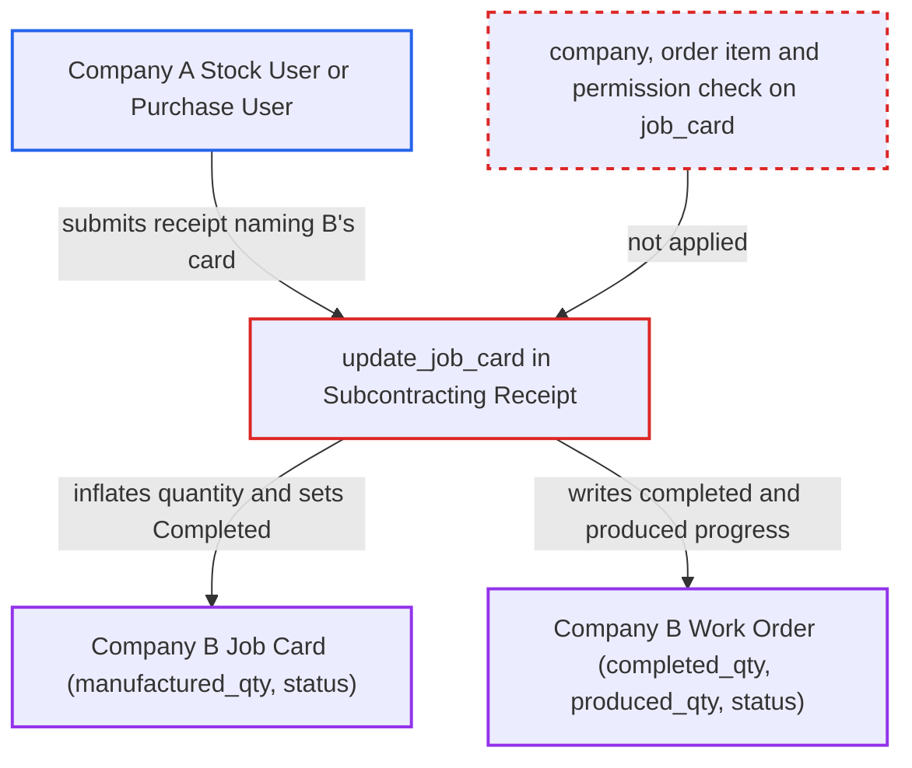

# Subcontracting Receipt job_card rows complete another company's Job Card and Work Order

| Field | Value |
|---|---|
| ID | `find_017aX2kXN8YPZohbXK5hh7kT` |
| Severity | **Low** |
| Status | open |
| CWE | CWE-639 — Insecure Direct Object Reference |
| Created | 2026-10-27T22:33:48.792981Z |
| Claude Security | https://claude.ai/security/findings/find_017aX2kXN8YPZohbXK5hh7kT |

## Description

A desk user in one company can falsely mark another company's subcontracted Job Card and its Work Order as produced or completed. The attacker needs a Stock User or Purchase User login and a submitted subcontracting order in their own company. `SubcontractingReceipt.update_job_card` trusts the `job_card` on each receipt row, and never checks the card's company or its link to the order item. The damage is limited to manufacturing progress fields.

1. **Attacker (Stock User or Purchase User)** creates a Subcontracting Receipt with a foreign Job Card on a row. The `job_card` field on the receipt row is a plain Link with permlevel 0, and its `read_only` flag is only a desk hint, so the server accepts a client-supplied value such as a Company-B `PO-JOB#####` name. ([`erpnext/subcontracting/doctype/subcontracting_receipt_item/subcontracting_receipt_item.json:598-605`](https://github.com/cx-benchmark/erpnext/blob/90e7aefca73da3c440d2e8da7472fcb67838e678/erpnext/subcontracting/doctype/subcontracting_receipt_item/subcontracting_receipt_item.json#L598-L605))
2. **Receipt validation** accepts the row without examining the card. `validate_items` and `validate_with_previous_doc` never look at `job_card`, so the card's company, its link to the row's Subcontracting Order item and the submitter's rights on it are never checked. ([`erpnext/controllers/subcontracting_controller.py:162-252`](https://github.com/cx-benchmark/erpnext/blob/90e7aefca73da3c440d2e8da7472fcb67838e678/erpnext/controllers/subcontracting_controller.py#L162-L252))
3. **the method `update_job_card`** loads the named Job Card and calls `set_manufactured_qty`. It runs on submit and on cancel, and it uses a plain `frappe.get_doc`, so no permission or company check applies. ([`erpnext/subcontracting/doctype/subcontracting_receipt/subcontracting_receipt.py:282-286`](https://github.com/cx-benchmark/erpnext/blob/90e7aefca73da3c440d2e8da7472fcb67838e678/erpnext/subcontracting/doctype/subcontracting_receipt/subcontracting_receipt.py#L282-L286))
4. **the method `set_manufactured_qty`** adds up receipt quantities and writes the total into `manufactured_qty`. For a card with `is_subcontracted` = 1, `get_manufactured_qty` sums the `qty` of every submitted receipt row naming the card, whatever its company, and stores the total with `db_set`. ([`erpnext/manufacturing/doctype/job_card/job_card.py:311-335`](https://github.com/cx-benchmark/erpnext/blob/90e7aefca73da3c440d2e8da7472fcb67838e678/erpnext/manufacturing/doctype/job_card/job_card.py#L311-L335))
5. **the method `update_semi_finished_good_details`** writes progress onto the victim's Work Order. It sets the operation's `completed_qty` with `frappe.db.set_value`. If the card's `finished_good` is the Work Order's production item, it also sets `produced_qty` and `status` with `db_set`, and `save()` never runs. ([`erpnext/manufacturing/doctype/job_card/job_card.py:1242-1270`](https://github.com/cx-benchmark/erpnext/blob/90e7aefca73da3c440d2e8da7472fcb67838e678/erpnext/manufacturing/doctype/job_card/job_card.py#L1242-L1270))
6. **the method `set_status`** marks the victim's Job Card as Completed. With `update_status=True`, it sets the card's `status` to Completed once `manufactured_qty` plus process loss reaches the quantity to produce. ([`erpnext/manufacturing/doctype/job_card/job_card.py:1564-1607`](https://github.com/cx-benchmark/erpnext/blob/90e7aefca73da3c440d2e8da7472fcb67838e678/erpnext/manufacturing/doctype/job_card/job_card.py#L1564-L1607))
7. **Company B's Job Card** stops offering "Make Subcontracting PO". The button appears only while `for_quantity` is above `manufactured_qty`, so the inflated value hides it for the owning company. ([`erpnext/manufacturing/doctype/job_card/job_card.js:618-627`](https://github.com/cx-benchmark/erpnext/blob/90e7aefca73da3c440d2e8da7472fcb67838e678/erpnext/manufacturing/doctype/job_card/job_card.js#L618-L627))

## Assessment

The attacker is a desk user with Stock User or Purchase User, restricted to Company A by a Company User Permission. They need a submitted Company-A Subcontracting Order. Through `/api/resource` or the form, they create a Company-A receipt from that order and set one row's `job_card` to a Company-B Job Card. Card names follow the sequential `PO-JOB#####` series, so they can be guessed. The attack needs Company B to run subcontracted operations with semi-finished-goods tracking, which is not the default manufacturing setup. The target card must be submitted, which is its normal state. No action by the victim is needed. Cancelling the receipt also runs `update_job_card`. The report assumes (Frappe `>=17.0.0-dev,<18`, not in the checkout) that save-time `has_user_permission` checks a Link only when the user has User Permissions on the Link's target doctype. A Company User Permission therefore does not constrain `job_card`.

Impact: The attacker can set `manufactured_qty` and `status` on another company's Job Card, and the Work Order operation's `completed_qty`. For a final operation they can also set the Work Order's `produced_qty` and `status`, so it shows production that never happened. The damage is limited to these manufacturing progress fields, and no stock or GL postings are made in Company B. Company B's card stops offering the subcontracting PO for its outstanding quantity. The next operation's sequence check, `validate_previous_operation_manufactured_qty`, passes for goods that were never received. Company B's users cannot see or cancel the Company-A receipt that causes this. Their own receipts are not blocked and just add to the inflated total.

## Recommendation

`SubcontractingReceipt.update_job_card` trusts each row's `job_card` Link. It does not check that the Job Card belongs to the receipt's company and to the row's Subcontracting Order item. `JobCard.set_manufactured_qty` then writes the card and its Work Order through calls that bypass permission checks.

Fix criteria: A receipt row whose `job_card` names a card of another company, or a card that differs from the `job_card` on its `subcontracting_order_item`, is rejected at validate, before any roll-up. Test: a Company-A user's receipt that names a Company-B Job Card is refused. That card's `manufactured_qty` and `status` stay unchanged. Its Work Order's operation `completed_qty`, `produced_qty` and `status` also stay unchanged.

## Evidence

**https://github.com/cx-benchmark/erpnext**

- [`erpnext/subcontracting/doctype/subcontracting_receipt/subcontracting_receipt.py:282-286`](https://github.com/cx-benchmark/erpnext/blob/90e7aefca73da3c440d2e8da7472fcb67838e678/erpnext/subcontracting/doctype/subcontracting_receipt/subcontracting_receipt.py#L282-L286)
- [`erpnext/manufacturing/doctype/job_card/job_card.py:311-335`](https://github.com/cx-benchmark/erpnext/blob/90e7aefca73da3c440d2e8da7472fcb67838e678/erpnext/manufacturing/doctype/job_card/job_card.py#L311-L335)
- [`erpnext/manufacturing/doctype/job_card/job_card.py:1242-1270`](https://github.com/cx-benchmark/erpnext/blob/90e7aefca73da3c440d2e8da7472fcb67838e678/erpnext/manufacturing/doctype/job_card/job_card.py#L1242-L1270)
- [`erpnext/manufacturing/doctype/job_card/job_card.py:1564-1607`](https://github.com/cx-benchmark/erpnext/blob/90e7aefca73da3c440d2e8da7472fcb67838e678/erpnext/manufacturing/doctype/job_card/job_card.py#L1564-L1607)
- [`erpnext/manufacturing/doctype/job_card/job_card.js:618-627`](https://github.com/cx-benchmark/erpnext/blob/90e7aefca73da3c440d2e8da7472fcb67838e678/erpnext/manufacturing/doctype/job_card/job_card.js#L618-L627)
- [`erpnext/controllers/subcontracting_controller.py:162-252`](https://github.com/cx-benchmark/erpnext/blob/90e7aefca73da3c440d2e8da7472fcb67838e678/erpnext/controllers/subcontracting_controller.py#L162-L252)
- [`erpnext/subcontracting/doctype/subcontracting_receipt_item/subcontracting_receipt_item.json:598-605`](https://github.com/cx-benchmark/erpnext/blob/90e7aefca73da3c440d2e8da7472fcb67838e678/erpnext/subcontracting/doctype/subcontracting_receipt_item/subcontracting_receipt_item.json#L598-L605)
- [`erpnext/manufacturing/doctype/job_card/job_card.json`](https://github.com/cx-benchmark/erpnext/blob/90e7aefca73da3c440d2e8da7472fcb67838e678/erpnext/manufacturing/doctype/job_card/job_card.json)

