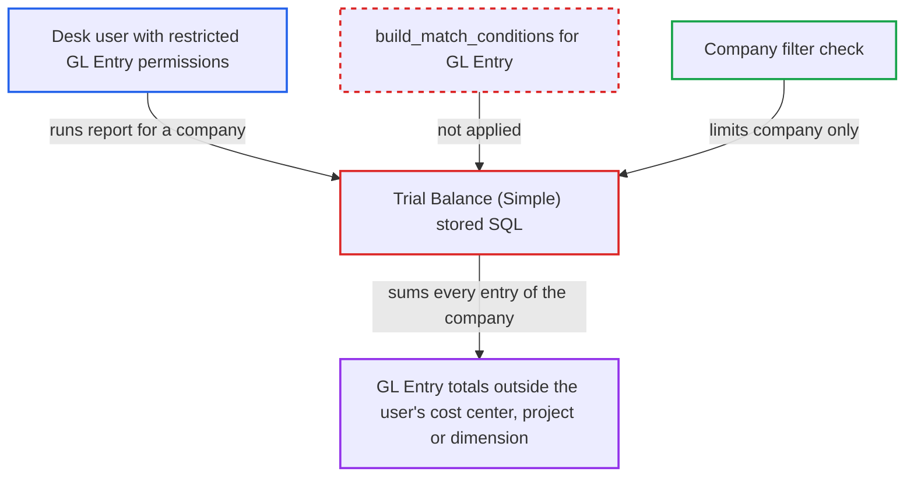

# Trial Balance (Simple) ignores GL Entry user permissions on cost center, project and dimensions

| Field | Value |
|---|---|
| ID | `find_01XMpKsK2WVuLWJTVT5J8pk8` |
| Severity | **Low** |
| Status | open |
| CWE | CWE-862 — Missing Authorization |
| Created | 2026-10-27T21:11:36.823278Z |
| Claude Security | https://claude.ai/security/findings/find_01XMpKsK2WVuLWJTVT5J8pk8 |

## Description

A desk user whose GL Entry access is limited by User Permissions on cost center, project, fiscal year or an accounting dimension can read the company's full per-account, per-day debit and credit totals. The data is aggregated and read-only, and covers only companies the user may select. The cause is the stored SQL of the `Trial Balance (Simple)` Query Report, which never applies GL Entry permission conditions.

1. **Attacker (desk user)** calls the report endpoint for `Trial Balance (Simple)`. The user holds Accounts User, Accounts Manager or Auditor and passes `report_name=Trial Balance (Simple)` and a company they may select to `/api/method/frappe.desk.query_report.run`. ([`erpnext/accounts/report/trial_balance_simple/trial_balance_simple.json:26-39`](https://github.com/cx-benchmark/erpnext/blob/90e7aefca73da3c440d2e8da7472fcb67838e678/erpnext/accounts/report/trial_balance_simple/trial_balance_simple.json#L26-L39))
2. **Framework `frappe.desk.query_report.run`** checks only role, report permission, the Company filter and Link columns. The `company` filter is a Link filter, and the post-filter covers only the `Account` and `Finance Book` columns, so cost center, project and dimension restrictions are not checked. ([`erpnext/accounts/report/trial_balance_simple/trial_balance_simple.json:7-16`](https://github.com/cx-benchmark/erpnext/blob/90e7aefca73da3c440d2e8da7472fcb67838e678/erpnext/accounts/report/trial_balance_simple/trial_balance_simple.json#L7-L16))
3. **Stored SQL in `trial_balance_simple.json`** sums `debit` and `credit` from `tabGL Entry` for the whole company. The query is filtered only by `is_cancelled = 0 and company = %(company)s` and adds no `build_match_conditions("GL Entry")` predicates. ([`erpnext/accounts/report/trial_balance_simple/trial_balance_simple.json:25`](https://github.com/cx-benchmark/erpnext/blob/90e7aefca73da3c440d2e8da7472fcb67838e678/erpnext/accounts/report/trial_balance_simple/trial_balance_simple.json#L25))
4. **Attacker (desk user)** receives totals that include entries outside their permitted scope. The result has per-account, per-day and per-finance-book totals that include postings the user cannot see in `General Ledger` or `Trial Balance`.

## Assessment

The attacker is a desk user with Accounts User, Accounts Manager or Auditor whose GL Entry access is limited by User Permissions on Cost Center, Project, Fiscal Year or an accounting dimension. They need a company they may select. It matters only on sites that use such non-Company restrictions. The report assumes the pinned Frappe (`>=17.0.0-dev,<18.0.0`) validates the declared `company` Link filter with `select` permission, so a user restricted by a Company User Permission is refused for other companies. If that framework check were absent, the same SQL would also expose other companies' ledgers.

Impact: The attacker reads aggregated debit and credit totals per account, posting date and finance book for GL Entries outside their permitted cost centers, projects or dimensions. The data has no voucher, party or cost-center breakdown. It is limited to companies they may select and is read-only.

## Recommendation

The Query Report's SQL reads `tabGL Entry` without the session user's GL Entry permission conditions. The framework's Link-column post-filter cannot cover Cost Center, Project, Fiscal Year or dimension restrictions, because those values are not Link columns of the result.

Fix criteria: Every GL Entry contributing to the report's sums satisfies the session user's GL Entry User Permissions, the same conditions `build_match_conditions("GL Entry")` yields in `Trial Balance`. The company must be one the user may select. Verify that for a user restricted to one cost center, the report's totals equal those of `General Ledger` or `Trial Balance` for the same user. Also verify that postings of other cost centers are excluded.

## Evidence

**https://github.com/cx-benchmark/erpnext**

- [`erpnext/accounts/report/trial_balance_simple/trial_balance_simple.json:25`](https://github.com/cx-benchmark/erpnext/blob/90e7aefca73da3c440d2e8da7472fcb67838e678/erpnext/accounts/report/trial_balance_simple/trial_balance_simple.json#L25)
- [`erpnext/accounts/report/trial_balance_simple/trial_balance_simple.json:26-39`](https://github.com/cx-benchmark/erpnext/blob/90e7aefca73da3c440d2e8da7472fcb67838e678/erpnext/accounts/report/trial_balance_simple/trial_balance_simple.json#L26-L39)
- [`erpnext/accounts/report/trial_balance_simple/trial_balance_simple.json:7-16`](https://github.com/cx-benchmark/erpnext/blob/90e7aefca73da3c440d2e8da7472fcb67838e678/erpnext/accounts/report/trial_balance_simple/trial_balance_simple.json#L7-L16)
- [`erpnext/accounts/doctype/gl_entry/gl_entry.json:105-113`](https://github.com/cx-benchmark/erpnext/blob/90e7aefca73da3c440d2e8da7472fcb67838e678/erpnext/accounts/doctype/gl_entry/gl_entry.json#L105-L113)
- [`erpnext/accounts/doctype/account/account.json`](https://github.com/cx-benchmark/erpnext/blob/90e7aefca73da3c440d2e8da7472fcb67838e678/erpnext/accounts/doctype/account/account.json)
- [`erpnext/accounts/report/trial_balance/trial_balance.py:374-375`](https://github.com/cx-benchmark/erpnext/blob/90e7aefca73da3c440d2e8da7472fcb67838e678/erpnext/accounts/report/trial_balance/trial_balance.py#L374-L375)
- [`erpnext/accounts/report/financial_statements.py:780-783`](https://github.com/cx-benchmark/erpnext/blob/90e7aefca73da3c440d2e8da7472fcb67838e678/erpnext/accounts/report/financial_statements.py#L780-L783)

